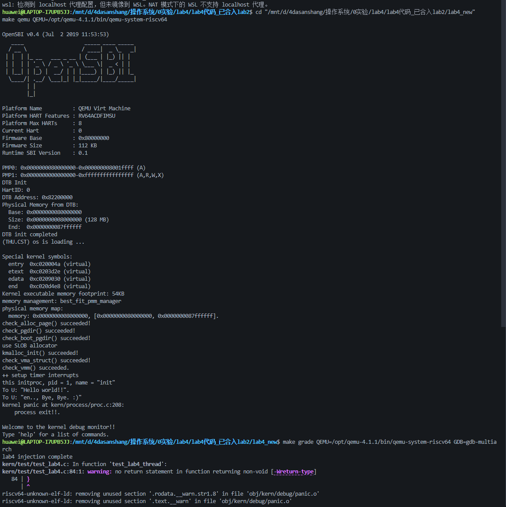
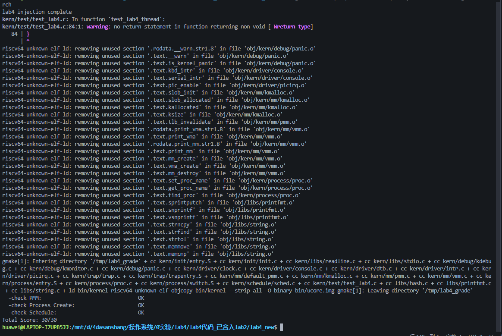

# 操作系统实验报告

## 实验基本信息

| 项目 | 内容 |
|------|------|
| 实验名称 | Lab4：进程管理 |
| 小组 | 第 6 组 |
| 小组成员 | 2411870-董朝阳、2411292-张旭、2412219-王炳環 |
| 完成日期 | 2026-11-11 |
| 代码位置 | GitHub 仓库 EtherealWish/os-group6，lab4 分支下的 code/ |
| 本次验收版本 | 04f1d94，包含集成提交 4e5f4b1 与模块二基线 8e3d2a6 |
| 验证结果 | 内核启动成功，PMM、Process Create、Schedule 三项评分通过，总分 30/30 |

### 小组分工

| 成员 | 负责的练习或模块 | 本报告覆盖的内容 |
|------|----------------|------------------|
| 2412219-王炳環 | 模块一，虚拟内存页操作 | 映射建立与撤销、引用计数、页表和 TLB 一致性、整体联调与测试证据 |
| 2411870-董朝阳 | 模块二，进程创建及初始化 | PCB 初始化、内核线程创建、首次执行现场、失败回收 |
| 2411292-张旭 | 模块三，进程调度，负责人按当前分工推定，待本人确认 | 调度器、运行实体切换、上下文保存与恢复 |


## 一、实验目的

1. 在已有物理内存管理和多级页表框架上，实现虚拟页与物理页之间的映射维护，理解页表项、页面引用计数及 TLB 状态之间的联系。
2. 掌握进程控制块、独立内核栈、切换上下文和 Trap frame 的作用，完成内核线程的创建、登记与就绪状态初始化。
3. 理解 RISC-V 调用约定和异常返回机制，建立新线程从首次上下文切换进入普通 C 函数的执行路径。
4. 实现基本调度过程，理解单核关中断临界区如何维护当前线程、页表和执行现场的一致性。
5. 通过源文件编译、内核启动和注入评分测试分层验证实现，并分析 AI 辅助开发中规格约束、源码审查和实际执行证据的作用。


## 二、实验环境

### 2.1 本次集成验证环境

| 项目 | 实际配置 |
|------|----------|
| 宿主系统与编辑器 | Windows，Visual Studio Code |
| Linux 环境 | WSL Ubuntu 26.04.1 LTS |
| 交叉编译器 | riscv64-unknown-elf-gcc 14.2.0 |
| 构建工具 | GNU Make 4.4.1 |
| 调试器 | gdb-multiarch，GNU GDB 17.1 |
| 模拟器 | QEMU 4.1.1，路径为 /opt/qemu-4.1.1/bin/qemu-system-riscv64 |
| 目标平台 | RISC-V 64 位，QEMU virt |
| 固件及内存 | OpenSBI v0.4，启动日志报告 128 MiB 内存 |
| 物理页分配策略 | Best-Fit，经 default_pmm_manager 接口接入 Lab4 |

以上为本次最终联调使用的环境。其他成员历史记录中的工具版本可能不同，模块二原始验证记录单独保存在仓库报告中。

### 2.2 AI 工具与使用范围

| 成员 | AI 编程工具 | 底层模型 | 本次材料能够确认的使用范围 |
|------|------------|----------|--------------------------|
| 2412219-王炳環 | Codex 桌面应用 | GPT-6 Astra | 实验要求解析、模块一实现、前置代码移植、补齐联调代码、编译与评分排错、版本合并及报告整理 |


## 三、实验整体逻辑分析

### 3.1 本章节的逻辑主线

本实验让内核具备创建和执行多个内核线程的能力。完成这一目标，需要先提供可靠的内存资源，再构造可调度实体，最后把 CPU 的执行现场切换到所选线程。

内核线程共享已经建立的内核地址空间，同时拥有各自的 PCB 和内核栈。共享页表使线程能够访问相同的内核代码及数据；独立内核栈使函数调用、局部变量和保存现场具有各自的存放位置。因此，地址空间共享和执行现场独立可以同时成立。

本实验的主要执行顺序如下。

```text
kern_init
  ├─ pmm_init：物理页管理、页表映射自检、内核堆初始化
  ├─ pic_init / idt_init：中断与 Trap 入口设置
  ├─ vmm_init：虚拟内存区域结构自检
  ├─ proc_init：建立 idleproc，创建并登记 initproc
  ├─ clock_init / intr_enable：配置时钟并开启中断
  └─ cpu_idle
       └─ schedule → proc_run → switch_to
            └─ forkret → forkrets → __trapret → sret
                 └─ kernel_thread_entry → init_main
```

### 3.2 功能的逐步实现

首先移植 Lab2 的物理内存初始化和 Best-Fit 分配实现，使内核能够获得页表页、线程栈和内核堆所需的物理资源。接着实现模块一，维护映射关系以及引用计数，为后续内存操作提供基础。

随后合入 Lab3 中断处理和 Trap 恢复代码。新线程首次启动使用人工构造的 Trap frame，经异常返回路径恢复寄存器，因此 `trapentry.S` 的恢复逻辑也是线程创建与执行之间的必要连接。

模块二建立 PCB 和独立内核栈，并预先安排首次运行时使用的上下文。资源准备完成后才把新线程加入 PID 哈希表和进程链表，最后设置为可运行状态。

模块三从链表中选择就绪线程，更新 `current`、切换页表并恢复目标线程的上下文。至此，保存于内存中的线程描述才能真正转化为正在执行的指令流。


## 四、实验内容与实现

### 功能模块一：虚拟内存页操作

负责人为 2412219-王炳環。实现文件为 `code/kern/mm/pmm.c`。

#### 模块功能描述

需要实现的接口如下。

```c
int page_insert(pde_t *pgdir, struct Page *page,
                uintptr_t la, uint32_t perm);
void page_remove(pde_t *pgdir, uintptr_t la);
```

`page_insert()` 将指定虚拟地址所在页映射到目标物理页，并设置调用者传入的权限。`page_remove()` 撤销映射，在最后一个引用被删除时释放物理页。

模块依赖现有的 `get_pte()` 定位或创建末级页表项，使用 `pte_create()` 编码页号和权限，通过 `pte2page()` 找到已有映射对应的物理页描述符，并通过 `tlb_invalidate()` 更新地址翻译缓存。

本模块应维护三个相互关联的状态。

| 状态 | 正确性要求 |
|------|------------|
| 页表项 | 有效位、目标物理页和权限与本次操作一致 |
| 物理页引用数 | 反映被维护的映射所持有的引用，覆盖映射时撤销旧引用 |
| TLB | 页表变更后，处理器后续访问能够使用新的翻译关系 |

#### 映射建立与更新

实现先调用 `get_pte(pgdir, la, 1)`。返回空指针时返回 `-E_NO_MEM`，此时不会改动目标映射和数据页引用数。页表项取得成功后，按原映射状态处理。

| 操作场景 | 对引用计数的处理 |
|----------|----------------|
| 地址原来没有有效映射 | 新页引用数加一 |
| 原来映射到另一物理页 | 撤销旧映射，新页引用数加一 |
| 原来已经映射到同一物理页 | 引用数保持不变 |

上述三种场景最终都执行 `pte_create(page2ppn(page), perm)` 重建页表项，并刷新对应地址的 TLB。

同页重复映射尤其需要注意。例如某地址已经映射到物理页 P，此次调用只是修改权限。如果先无条件删除旧映射，P 的引用数可能降至零并被释放；随后继续使用该页就可能破坏内存状态。实现比较新旧物理页，确认相同时直接更新权限，可以避免这一问题。

权限更新采用重新构造页表项。若只把新权限按位或入旧值，原有权限位可能无法清除，例如原先的用户访问权限会残留。框架的 `pte_create()` 自动设置 `PTE_V`，调用方提供其余权限。

#### 映射撤销

`page_remove()` 调用 `get_pte(pgdir, la, 0)`。页表不存在或页表项无效时直接返回，因此连续删除同一地址具有幂等性。存在映射时，先记录旧物理页，清空页表项并刷新对应 TLB，然后减少引用数，引用归零时调用 `free_page()`。

函数撤销数据页映射，框架将中间级页表页的生命周期单独处理。`check_pgdir()` 结束时显式回收测试使用的中间级页表页，这与本模块的职责划分相配合。

还需要区分本函数与页表分配器的错误处理边界。现有 `get_pte()` 分级创建页表时，若前一级分配成功而后一级失败，前一级空页表可能仍挂在页目录中。本次实现沿用该接口行为；当前评分没有覆盖这种故障注入场景，因此 30/30 不能作为完全回滚验证的证据。

#### 最终提示词

以下为依据最终实现整理的复现提示词。

```text
[背景]
完成 RISC-V uCore Lab4 模块一。先读取 pmm.c、pmm.h、mmu.h
以及 check_pgdir、check_boot_pgdir，使用本项目已有接口。

[规格]
实现 page_insert 和 page_remove，保持函数签名。
page_insert 应覆盖首次映射、替换其他物理页、同页修改权限三种情况。
同页重映射不能释放物理页，也不能重复增加引用。
页表项应使用本次权限重建，避免残留旧权限。
get_pte 返回 NULL 时返回 -E_NO_MEM。
page_remove 对未映射地址直接返回；撤销映射后引用归零才释放物理页。
页表更新必须考虑目标地址的 TLB 失效。

[验证]
先编译目标文件，再运行页表自检与课程 PMM 注入测试。
说明每种场景的页表变化、引用数变化、错误返回和测试依据。
保留 LAB4 标记，学号填写 2412219。
```

#### 实现迭代过程

模块一函数实现采用一个主要版本，验证分为三个阶段。首先根据框架接口补齐映射与撤销逻辑，目标文件编译成功。接着进行整体验证，发现工程仍缺 Lab3 中断处理和 Lab4 其他模块，逐项补齐依赖后，内核中的两个页表自检通过。最后在课程测试注入流程中，PMM 测试进一步覆盖同页重映射、映射替换和重复删除，结果为 OK。

这段过程表明，模块单文件编译只能确认语法和接口层面的部分正确性。映射关系和实际访存仍需要启动后的断言与访问测试来验证。

#### 数据结构与地址转换接口分析

模块一操作的核心对象是页表项和 `struct Page`。页表项由处理器读取，其中保存物理页号和访问控制位；`struct Page` 是内核用于管理物理页的软件描述，包含引用计数、分配标志和空闲块信息。两者通过 `pte2page()`、`page2ppn()` 等接口建立联系。

`pgdir` 表示内核能够访问的顶级页表地址，`la` 表示待建立或撤销映射的虚拟地址。`get_pte()` 按地址中的各级索引查找末级页表项，返回该表项的内核虚拟地址。因此，`*ptep` 才是需要检查和修改的表项内容。访问页表本身仍然需要正确的物理地址到内核虚拟地址转换，框架通过 `KADDR()` 完成这一过程。

| 接口或字段 | 在本模块中的用途 | 使用时需要满足的条件 |
|------------|------------------|----------------------|
| get_pte(pgdir, la, create) | 定位末级页表项，必要时创建中间级页表 | 返回后检查 NULL，删除映射时 create 为 0 |
| PTE_V | 判断表项是否有效 | 只有有效表项才能交给 pte2page 解释 |
| pte2page(*ptep) | 从已有映射找到物理页描述符 | 调用前确认表项有效 |
| page2ppn(page) | 取得目标物理页的页号 | page 应是有效且由内存管理器管理的页面 |
| pte_create(ppn, perm) | 按页号和新权限重建页表项 | 传入页号，避免把物理字节地址误当页号 |
| page_ref_inc / page_ref_dec | 维护映射持有的物理页引用 | 同页重复映射时引用数不变 |
| free_page(page) | 归还最后一个引用释放后的物理页 | 引用计数已归零 |
| tlb_invalidate(pgdir, la) | 使目标地址的翻译缓存失效 | 在表项更新后执行 |

虚拟地址可以包含页内偏移。例如 `check_boot_pgdir()` 使用 `0x100` 和 `0x100 + PGSIZE`。`get_pte()` 根据页索引选择表项，两个地址分别落入两个虚拟页；各自的页内偏移仍然是 `0x100`。当这两个虚拟页指向同一物理页时，它们访问的是物理页内的同一位置，这构成共享映射访存测试的基础。

#### 模块一的功能规格与验收条件

本模块的规格可以分为输入前提、成功后的状态和失败处理三部分。输入前提是页目录符合框架结构，目标物理页来自当前物理内存管理器，调用方遵守内核对页表修改的同步约定。模块一自身没有加入新的并发锁，因此不能把当前启动阶段及单核测试结果直接扩展为任意多核并发安全保证。

对 `page_insert()`，成功返回 0 后，目标地址对应有效表项，表项指向参数指定的物理页，并包含本次要求的权限。新旧映射的引用数变化应与实际新增、撤销的映射数量对应。当无法取得页表项时返回 `-E_NO_MEM`，调用方能够据此识别失败。中间级页表分配的回滚范围沿用现有 `get_pte()` 的实现。

对 `page_remove()`，执行结束后，目标位置不再具有原来的有效映射。若删除前没有有效映射，页面引用数和空闲页数量不应因本次调用变化。若删除的是最后一个引用，物理页需要被归还给分配器。再次删除相同地址时仍能安全返回。

| 验收场景 | 操作前 | 操作后应观察到的结果 |
|----------|--------|----------------------|
| 首次映射 | 地址 A 无映射，P 的引用数为 0 | A 指向 P，P 引用数为 1 |
| 添加共享映射 | A 已指向 P，P 引用数为 1 | 将 B 指向 P 后，P 引用数为 2 |
| 同页重映射 | A 指向 P | 更新 A 的权限，P 引用数保持原值 |
| 替换映射 | A 指向 P，新目标为 Q | P 引用数减一，Q 引用数加一，A 指向 Q |
| 删除共享引用 | A、B 都指向 P，P 引用数为 2 | 删除 A 后 P 引用数为 1，B 的映射仍有效 |
| 删除最后引用 | B 指向 P，P 引用数为 1 | 删除 B 后 P 引用数归零，P 被释放 |
| 重复删除 | A 已经没有映射 | 直接返回，引用数不会继续减少 |
| 页表申请失败 | get_pte 返回 NULL | page_insert 返回 -E_NO_MEM |

#### 最终代码与执行顺序分析

```c
//LAB4 function1 2412219
void page_remove(pde_t *pgdir, uintptr_t la)
{
    // 查找现有页表项。
    pte_t *ptep = get_pte(pgdir, la, 0);
    if (ptep == NULL || (*ptep & PTE_V) == 0)
    {
        return;
    }

    struct Page *page = pte2page(*ptep);

    // 撤销映射，使对应地址的旧 TLB 缓存失效。
    *ptep = 0;
    tlb_invalidate(pgdir, la);

    // 最后一个映射被撤销时，释放物理页。
    if (page_ref_dec(page) == 0)
    {
        free_page(page);
    }
}

int page_insert(pde_t *pgdir, struct Page *page,
                uintptr_t la, uint32_t perm)
{
    // 中间级页表缺失时，允许分配页表页。
    pte_t *ptep = get_pte(pgdir, la, 1);
    if (ptep == NULL)
    {
        return -E_NO_MEM;
    }

    if ((*ptep & PTE_V) == 0)
    {
        page_ref_inc(page);
    }
    else if (pte2page(*ptep) != page)
    {
        page_remove(pgdir, la);
        page_ref_inc(page);
    }

    // 同页重复映射时引用数不变，权限仍按本次参数更新。
    *ptep = pte_create(page2ppn(page), perm);
    tlb_invalidate(pgdir, la);
    return 0;
}
```

`page_remove()` 的第一个判断采用短路求值。当 `ptep == NULL` 时，后面的 `*ptep` 不会被求值，避免空指针解引用。存在有效映射后，先用 `pte2page()` 保存旧页面指针，再清零表项；如果先清零再寻找旧页面，就会失去原映射中保存的页号信息。

撤销顺序还考虑了物理页重用。先清除映射并执行 TLB 失效，再根据引用数决定是否释放页面，可以使页面回收发生在本地旧映射失效之后。在当前单核执行条件下，这一顺序减少了旧翻译继续指向已回收页面的风险。跨处理器的翻译缓存同步仍属于后续扩展内容。

`page_insert()` 在成功取得页表项后才改变数据页的引用计数。这样，页表申请失败不会产生一个没有对应映射的数据页引用。接着判断有效位，若原地址没有映射，增加新引用；若映射到另一页面，调用已有的 `page_remove()` 统一处理旧页回收；若新旧页面相同，跳过引用数变更。

最后统一写入页表项并刷新 TLB，使三个分支具有相同的提交步骤。替换映射时，撤销旧映射和写入新映射各自执行一次 TLB 失效，当前实现以清晰的状态维护和复用撤销逻辑为主。

#### 引用计数变化的具体推演

以两个虚拟地址 A、B 和两个新分配的物理页 P1、P2 为例，开始时两个页面的引用数均为 0。

| 步骤 | 执行操作 | A 的映射 | B 的映射 | P1 引用数 | P2 引用数 |
|------|----------|----------|----------|-----------|-----------|
| 1 | 将 A 映射到 P1 | P1 | 无 | 1 | 0 |
| 2 | 将 B 映射到 P2 | P1 | P2 | 1 | 1 |
| 3 | 将 B 改为映射到 P1 | P1 | P1 | 2 | 0，已释放 |
| 4 | 将 B 再次映射到 P1，并调整权限 | P1 | P1 | 2 | 已释放 |
| 5 | 删除 A | 无 | P1 | 1 | 已释放 |
| 6 | 删除 B | 无 | 无 | 0，已释放 | 已释放 |
| 7 | 再次删除 B | 无 | 无 | 已释放 | 已释放 |

步骤 3 同时包含旧引用撤销和新引用建立。步骤 4 只改变访问属性，映射所引用的物理对象没有改变。步骤 5 表明撤销一个地址后，共享物理页仍需要保留，直到步骤 6 最后一个引用消失。

这里的引用计数也不能直接理解为“引用该页的进程数”。同一个地址空间中的多个虚拟页就能够同时映射到同一个物理页，因此本实验以页表映射所持有的引用来解释计数变化更准确。

#### 权限位与 TLB 一致性分析

页表项同时保存地址和权限，检查物理页号正确还不足以说明映射更新正确。`check_pgdir()` 先建立具有 `PTE_U | PTE_W` 的映射，再用权限值 0 替换，并检查 `PTE_U` 被清除。这个测试能够发现“只增加权限而没有清除旧权限”的实现问题。

权限值为 0 的部分测试主要检查页表项及引用数。测试在实际读写共享映射时使用 `PTE_R | PTE_W`，从而满足相应访存要求。理解不同测试的目的，可以避免把只用于结构检查的参数组合直接当作普通可访问页面的配置。

TLB 保存处理器近期使用的地址翻译。内核写入新 PTE 后，处理器缓存中可能仍保留旧物理地址或旧权限。框架中的 `tlb_invalidate()` 对目标虚拟地址执行 `sfence.vma`，使后续翻译与新的页表状态对应。实现与验证时，需要同时考虑“内存里的表项已经改变”和“处理器已经采用新表项”这两个条件。

#### 分阶段调试记录

本次调试按照可观察结果逐步推进，模块一本身没有为迎合评分而添加 PASS 打印。评分中的 PASS 由课程测试在断言通过后输出。

第一阶段核对填写位置和接口。将两个函数写入 `pmm.c` 的 `//LAB4 function1 2412219` 下方，检查函数签名、括号及定义顺序。随后进入 WSL，在包含 Makefile 的目录执行目标文件编译，输出两条 `+ cc` 信息并正常返回。

第二阶段检查整体验证所需的依赖。运行 `make` 后，错误首先出现在 Lab3 中断处理占位处，说明模块一通过编译后，工程仍需要前置实验的实现。继续补齐依赖和其他模块，才具备构建可启动内核的条件。调试中以报错文件和缺失符号定位原因，避免对已经通过单文件编译的映射函数进行无依据修改。

第三阶段运行启动自检。内核输出 `check_pgdir() succeeded!` 和 `check_boot_pgdir() succeeded!`，说明现有映射断言和共享页访存检查执行完成。随后能够进入 initproc，表明本模块与内核初始化及后续线程资源准备可以共同运行。

第四阶段运行注入评分。测试对同页重映射前后的空闲页数和引用数进行比较，并连续两次撤销同一个地址，进一步验证不会发生多余释放或重复减少引用。最终 PMM 项为 OK；完整工程同时取得 30/30，作为小组集成验证结果记录。

#### 对模块一实现的总结

模块一的实现规模较小，但每次映射更新都会同时影响地址转换和内存资源的生命周期。正确实现需要根据操作前状态决定引用数变化，再使页表和 TLB 对应到操作后的状态。对同页重映射保持引用数不变、对异页替换撤销旧引用、对未映射地址删除直接返回，是本次实现中最需要明确的三个边界。

本次实现通过了已有页表自检和课程 PMM 测试。进一步增强验证时，可以在临时测试环境注入中间级页表分配失败，检查分配器错误恢复的边界；还可以针对更多权限组合和地址边界补充检查。上述项目作为后续验证方向，未计入本次已完成的测试结果。


## 五、测试与验证

### 5.1 验证命令

在 Ubuntu 终端进入 `lab4_new` 或仓库 `code` 目录后执行以下命令。

```bash
make
make qemu QEMU=/opt/qemu-4.1.1/bin/qemu-system-riscv64
```

退出模拟器后运行课程评分。

```bash
make grade QEMU=/opt/qemu-4.1.1/bin/qemu-system-riscv64 GDB=gdb-multiarch
```

`make grade` 会将代码复制到临时目录，利用 `tools/inject.py` 在初始化和线程入口处注入测试，再构建测试内核并核对串口结果。正式源码只保存一份，仓库位置为 `lab4` 分支的 `code/`；临时注入副本是验证流程的产物。

### 5.2 测试覆盖与结果

| 检查 | 主要覆盖内容 | 结果 |
|------|--------------|------|
| 两个内存管理源文件编译 | 头文件依赖、函数签名及编译兼容性 | 通过 |
| 完整内核构建 | 全工程编译、汇编及符号链接 | 通过 |
| check_pgdir | 映射建立、替换、引用计数、权限撤销与页面回收 | succeeded |
| check_boot_pgdir | 多个虚拟地址共享物理页及实际访存一致性 | succeeded |
| check_vma_struct / check_vmm | 现有虚拟内存区域框架检查 | succeeded |
| PMM 注入测试 | 同页改权限、不同页替换、重复删除及引用数 | OK |
| Process Create 注入测试 | idle/init 状态、PID、父子关系、栈及初始上下文 | OK |
| Schedule 注入测试 | 两个测试线程主动调度并实际执行 | OK |

最终评分输出如下。

```text
check PMM:             OK
check Process Create:  OK
check Schedule:        OK
Total Score: 30/30
```

启动过程中还观察到以下输出。

```text
check_pgdir() succeeded!
check_boot_pgdir() succeeded!
check_vmm() succeeded.
this initproc, pid = 1, name = "init"
To U: "Hello world!!".
To U: "en.., Bye, Bye. :)"
```

### 5.3 调试问题与解决过程

| 问题 | 原因分析 | 处理方式及结果 |
|------|----------|----------------|
| PowerShell 无法识别 make | 实验构建工具安装在 Ubuntu WSL 中 | 进入 Ubuntu 并切换到包含 Makefile 的目录后执行 |
| interrupt_handler / exception_handler 隐式声明 | Lab3 处理函数占位未补齐 | 合入已有实现，编译继续通过 |
| 链接找不到 proc_init / cpu_idle | 模块二、三缺失 | 补齐联调代码，并在正式提交时采用组员的模块二 |
| kva2page 参数类型报错 | kmalloc.c 将整数形式地址传给 void * 参数 | 增加显式地址类型转换，符合现有接口 |
| 新线程恢复路径不完整 | trapentry.S 中的恢复宏及调用仍是占位内容 | 合入 Lab3 的 RESTORE_ALL 和入口调用 |
| 评分测试回调类型不匹配 | 测试函数为 void 返回，kernel_thread 要求 int 返回 | 将测试函数签名改为 int，保留其调度断言和循环行为 |
| 评分阶段无串口结果 | 本机调试器名称与默认配置不同，脚本未加载内核 ELF，且需处理分页建立前的断点 | 使用 gdb-multiarch，加载 bin/kernel，并采用硬件断点后复测通过 |

评分测试回调改为 `int` 后，用户提供的运行截图仍出现 `no return statement` 警告。该测试线程通过无限循环持续让出 CPU，本次执行未走到函数末尾，评分结果正常；这条警告仍作为已知待清理项记录。链接器输出的 `removing unused section` 对应启用的未使用段清理行为。

线程函数结束后进入框架原有 `do_exit()`，输出 `process exit!!` 并进入调试监视器。最终代码尚未实现完整的退出资源回收，因此测试结果不能解释为进程退出生命周期已全部完成。

### 5.4 实际运行截图

完成模块一的实现和依赖代码集成后，在 QEMU 中启动内核，观察页表自检是否能够顺利完成。图 1 展示了本次正式运行的输出，其中与本人模块直接相关的是 `check_pgdir() succeeded!` 和 `check_boot_pgdir() succeeded!`。前者检查映射建立、替换、权限更新及引用计数，后者进一步通过共享物理页的实际读写验证映射关系。



从图 1 可以看到，两项页表自检均通过，随后内核完成虚拟内存检查并进入 initproc，输出 Hello world。这说明模块一的映射操作能够与后续内核初始化和线程运行共同工作。线程返回后显示的 `process exit!!` 对应框架既有的退出处理，具体行为已在前文说明。

在启动自检通过的基础上，继续执行课程提供的 `make grade`。评分流程将测试注入临时副本，对同页重映射、映射替换、重复删除及线程创建与调度进行断言检查。图 2 展示了本次评分的最终输出。



图 2 中 `check PMM`、`check Process Create` 和 `check Schedule` 均显示 OK，最终总分为 30/30。其中 PMM 项直接验证本人负责的模块一，另外两项反映了小组集成代码的运行情况。结合图 1 中的页表自检与图 2 中的注入测试，可以确认本次实现通过了课程现有测试覆盖的映射维护、引用计数和共享页访问检查。


## 六、实验总结与收获

### 6.1 对操作系统的理解

| 实验中的知识点 | 对应的操作系统原理 | 本实验中的体现与边界 |
|----------------|------------------|----------------------|
| 多级页表与映射维护 | 地址转换、页级保护、空间管理 | 修改 PTE 后完成虚拟页到物理页的对应；沿用现有多级页表遍历 |
| 页面引用计数 | 共享资源的生命周期管理 | 多个虚拟页可共享一个物理页，最后一个引用撤销后才能回收 |
| TLB 失效 | 地址翻译缓存一致性 | 页表写入后执行 sfence.vma，使后续访问看到新翻译 |
| PCB 与状态 | 进程抽象、就绪状态及资源组织 | PCB 将 PID、状态、栈、页表和上下文关联起来 |
| 人工构造首次现场 | 线程启动与异常返回机制 | 通过 Trap frame 和 sret 将执行流引向 kernel_thread_entry |
| 上下文切换 | CPU 复用和调用约定 | 保存 ra、sp 和被调用者保存寄存器，使线程能从原调用点继续 |
| 关中断临界区 | 并发状态的一致性 | 单核下保护登记和切换过程；多核环境还需要跨核同步 |

本实验使我们看到，创建线程包含两个不同层次的工作。一层是分配对象和登记状态，另一层是构造能够被硬件及汇编恢复的现场。只有两者相互匹配，新线程才可以真正执行。一个字段值即使在 C 结构体层面合法，也可能因栈位置、寄存器偏移或返回状态不匹配而无法进入函数。

对内存管理而言，引用计数将映射操作与物理页生命周期联系起来。同页重映射、替换映射和重复删除的处理差异，体现了资源管理必须以状态变化为依据。权限更新与 TLB 刷新进一步说明，软件数据结构和处理器缓存需要共同满足一致性要求。

OS 原理中仍有多项重要内容尚未在本实验完整实现，包括用户态进程和权限隔离、系统调用、用户地址空间复制、写时复制、按需分页与页面置换、完整退出和等待回收、抢占式时间片调度、多核锁与跨核 TLB 同步。当前 30/30 仅代表课程现有测试覆盖的功能通过。

### 6.2 AI 协作开发的经验

**第一，提示词的价值在于把隐含正确性条件写出来。** 对 `page_insert()`，仅要求“建立映射”无法约束同页重复映射、权限撤销和引用归零等情况。将输入状态分为无映射、同页映射和异页映射后，生成代码才具有清晰的分支语义。我们把需要保持的条件落实到 PTE、引用数和 TLB 三个对象上，使审查能够逐项进行。

**第二，理解接口的失败边界比增加判断语句更重要。** `page_insert()` 的分配失败来自 `get_pte()`，而后者可能分级申请页表。外层返回错误与内部资源完全回滚属于不同的保证。AI 容易在总结中把“返回错误”概括成“所有状态不变”，因此需要继续追踪依赖函数，明确哪些保证已经实现、哪些情况尚未测试。

**第三，验证应沿着实际执行链逐层推进。** 单文件编译验证接口，全工程链接暴露跨模块缺项，启动自检验证内存行为，initproc 输出确认首次切换，两个线程主动调度则验证挂起后恢复。不同层次的证据对应不同结论，避免把“可以编译”直接写成“功能完整正确”。


