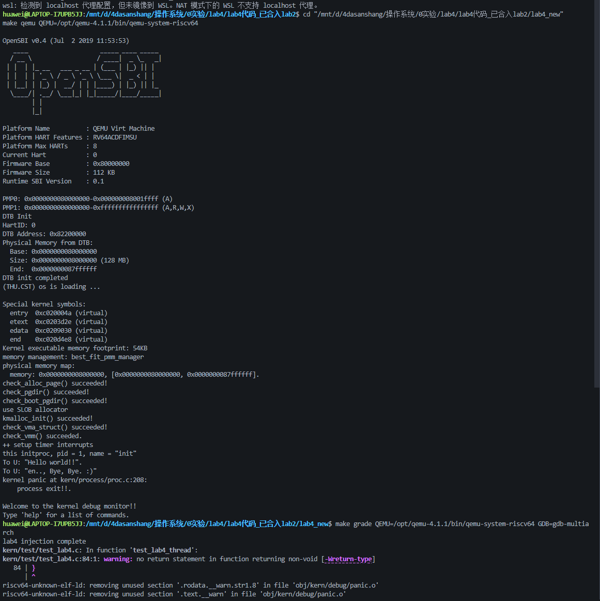
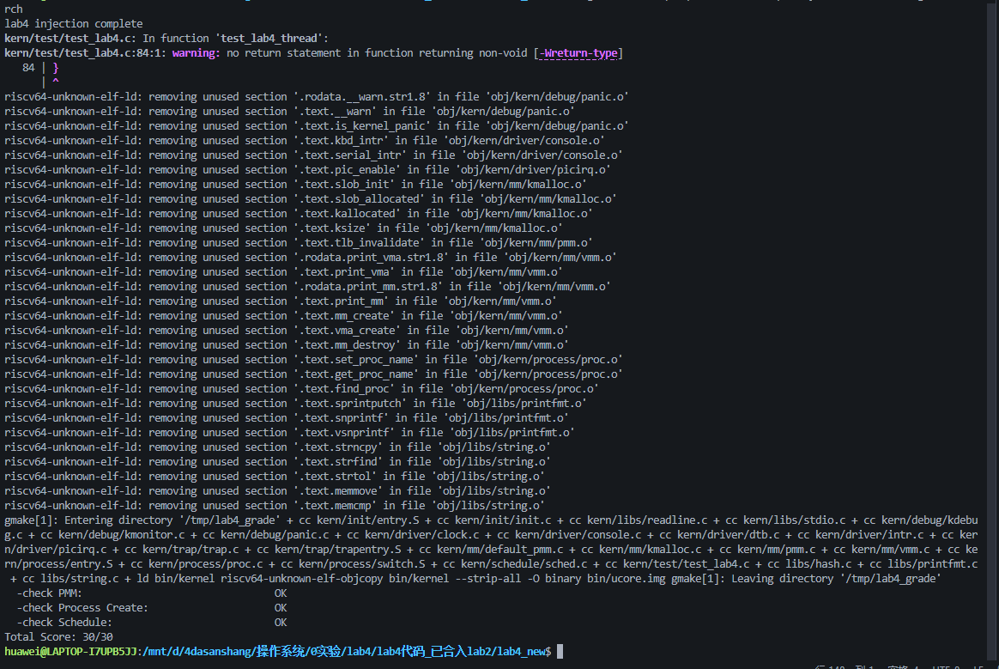

# 操作系统 Lab4 实验报告

第 6 组 · 进程管理 · 整理与集成复测日期为 2026-11-12

| 成员 | 负责内容 |
| --- | --- |
| 王炳環，2412219 | 模块一，虚拟内存页操作，前置实现移植及集成验证 |
| 董朝阳，2411870 | 模块二，进程创建及初始化，失败路径和容量边界验证，报告统稿 |
| 张旭，2411292 | 模块三，进程调度，专项测试、GDB 检查及 Challenge |

本报告整合成员提交的两份报告、两份 Prompt、模块一运行截图，以及仓库内模块二说明和原始日志。成员提供的历史专项结果按材料注明来源。本次重新构建和评分对应正式集成代码 `9435ded`，获得 30/30。

## 一、实验目的与整体逻辑

Lab4 在物理内存管理和 Trap 处理基础上，建立虚拟页映射维护、内核线程创建和调度的完整路径。首先使地址转换和物理页生命周期保持一致，再构造 PCB、独立内核栈与首次执行现场，最后选择可运行线程并恢复其上下文。

```text
kern_init
  → pmm_init → 页表自检与 kmalloc_init
  → pic_init / idt_init → vmm_init
  → proc_init → 建立 idleproc，创建 initproc
  → clock_init / intr_enable → cpu_idle
  → schedule → proc_run → switch_to
  → forkret → forkrets → __trapret → sret
  → kernel_thread_entry → init_main
```

线程共享内核页表，各自拥有 PCB、内核栈及切换上下文。`proc_init` 完成后 CPU 仍执行 idle 的初始化流程，init 只有被调度后才开始运行。本实验的调度由显式调用 `schedule` 驱动。

课程模块范围和报告要求以指导书为准。[Lab4 练习与模块划分](http://oslab.mobisys.top/lab2026/_book/lab4/lab4_2_1_exercises.html) · [实验报告要求](http://oslab.mobisys.top/lab2026/_book/lab4/lab4_5_labs_requirement.html)

## 二、基线、环境与材料来源

代码位于小组仓库 `lab4` 分支的 `code/`。`c4f2cce` 导入官方框架，`8e3d2a6` 完成模块二，`4e5f4b1` 接入页表和调度依赖，`04f1d94` 增加已有评分工具兼容修改，`9435ded` 完善模块三说明和 Sv39 常量表达。本次报告整理从远程获取并快进到 `9435ded`，随后使用该版本的副本运行。

| 验证来源 | 环境和版本 |
| --- | --- |
| 2026-11-12 本次集成复测 | WSL2 Ubuntu 24.04.5 LTS，GCC 10.2.0，Make 4.3，交叉 GDB 10.1，QEMU 4.1.1 |
| 王炳環提供的集成材料 | WSL Ubuntu 26.04.1 LTS，GCC 14.2.0，Make 4.4.1，gdb-multiarch 17.1，QEMU 4.1.1 |
| 张旭提供的模块三材料 | WSL，GCC 10.2.0，交叉 GDB 10.1，QEMU 4.1.1 |
| 董朝阳的模块二阶段记录 | WSL2 Ubuntu 24.04.5 LTS，GCC 10.2.0，交叉 GDB 10.1，QEMU 4.1.1 |

目标为 RISC-V RV64、Sv39、QEMU virt，QEMU 4.1.1 的默认固件为 OpenSBI v0.4，内存为 128 MiB。此前用相同镜像对比时，QEMU 8.2.2 只输出固件信息后超时，因此本次使用已验证的 4.1.1。[版本和本次运行日志](tests/lab4-integrated-20261112/validation.log) · [历史 QEMU 对比记录](lab4-module2.md)

| 成员 | AI 工具与模型记录 |
| --- | --- |
| 王炳環 | 材料记为 Codex 桌面应用，GPT-6 Astra |
| 董朝阳 | Codex 桌面应用。本会话未记录可据以确认的具体子型号 |
| 张旭 | 材料记为 Codex CLI，GPT-6.1 Sol，xhigh |

成员文档正文保存在 `materials/`，Prompt 按三模块汇总在 [prompt.md](prompt.md)。Lab3 原报告和 Prompt 分别保存在 [lab3-report.md](lab3-report.md) 与 [lab3-prompt.md](lab3-prompt.md)。

## 三、功能模块一 · 虚拟内存页操作

负责人为 2412219-王炳環，核心文件为 `kern/mm/pmm.c`，接口为 `page_insert(pgdir, page, la, perm)` 和 `page_remove(pgdir, la)`。

`page_insert` 先通过 `get_pte(pgdir, la, 1)` 取得末级表项，分配失败返回 `-E_NO_MEM`。取得表项后根据旧映射处理引用计数，再统一重建表项和刷新目标 TLB。

| 原状态 | 操作后状态 |
| --- | --- |
| 地址没有有效映射 | 新物理页引用数增加一次，写入新映射 |
| 已映射同一物理页 | 引用数保持不变，更新权限 |
| 已映射另一物理页 | 撤销旧引用，再建立新引用 |
| 删除不存在的映射 | 直接返回，支持重复删除 |
| 删除有效映射 | 清空 PTE、刷新 TLB，引用归零时释放物理页 |

同页重映射时若先无条件删除，唯一引用可能归零并释放仍要使用的页面。实现比较新旧页面，跳过同页的引用变更。权限用 `pte_create(page2ppn(page), perm)` 重建，避免旧 `PTE_U` 或 `PTE_W` 残留。框架 `pte_create` 会设置有效位。

`page_remove` 以 `create=0` 查表，先确认表项有效，再保存旧页指针、清空映射并执行 `sfence.vma`，最后减少引用并按需回收。引用计数描述映射持有的引用，同一地址空间的多个虚拟页也可以共享一个物理页。

`check_pgdir` 检查共享、替换、权限清除和引用数。`check_boot_pgdir` 把两个虚拟页映射到同一物理页，通过读写确认实际共享。中间级页表页由框架自检显式回收。现有 `get_pte` 在前一级建表成功、后一级分配失败时可能保留空页表，本模块沿用该行为，尚未进行该分配失败路径的故障注入。[模块一原材料](materials/lab4-module1-report.md)

## 四、功能模块二 · 进程创建及初始化

负责人为 2411870-董朝阳，核心文件为 `kern/process/proc.c`。

| 函数 | 核心实现与约束 |
| --- | --- |
| `alloc_proc` | 分配并清零 PCB，设置 `PROC_UNINIT`、PID -1、启动页表物理地址和空链表节点 |
| `proc_init` | 初始化普通队列和 PID 哈希表，让 PID 0 的 idle 复用启动栈，设 `current = idleproc` 并请求调度，再创建 PID 1 的 init |
| `kernel_thread` | 清零临时 Trap frame，把函数和参数放入 s0/s1，epc 指向入口，设置 SPP、SPIE 并清除 SIE |
| `do_fork` | 分配 PCB 与内核栈，准备地址空间及现场，完成后分配 PID、挂接哈希和链表、计数并唤醒 |
| `copy_thread` | 把帧复制到新线程栈上，子线程 a0 置零，按参数选择启动 SP，context.ra 指向 forkret，context.sp 指向帧 |
| `copy_mm` | 当前阶段断言父线程无用户地址空间，子线程 mm 为 NULL，使用共享的内核页表 |

idle 直接承接当前执行流，不放入普通进程链表。普通线程有自己的两页内核栈，Trap frame 和首次恢复上下文位于其中。首次 `switch_to` 的 `ret` 进入 `forkret`，由 `forkrets` 将 sp 指向帧，`__trapret` 恢复现场并执行 `sret`。随后 `kernel_thread_entry` 将 s1 移到 a0，再调用 s0。

`do_fork` 的容量检查、分配和发布位于单核关中断临界区，结束时恢复进入前的状态。PCB 或栈分配失败时逆序释放资源，避免未就绪对象被调度器看到。返回值分别为正 PID、`-E_NO_MEM` 或 `-E_NO_FREE_PROC`。

邻近的 `set_proc_name` 改用 `strnlen(name, PROC_NAME_LEN)` 控制源字符串读取长度。2026-11-10 的补充测试实际覆盖 PCB 和栈分配失败、资源及链表回滚、中断恢复、显式 SP，以及创建至 4096 个进程后的拒绝路径。GDB 核验 init 首次入口。这些是模块二阶段在临时依赖组合中的结果。[模块二实现和原始证据](lab4-module2.md)

## 五、功能模块三 · 进程调度

负责人为 2411292-张旭，涉及 `proc.c`、`schedule/sched.c` 和 `process/switch.S`。

`cpu_idle` 持续检查 `current->need_resched`，非零时调用 `schedule`。调度器关闭中断，清除请求，从当前线程的后继查找可运行目标。当前为 idle 时从普通链表首节点开始；遍历时跳过头结点和非 `PROC_RUNNABLE` 对象。找不到普通线程则选 idle，只有自身可运行时允许重新选中自身。选定后增加目标 `runs`，交给 `proc_run`。

`proc_run(current)` 直接返回。切换目标不同时，在临界区更新 current，按 Sv39 格式装载 satp、刷新 TLB，并调用 `switch_to`。

```c
write_csr(satp, ((uintptr_t)SATP_MODE_SV39 << 60) |
               (proc->pgdir >> PGSHIFT));
flush_tlb();
switch_to(&prev->context, &proc->context);
```

MODE 值为 8，位于 satp 的最高四位，PPN 是根页表物理字节地址右移 12 位。工程中的旧 `lsatp` 为 Sv32 格式，因此本实验直接构造 RV64 的 satp。

`struct context` 按 ra、sp、s0 至 s11 排列，共 14 个 8 字节槽位，总计 112 字节。`switch_to` 先按偏移 0 至 104 保存旧值，再恢复目标值并 ret。调用者按 ABI 保护跨函数调用仍需使用的临时值，因此切换只需保存这些必要状态。Trap 则可能打断任意指令，需要更完整的帧。

线程切走后调用栈仍属于该线程。它再次被选中时从自身 `switch_to` 调用之后继续，再恢复栈上保存的中断状态。内层 `proc_run` 保存到 SIE=0，外层 `schedule` 最后恢复原先 SIE，从而保持嵌套临界区语义。[模块三原报告](materials/lab4-module3-report.md)

## 六、规格与 Prompt 设计

三模块的 Prompt 均围绕输入状态、资源归属、成功后的状态和失败边界编写。整理后的原文及复现规格集中在 [prompt.md](prompt.md)。

| 模块 | 规格关注点 | 实际迭代 |
| --- | --- | --- |
| 一 | 无映射、同页、异页三类状态，权限重建、引用计数和 TLB，分配失败返回 | 单文件编译后补齐前置依赖，再做页表自检和 PMM 评分 |
| 二 | PCB 安全初值、独立栈、首次运行链、发布顺序和逆序回滚 | 明确课程模块范围后实现六个函数，先单文件编译，再用临时依赖验证；另测失败与容量边界 |
| 三 | 空表、自身、状态筛选、中断嵌套、Sv39、14 个寄存器与首次启动 | 第一轮核验既有调度实现并完善标记和注释，第二轮课程、专项及 GDB 验证 |

模块三两轮 Prompt 使用 `[PROMPT]`、`[RELY]`、`[GUARANTEE]`、`[SPECIFICATION]`，把接口依赖、修改边界与前后置条件集中表达。模块二实际用户请求完整保存，四段式文本明确标为 2026-11-12 依据实现整理的复现规格。模块一材料中的最终提示词按成员整理记录保留。

## 七、测试结果与证据

### 本次正式集成代码复测

2026-11-12 复制 `9435ded` 的 `code/` 到独立目录，从干净源码构建，再用当前仓库的注入器和评分脚本执行测试。运行记录包含 shell 跟踪、工具版本、返回值与完整串口，测试副本保存在仓库外。

```bash
export PATH=/opt/riscv/riscv64-unknown-elf-toolchain-10.2.0-2020.12.8-x86_64-linux-ubuntu14/bin:/opt/qemu-4.1.1/bin:$PATH
cd /mnt/d/os-lab-lab4-validation-0543e09d/report-materials-20261112/integrated-code
make -j4
python3 tools/inject.py "$PWD"
timeout 45s sh -x tools/grade.sh -v
```

| 操作或检查 | 结果 |
| --- | --- |
| 完整编译 | 退出 0，生成 bin/kernel 和 bin/ucore.img |
| 注入课程测试 | 退出 0 |
| 课程评分 | 退出 0，总分 30/30 |
| PMM、Process Create、Schedule | 串口分别出现 PASS，评分均为 OK |
| 启动页表与 VMA 自检 | check_pgdir、check_boot_pgdir、check_vma_struct、check_vmm 均成功 |
| init 执行 | PID 1、名称 init，输出 Hello world 和结束问候 |

```text
[Test PMM] PASS
[Test Process Create] PASS
[Test Schedule] PASS
this initproc, pid = 1, name = "init"
To U: "Hello world!!".
To U: "en.., Bye, Bye. :)"
Total Score: 30/30
```

详细输出见 [完整验证日志](tests/lab4-integrated-20261112/validation.log) 与 [串口日志](tests/lab4-integrated-20261112/serial.log)。当前测试线程返回类型已在远程 `04f1d94` 改为 int，本次仍出现 `no return statement` 警告；本次报告整理沿用该版本的测试和评分规则。

init 返回后进入占位 `do_exit`，触发 `process exit!!` 并到监控器。监控器在 readline 前调用 SBI 关机。评分脚本的 GDB 因连接关闭返回，但脚本继续核对串口并返回 0。因此 30/30 表示课程断言与输出通过，readline 结束断点的命中情况需另行判断。

### 成员历史补充验证

| 来源 | 记录的覆盖和结果 | 证据性质 |
| --- | --- | --- |
| 模块二，2026-11-10 | PCB 初值、两类分配失败、回滚、SIE、首次帧和 MAX_PROCESS=4096 通过，GDB 首次入口通过 | 仓库保存原始日志，对应模块二阶段临时依赖镜像 |
| 模块三，成员两轮材料 | 共 16 项 PASS、1 项 FAIL、2 项 SKIP；独立 GDB 76 项断言通过 | 本次收到成员的文字记录，专项源码和原始完整日志未随附件提供 |
| 模块三多线程检查 | 工作线程各 6 轮，18 次寄存器往返，SIE=0/1 各 9 次，栈哨兵完整 | 按成员报告保留，未在本次重复执行 |
| 模块三资源检查 | 创建 5 线程占 10 页，切换前后空闲页均 31714 | 线程保留至关机，覆盖切换期间资源稳定性 |
| 模块三 FAIL | readline 结束断点未命中，GDB 返回 1 | 成员定位为监控器提前 SBI 关机 |
| 模块三两项 SKIP | 不同根页表和完整 TLB 陈旧项检查，完整退出回收 | 全部线程共享启动页表，退出尚为占位实现 |

### 成员提供的运行截图

两张截图来自王炳環提供的压缩包，材料对应 `04f1d94` 阶段。截图显示页表自检成功、init 输出及评分 30/30。本次 `9435ded` 复测结果以上面的日志为依据。





## 八、调试问题与处理

| 问题 | 分析和处理 |
| --- | --- |
| 初期框架缺前置实现 | 从实际报错文件确认 Lab2 分配器、Lab3 Trap 及其他模块依赖，先在临时副本联调，正式集成后再复测 |
| kmalloc 地址参数类型 | 远程集成代码已将整数地址显式转换为 kva2page 所需的指针 |
| GDB 镜像不存在 | 模块二调试遇到 make grade 清理镜像，重建后继续 |
| GDB 对 sp 或 satp 运算误报 | 先转换为适合的无符号整数类型再检查对齐和 MODE，复跑断言通过 |
| readline 断点未命中 | 监控器在 readline 前关机。成员将该项保留为 FAIL，课程分数和结束流程分别记录 |
| verbose 日志不完整 | 直接对文件重定向时，脚本对 /dev/stdout 的重开可能截断日志。本次用管道接 tee 保存完整 shell 跟踪 |
| 不同工具链的评分兼容 | 远程提交 04f1d94 调整测试回调类型、加载 ELF 和硬件断点。当前复测沿用已有版本，并记录剩余警告 |

成员材料反映，核验实际代码与运行值可以修正提示词中的错误假设。例如“评分一定在 readline 断点终止”与监控器提前关机冲突，评分成功也不能消除这条流程检查失败。

## 九、操作系统原理与实验边界

| 原理知识 | 实验对应 |
| --- | --- |
| 地址转换与页级保护 | PTE 的页号、权限、有效位以及 TLB 失效 |
| 共享资源生命周期 | 多个映射可引用同一物理页，最后一个引用撤销才回收 |
| 进程抽象与状态 | PCB 关联身份、栈、页表和现场，PROC_RUNNABLE 包括就绪与运行，current 标识当前线程 |
| 策略与机制 | schedule 选择目标，proc_run 和 switch_to 执行切换 |
| 上下文与 CPU 复用 | 保存栈和必要寄存器使线程从上次执行点继续 |
| 临界区 | 单核关中断保护登记与切换，恢复先前状态使嵌套安全 |
| 内核态控制转移 | 构造 Trap frame，借助 sret 启动内核线程 |

当前尚未覆盖独立用户进程、系统调用、写时复制、按需分页与页面置换、完整退出等待回收、时间片抢占、多核锁及跨核 TLB 同步。三模块的课程集成测试已经通过，模块一分级建表失败回滚和不同地址空间切换仍有明确的验证边界。

## 十、扩展练习 Challenge

### 1. local_intr_save 和 local_intr_restore 如何控制中断

这两个宏定义在 `kern/sync/sync.h` 中。`local_intr_save(intr_flag)` 调用 `__intr_save()`，读取 `sstatus` 的 SIE 位。若 SIE 为 1，就调用 `intr_disable()` 清除该位，并把 `intr_flag` 记为 1；若原本为 0，则记录 0。这样既关闭了中断，也留下了进入临界区前的状态。

`intr_disable()` 通过 `clear_csr(sstatus, SSTATUS_SIE)` 执行 `csrrc` 清位，`intr_enable()` 通过 `set_csr()` 执行 `csrrs` 置位。`SSTATUS_SIE` 的值是 `0x2`，对应 `sstatus` 的第 1 位。`local_intr_restore(intr_flag)` 只在标记为 1 时重新开启中断；标记为 0 时不执行开中断操作。

在模块三中，外层 `schedule()` 保存原状态后关中断，内层 `proc_run()` 读到的 SIE 已经是 0，所以它返回时继续保持关闭。旧线程切回后，由外层恢复最初的中断状态。这使嵌套调用能够共用一段关中断区间。

### 2. get_pte 中的两段代码为什么相像

多级页表的每一层都采用相同的组织方式：根据虚拟地址中的索引找到一个表项，再由表项找到下一级页表。分页模式改变的是层数和索引宽度，这个查找过程基本相同。以 4 KiB 基本页为例：

| 分页模式 | 地址划分 | 页表层数 | 每级表项数 | 每个表项大小 |
|---|---|---:|---:|---:|
| Sv32 | 10 位索引 + 10 位索引 + 12 位偏移 | 2 | 1024 | 4 字节 |
| Sv39 | 9 位索引 + 9 位索引 + 9 位索引 + 12 位偏移 | 3 | 512 | 8 字节 |
| Sv48 | 4 组 9 位索引 + 12 位偏移 | 4 | 512 | 8 字节 |

Sv32 用于 RV32，Sv39 和 Sv48 用于 RV64。三种模式的一张页表都占 4 KiB，页内偏移也都是 12 位。Sv39 和 Sv48 的表项大小、每级索引宽度相同，Sv48 比 Sv39 多一级页表，用于覆盖更大的虚拟地址范围。

当前 `kern/mm/pmm.c` 中的 `get_pte()` 按 Sv39 的三级结构查找。第一段通过 `PDX1(la)` 定位根级表项 `pdep1`，确保下一层页表存在；第二段通过 `PDX0(la)` 定位中间级表项 `pdep0`，确保末级页表存在。两段都要检查 `PTE_V`，在允许创建且页表缺失时申请一页、设置引用计数、清零，并将新页表的 PPN 写入上一级表项，所以代码形式几乎一样。

沿表项向下查找时，`PDE_ADDR()` 取出下一级页表的物理地址，`KADDR()` 转为内核可访问的虚拟地址。两次处理完成后，再用 `PTX(la)` 定位末级表项并返回它的地址。Sv32 少一级处理，Sv48 则多一级处理，都可以沿用这种逐层查找的方法。

### 3. 页表项查找和页表页分配是否应该拆开

我认为当前写法适合本实验。`create` 参数区分了两种用途：`get_page()` 和 `page_remove()` 传入 0，只查已有页表；`page_insert()` 传入 1，在建立映射时按需补齐中间级页表。调用者共用一套遍历逻辑，代码比较直接。

不过，`create=1` 会改变页表和内存占用。例如第一段成功创建下一层页表，第二段申请失败，函数会返回 `NULL`，但前面新建的页表仍然挂在原页表上。随着功能增加，把纯查找和建表分开，能让这类状态变化更明确，也便于在建表路径中统一处理分配失败和回收。

因此，本实验可以保留现有接口；扩展时可以让查找接口只返回已有表项，由建表接口负责申请和连接页表页，内部共用逐级遍历代码。还要注意，`get_pte()` 返回的是末级表项的地址，表项本身可能仍然无效；把数据页映射到该地址的工作由 `page_insert()` 完成。
