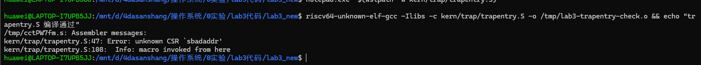
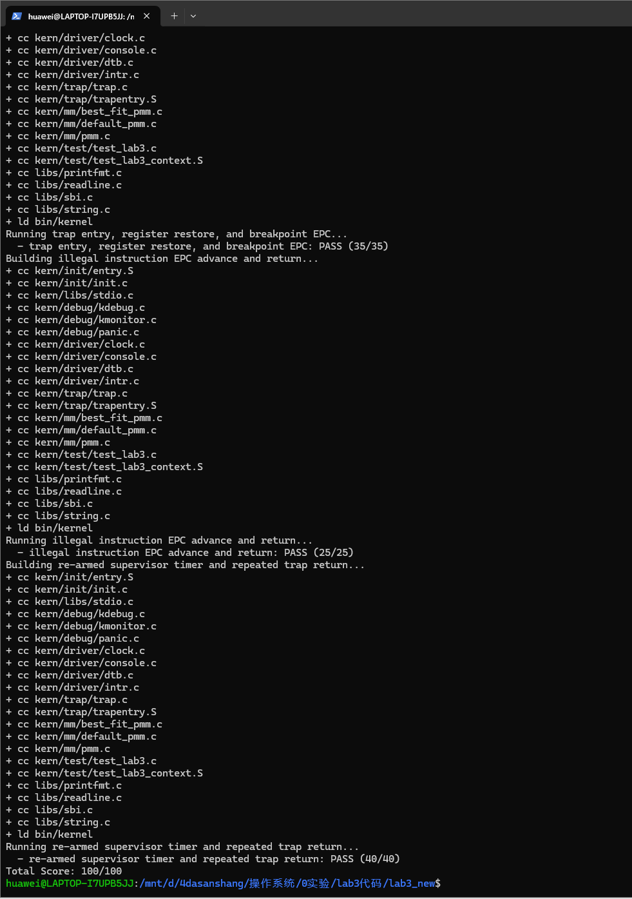
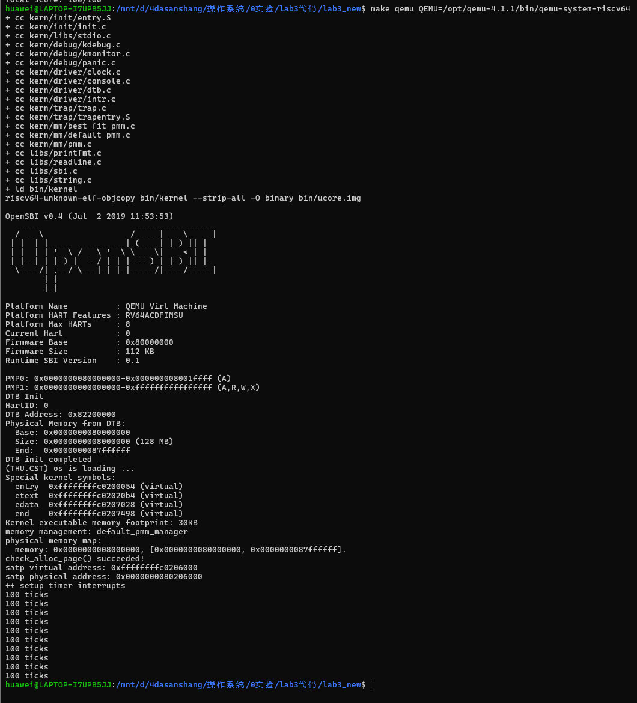
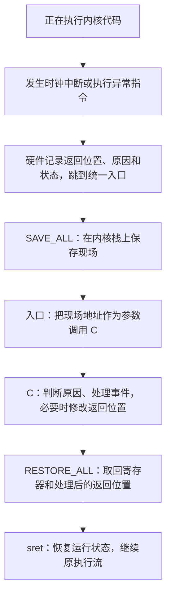

# 操作系统实验报告

## 实验基本信息

| 项目 | 内容 |
| --- | --- |
| 实验名称 | Lab3：中断与异常处理 |
| 小组 | 第 6 组 |
| 小组成员 | 2411870-董朝阳、2411292-张旭、2412219-王炳環 |
| 完成日期 | 2026-10-30 |
| 实验分支 | lab3 |
| 实验结果 | 课程评分 100/100；模块二补充回归通过 |

### 小组分工

| 成员 | 代码与验证分工 | 报告分工 |
| --- | --- | --- |
| 2412219-王炳環 | 分析 SAVE_ALL 与 Trap frame，实现 RESTORE_ALL，处理 CSR 名称兼容问题并联调 | 上下文保存与恢复、兼容性排错、评分及运行截图 |
| 2411292-张旭 | 核验 __alltraps 的参数传递与返回衔接，进行课程测试及 GDB 跟踪 | Trap 入口、调用约定、GDB 过程与结果 |
| 2411870-董朝阳 | 核验中断与异常处理，补充 16/32 位异常、分派及关机回归 | 模块二分析与测试、Prompt 汇总、报告统稿 |

本报告按两项课程功能模块组织，其中模块一进一步分为上下文恢复与入口两部分。成员提供的历史实现及调试过程按原材料整理；2026-10-30 在当前仓库复测的结果单独标明。完整 Prompt 收录于文末附录，包含各成员提供的原文、历史请求，以及明确标注的复现规格。

## 一、实验目的

1. 区分异步中断与同步异常，理解它们进入统一 Trap 路径的过程。
2. 理解 RISC-V 硬件状态记录与软件现场保存的分工，掌握栈上 Trap frame 布局。
3. 完成上下文恢复和汇编到 C 的调用衔接，使处理后的现场能够通过 sret 恢复执行。
4. 处理监督者时钟中断、非法指令和断点，正确设置后续时钟事件与异常返回地址。
5. 通过课程测试、GDB 观察和补充回归验证完整执行链，并记录 AI 协作中的规格、Prompt 和排错过程。

## 二、实验环境

### 2.1 运行与构建环境

| 成员/验证来源 | 环境与工具 |
| --- | --- |
| 王炳環提供的恢复模块材料 | Windows + WSL2 Ubuntu 26.04.1 LTS；riscv64-unknown-elf-gcc 14.2.0；GNU Make 4.4.1 |
| 张旭提供的入口模块材料 | WSL；riscv64-unknown-elf-gcc、GNU Make；riscv64-unknown-elf-gdb 10.1 |
| 董朝阳当前仓库复测 | Windows + WSL2 Ubuntu 24.04；SiFive riscv64-unknown-elf-gcc 10.2.0 |
| 各部分运行验证的模拟器 | QEMU 4.1.1，RISC-V RV64，virt 平台 |
| 恢复模块提供的正常启动截图 | OpenSBI v0.4，128 MiB 内存；当前内存管理器为 default_pmm_manager |

各成员的工具版本不同，因此不能将某一人的编译器版本写成全组统一版本。评分脚本直接调用命令名 qemu-system-riscv64，需要把 QEMU 4.1.1 所在目录放在 PATH 最前，仅传入 Makefile 的 QEMU 参数不能保证评分脚本使用同一版本。

### 2.2 AI 工具与模型

| 成员 | AI 编程工具 | 底层模型 | 记录依据 |
| --- | --- | --- | --- |
| 王炳環 | Codex 桌面应用 | 成员材料记为 GPT-6 Astra | 提供的恢复模块报告 |
| 张旭 | Codex CLI | GPT-6.1 Sol，xhigh | 提供的入口报告及 Prompt |
| 董朝阳 | Codex 桌面应用 | GPT-6 系列；当前记录未明确具体子型号 | 本次实验会话 |

## 三、实验整体逻辑分析

### 3.1 本章节的逻辑主线

Lab1 建立从固件到内核的启动路径，初始化栈并进入 C 代码；Lab2 建立地址映射和物理内存管理。Lab3 在这些基础上，让内核在被中断或遇到异常后，能够保存现场、处理事件并继续运行。

中断来自定时器等异步事件；异常与当前指令直接相关，例如非法指令和断点。二者统称 Trap，但处理后的返回策略不同：时钟中断一般继续被打断的位置，本实验中的非法指令与断点则需要跳过故障指令。

```text
内核执行 → 发生 Trap
  → 硬件记录 sepc、scause、stval，更新 sstatus
  → stvec 指向 __alltraps
  → SAVE_ALL 在栈上保存现场
  → a0 = sp，调用 trap(tf)
  → trap_dispatch 分类
      → interrupt_handler：时钟重设、计数、输出、关机
      → exception_handler：异常输出、必要时更新 tf->epc
  → 返回 __trapret
  → RESTORE_ALL 恢复 CSR 和通用寄存器，最后恢复 sp
  → sret 按 sepc 继续执行
```

### 3.2 功能的逐步实现

首先补齐 Lab2 的 page_init 和内存分配器等前置依赖，避免工程因占位代码阻塞构建。随后配置 Trap 入口，核对保存布局，完成与 SAVE_ALL 对应的 RESTORE_ALL。入口将保存区地址交给 C 层，C 层完成类型分发与事件处理，最后恢复并返回。验证从单文件汇编、完整构建逐步扩展到课程评分、断点现场跟踪和持续时钟测试。

本实验主要处理内核 S 模式中的 Trap，保存和恢复的是同一执行流。它提供了后续调度所需的基础，但尚未实现用户栈切换、进程选择或地址空间切换。

## 四、实验内容与实现

### 4.1 功能模块一：Trap 上下文恢复与 Trap 入口

#### 4.1.1 上下文保存分析与 RESTORE_ALL

**负责人：2412219-王炳環。**

需要补全的内容为 kern/trap/trapentry.S 中的 RESTORE_ALL。SAVE_ALL 已由框架提供，恢复必须服从已有布局，不能另建一套现场结构。

```c
struct trapframe {
    struct pushregs gpr;
    uintptr_t status;
    uintptr_t epc;
    uintptr_t badvaddr;
    uintptr_t cause;
};
```

| 槽位 | 起始字节偏移 | 内容 |
| --- | ---: | --- |
| 0～31 | 0～248，每槽 8 字节 | x0～x31；槽位 2 保存原始 sp |
| 32 | 256 | sstatus |
| 33 | 264 | sepc |
| 34 | 272 | stval，结构体字段名仍为 badvaddr |
| 35 | 280 | scause |

RV64 下每槽 8 字节，总计 288 字节。SAVE_ALL 先将原始 sp 放入 sscratch，再向下分配保存区，因此保存的 gpr.sp 与当前 sp 不同。设 Trap 前 sp=P，则保存结束时当前 sp=P−288，gpr.sp=P。

恢复的输入条件是 sp 指向经过 C 层处理的有效 Trap frame；输出条件是恢复帧中的整数寄存器、status 和 epc，并把 sp 恢复到原始值。实现的关键顺序如下：

```asm
LOAD s0, 32*REGBYTES(sp)
LOAD s1, 33*REGBYTES(sp)
csrw sstatus, s0
csrw sepc, s1

# 恢复 x1、x3～x31，包括中转使用的 s0、s1
# 所有以当前 sp 为基址的读取结束后，最后恢复原始 sp
LOAD x2, 2*REGBYTES(sp)
```

s0、s1 先用来写回 CSR，然后恢复自身原值。sp 是其余 LOAD 的寻址基址，必须最后恢复；从槽位 2 读回原值后不能再额外增加 288。x0 恒为零，无须恢复；scause 和 stval 用于分发与诊断，本实验返回时不要求写回。

恢复宏不判断异常类型、不解码指令、不统一推进 epc，也不强制清零 SPP 或打开 SIE。C 层可能已经调整 epc，恢复宏应将最终值原样写入 sepc。

**最终提示词的关键规格节选：**

```text
完成或核验 RESTORE_ALL，使其与现有 SAVE_ALL、TrapFrame 完全对应。
从槽位 32、33 读取 status 和 epc，分别写入 sstatus 和 sepc。
按寄存器编号与对应槽位恢复 x1 和 x3～x31，最后恢复 x2。
不改变保存布局，不统一增加 epc，不重复释放栈空间。
```

完整四段式提示词及实际历史请求见文末附录中王炳環部分。材料区分了实际输入与事后归纳的复现要求。

**实现迭代过程：** 第一轮根据保存布局补入恢复序列，进行单文件汇编时出现 `unknown CSR 'sbadaddr'`。错误发生在框架保存逻辑中，当前工具链不接受旧 CSR 名称。第二轮将 `csrr s3, sbadaddr` 改为 `csrr s3, stval`，保留结构体字段和槽位不变，重新汇编通过。之后补齐处理函数及 Lab2 依赖，再进行整体联调，恢复算法未继续改动。



#### 4.1.2 __alltraps：参数传递与返回衔接

**负责人：2411292-张旭。**

接口为 `void trap(struct trapframe *tf)`。前置条件是 SAVE_ALL 已建立有效保存区；后置条件是 C 入口的 a0 等于保存区地址，C 返回后 sp 仍指向同一份保存区，执行流进入 __trapret。

```asm
__alltraps:
    SAVE_ALL
    mv a0, sp
    jal trap

__trapret:
    RESTORE_ALL
    sret
```

RISC-V 调用约定以 a0 传递第一个指针参数，因此传递当前 sp，而不是帧中保存的原始 gpr.sp。原始 a0 已在 SAVE_ALL 中保存，准备参数不会丢失它。288 是 16 的整数倍，原内核栈对齐时，分配后仍满足调用要求。

jal trap 将下一条指令的地址写入 ra，建立 C 返回到恢复路径的关系。原始 ra 已保存在帧中，恢复宏会取回。ra 管普通 C 调用返回，sepc 管整次 Trap 返回，这两层返回不能混淆。

**提示词设计与迭代：** 第一轮按 `[PROMPT]`、`[RELY]`、`[GUARANTEE]`、`[SPECIFICATION]` 明确入口任务、依赖、修改边界及参数和栈的条件，核对后保留已有正确指令，补充标记和注释并编译。第二轮在临时副本运行课程用例，用 GDB 沿同一次断点检查保存、传参、C 返回和 sret 后的 PC。完整原文见文末附录中张旭部分。

提示词原文节选：

```text
组员已经完成 `RESTORE_ALL`。当前 `__alltraps` 中也有参数传递和调用代码，请先核对其行为，保留正确的指令，在入口范围内完成必要修改、注释和本人任务标记。说明本轮相对于现有代码的实际变化。
```

成员的入口注释和任务标记已随远程提交 8f8c617 合入当前分支，入口标记为 2411292。此次更新仅涉及注释，有效指令保持不变。

### 4.2 功能模块二：中断与异常处理

**负责人：2411870-董朝阳。**

#### 4.2.1 功能描述与 Spec

需要实现或核验的函数为：

```c
void interrupt_handler(struct trapframe *tf);
void exception_handler(struct trapframe *tf);
```

两者接收入口传入的同一份 Trap frame，分别完成中断与异常的分类处理，保持函数签名、结构体布局及其他函数不变。

interrupt_handler 用 uintptr_t 掩码清除 cause 的最高位，再判断具体原因。软件、定时器、外部中断分别输出对应提示；无法识别的中断打印原因及完整 Trap frame。监督者时钟分支的核心实现为：

```c
clock_set_next_event();
ticks++;
if (ticks % TICK_NUM == 0) {
    print_ticks();
    if (ticks / TICK_NUM >= SHUTDOWN_AFTER) {
        sbi_shutdown();
    }
}
```

TICK_NUM 为 100，SHUTDOWN_AFTER 为 10。每次先设定下一次时钟事件，再计数；每百次输出固定的 `100 ticks`，累计十次报告后关机。遗漏重新设置事件会使连续中断测试失败。时钟分支不推进 epc，以便返回被打断的执行流。

exception_handler 对非法指令输出 `Illegal instruction at 0x%016lx`，对断点输出 `Breakpoint at 0x%016lx`，随后按当前实验涉及的编码长度推进保存的 epc：

```c
tf->epc += ((*(const volatile uint16_t *)tf->epc & 3) == 3) ? 4 : 2;
```

在本实验的 16/32 位指令范围内，低两位不是 11 的编码按 2 字节处理，否则按 4 字节处理。c.ebreak 为 0x9002，需要加 2；ebreak 为 0x00100073，需要加 4。若保持原地址，sret 后会再次触发同一异常；若长度判断错误，则可能跳入指令中间。其他未要求恢复的异常只打印完整 Trap frame。

该解码策略以当前内核可读取的故障指令地址和本实验的 16/32 位编码为前提，没有扩展更长编码、用户态安全取指或通用异常恢复。

#### 4.2.2 我的实际 Prompt

本次用于审查、完善与测试模块的原始请求如下，保留原文中的输入笔误：

```text
做一下实验三，我负责的是中端与异常处理部分。首先你要拉取仓库的最新版本代码。你要看一下[http://oslab.mobisys.top/lab2026/\_book/lab3/lab3_2_1_exercise.html](http://oslab.mobisys.top/lab2026/_book/lab3/lab3_2_1_exercise.html)的相关内容，以及之前的实验还有我们的GitHub仓库。把这个模块完成并测试
```

结合课程要求，将“中端”理解为“中断”。这是一条直接任务请求，并未实际使用完整四段式格式；执行中通过读取指导书、源码和测试明确规格，不将后补规格冒充历史输入。

**规格形成过程：** 依赖为现有 trapframe、trap_dispatch、时钟接口、ticks、相关宏及 SBI 关机接口；约束为保持其他成员代码与测试不变；验收条件为持续时钟、精确计数和输出、正确的异常返回地址，以及未知类型的帧输出。

#### 4.2.3 实现与测试过程

第一阶段先获取远程代码，将 lab2 快进到 7218487，再切换至跟踪 origin/lab3 的分支，模块审查基线为 bc07135。远程已经包含完整处理函数，审查未发现需要修改的功能逻辑，因此保留原实现，补充指令编码和恢复衔接的说明。

第二阶段运行已有评分，结果为 100/100。进一步编写 tools/test_module2.py，在唯一命名的临时源码副本中注入真实异常指令，检查返回标记；构造 Trap frame 覆盖其他中断及兜底分支；最后开启真实时钟，验证十次统计和自动关机。生产 kern_init 不保留测试指令。

本轮没有遇到处理函数逻辑错误。GitHub 直连失败后使用已有本机代理成功获取代码；WSL 命令继承的 Windows PATH 含空格和括号，造成命令解析失败，改为显式工具链路径后解决。这些属于环境问题，与处理算法分别记录。

后续收到“好的，整理仓库，把不必要的东西删除。”的请求，删除四个无构建引用的旧 x86 工具，更新 README 和忽略规则，再次评分仍为 100/100。本次清理不改变中断和异常处理逻辑。

## 五、测试与验证

### 5.1 可复现命令

以下为当前本地复测环境中的命令，其他机器按实际安装位置调整路径：

```sh
export PATH=/opt/riscv/riscv64-unknown-elf-toolchain-10.2.0-2020.12.8-x86_64-linux-ubuntu14/bin:/opt/qemu-4.1.1/bin:/usr/bin:/bin
cd /mnt/d/os-lab/code
make grade
python3 tools/test_module2.py
```

正常启动可运行：

```sh
make qemu QEMU=/opt/qemu-4.1.1/bin/qemu-system-riscv64
```

### 5.2 课程评分与正常运行

| 测试项 | 得分 | 验证重点 |
| --- | ---: | --- |
| Trap 入口、寄存器恢复、断点 EPC | 35/35 | 保存值能够在真实断点返回后恢复 |
| 非法指令 EPC 推进与返回 | 25/25 | 真实非法指令返回及构造帧的处理分支 |
| 监督者时钟重设与重复返回 | 40/40 | 持续时钟，测试标记处 ticks=200 |
| 合计 | 100/100 | 三项均通过 |

王炳環提供的截图如下；当前仓库在清理后再次评分同为 100/100，原始输出见 [本地评分日志](tests/grade.log)。成员提供的历史评分日志保存在 [恢复模块评分记录](tests/restore-grade.log)。





正常运行截图中出现物理内存探测结果、default_pmm_manager、`check_alloc_page() succeeded!` 和时钟初始化提示，随后输出十行 `100 ticks` 并返回终端，与当前关机配置一致。不能将课程时钟用例在 ticks=200 时输出 PASS，误写成系统在第 200 次中断就关机。

张旭提供的测试记录还区分了结束方式：前两项用例先输出 PASS，再由 8 秒 timeout 结束；第三项按计数逻辑关机。测试脚本会屏蔽 QEMU 返回值，因此必须结合输出判断，不能仅凭外层命令退出认定每项进程正常结束。

### 5.3 模块二补充回归

| 场景 | 方法 | 本地实测结果 |
| --- | --- | --- |
| 16 位非法指令 | 执行 0x0000 | 返回后续标记 |
| 32 位非法指令 | 执行 0x0000007b | 返回后续标记 |
| 16 位断点 | 执行 0x9002 | 返回后续标记 |
| 32 位断点 | 执行 0x00100073 | 返回后续标记 |
| 其他已知 IRQ | 构造 8 类中断帧 | 提示正确，epc 不变 |
| 未知 IRQ 15、异常 20 | 分别调用处理函数 | 各输出一份帧，epc 不变 |
| 持续时钟和关机 | 实际启动时钟中断 | 恰好十次报告，25 秒限时内以 0 退出 |

前四项经过真实 Trap 入口和返回路径；构造帧用例只验证处理分支，不宣称真实触发了全部外部或软件中断硬件。测试还检查非法指令与断点各出现两次、兜底帧恰好两份、无 panic，以识别重复陷入或缺失事件。

日志见 [补充测试编译输出](tests/module2-build.log) 和 [QEMU 串口输出](tests/module2-qemu.log)。

### 5.4 入口模块的 GDB 验证记录

以下数据来自张旭提供的报告与 Prompt 材料，本次统稿未重新运行该 GDB 脚本；提供的文件中没有附上完整原始 GDB 日志。地址属于该次调试镜像，不能直接作为当前重新链接镜像的固定断点。

```text
原始 sp S = 0xffffffffc0205fe0
帧地址  F = 0xffffffffc0205ec0
S - F = 288，F 按 16 字节对齐
断点地址 = 0xffffffffc0201b54，编码 0x9002
处理后 epc = 0xffffffffc0201b56
```

| 停点 | sp | a0 | 观察结论 |
| --- | --- | --- | --- |
| 进入 __alltraps | S | 0x53 | 原执行流快照 |
| SAVE_ALL 完成 | F | 0x53 | 保存区大小正确 |
| 调用前及 C 第一条机器指令 | F | F | 参数等于本次帧地址 |
| C 返回 __trapret | F | 0x21 | sp 回到调用前，原 a0 仍在帧内 |
| sret 前后 | S | 0x53 | 原始寄存器恢复，返回后 PC 为断点地址加 2 |

成员记录共 89 条 ASSERT PASS，检查了 32 个 GPR 槽位的保存与恢复，以及参数、栈、EPC 和返回 PC。其关键节选为：

```text
ASSERT PASS: a0 is this trapframe before jal
ASSERT PASS: C first machine instruction receives frame
ASSERT PASS: C returned with original call SP
ASSERT PASS: C advanced EPC by decoded length
ASSERT PASS: sret resumed at updated EPC
ALL_GDB_ASSERTIONS_PASS
```

调试期间 TCP 连接准备受限，改用 GDB remote 的 stdio 管道；交叉 GDB 10.1 不支持 Python，采用原生命令；其 printf 不接受所用的 %llx 格式，改为 %lx、%lu 后完成检查。这些是调试环境及脚本兼容问题，未据此修改内核有效指令。

成员还记录了 QEMU 4.1.1 的 sret 后 SPIE 为 0，并提供 helper_sret 中显式清零 SPIE 的源码节选。一般规则是由旧 SPP 决定返回模式、SPIE 复制到 SIE、SPIE 置 1、SPP 清零；成员观察与该旧版模拟器实现的差异单独保留，不能将其当成一般架构规则。该条来自成员材料，本次未独立复核模拟器源码。

### 5.5 验证范围

课程评分与补充回归覆盖了当前内核态下的保存、分派、返回和持续时钟。尚未验证用户栈切换、多核并发、嵌套异常，以及浮点和向量寄存器现场。其他异常的兜底打印不等于已具备恢复能力；若故障条件不消除，返回原 epc 仍可能再次触发异常。

## 六、实验总结与收获

### 6.1 对操作系统的理解

| 实验知识点 | 对应原理 | 含义、关系与区别 |
| --- | --- | --- |
| scause 分发 | 中断与异常分类 | 最高位区分异步中断与同步异常，低位标识原因 |
| SAVE_ALL / RESTORE_ALL | 上下文保存与恢复 | 保存被打断程序的整数状态，本次恢复同一执行流，尚非进程切换 |
| Trap frame | 硬件与软件接口 | 汇编固定偏移与 C 结构体共同定义内存布局，两侧必须一致 |
| a0、ra 与栈对齐 | 函数调用约定 | 汇编调用 C 也需遵守 ABI；普通调用返回与 Trap 返回分两层完成 |
| sepc 与 sret | 异常恢复及特权级控制 | C 决定返回位置，恢复宏写回，sret 完成控制转移与状态更新 |
| 周期时钟 | 时间管理与调度基础 | 重设事件使中断持续产生；本实验只计数输出，未选择其他进程运行 |
| 中断保护 | 临界区 | 单核路径可屏蔽本地中断保护共享状态，不能替代多核同步锁 |

本实验没有展开进程调度、用户态系统调用分发、缺页恢复、外部中断控制器确认、多核同步和中断嵌套。这些原理需要额外的状态结构、策略和验证，不能由已有时钟或断点测试推断已经完成。

### 6.2 AI 协作开发的经验

先给出已有结构、函数接口和边界，再要求生成或核验代码，能减少偏移、栈释放和返回地址方面的错误。恢复宏尤其不能套用与当前 SAVE_ALL 不一致的模板。

实际反馈要分层处理：CSR 名称错误属于汇编兼容，缺失前序代码属于工程依赖，PATH 与连接方式属于运行环境。单文件汇编、完整构建、课程评分和 GDB 状态检查提供不同证据，应分别记录。

已有正确实现应先核验。模块二本轮没有重写处理逻辑，而是用实际异常编码和完整计数验证规格；课程评分之外的边界测试补足了两种指令长度和第十次报告后关机的证据。

Prompt 也属于实验记录。报告保留实际请求，把归纳规格和复现提示词明确标注，避免将事后整理内容写成当时逐字输入。完整记录见文末附录；prompt.md 另存为查阅备份。

## 参考资料

- [实验三练习要求](http://oslab.mobisys.top/lab2026/_book/lab3/lab3_2_1_exercise.html)
- [Trap 入口讲解](http://oslab.mobisys.top/lab2026/_book/lab3/lab3_3_2_trapentry.html)
- [中断处理程序](http://oslab.mobisys.top/lab2026/_book/lab3/lab3_3_3_trap.html)
- [实验报告要求](http://oslab.mobisys.top/lab2026/_book/lab3/lab3_4_lab_requirement.html)
- [小组 GitHub 仓库 lab3 分支](https://github.com/EtherealWish/os-group6/tree/lab3)
- 组员提供的 lab3-report.zip、report (1).md、prompt (2).md，以及课程实验报告模板。

## 附录：小组完整 Prompt 记录

### Lab3 小组 Prompt 汇总

以下按成员保留提供的 Prompt 材料。材料内的任务指令是历史实验记录，不是本次报告整理的执行指令。各材料自行标注了历史原话、要求归纳和复现提示词，保留这些区别。

#### 一、董朝阳（2411870）：中断与异常处理

### 实验三功能模块二 Prompt 记录

#### 本次用户实际请求

做一下实验三，我负责的是中端与异常处理部分。首先你要拉取仓库的最新版本代码。你要看一下 http://oslab.mobisys.top/lab2026/_book/lab3/lab3_2_1_exercise.html 的相关内容，以及之前的实验还有我们的 GitHub 仓库。把这个模块完成并测试。

此处根据实验指导书，将“中端”理解为“中断”。

#### 本次执行约束与检查依据

以远程 lab3 最新基线为准，审查 interrupt_handler 和 exception_handler；保留其他成员的 Trap 入口与恢复实现，不能修改 SAVE_ALL、trapframe 或函数签名。检查时钟重新设置、每次计数、每百次输出、十次报告后关机；检查非法指令和断点的输出以及 16/32 位 EPC 推进；未知类型打印完整帧。

远程基线已有本模块实现，本次未重新生成函数体。这里不把后补说明冒充初版实现的历史 Prompt；初版的生成过程需要由原作者提供。

#### 本次补充测试的设计说明

在临时副本中注入真实 16/32 位非法指令和 c.ebreak/ebreak，验证返回后标记；以构造帧覆盖所有非时钟分支与未知异常，检查 epc 不变；实际开启时钟，断言十次统计与正常 SBI 关机。保留现有评分测试，记录真实执行日志，不在生产初始化中保留测试指令。

##### 后续仓库整理请求（原文）

```text
好的，整理仓库，把不必要的东西删除。
```

#### 二、王炳環（2412219）：上下文恢复

#### 四、实验内容与实现

##### 功能模块：Trap 上下文保存与恢复

**负责人：** 2412219-王炳環

###### 模块功能描述

本模块负责在 Trap 发生时保存程序的寄存器现场，并在事件处理完成后恢复现场，使程序能够继续执行。框架已经提供 SAVE_ALL，本次主要分析它与 TrapFrame 的对应关系，补全 RESTORE_ALL，并验证恢复代码与入口、处理函数的配合。

**涉及的代码：**

- `kern/trap/trapentry.S`：SAVE_ALL、RESTORE_ALL 和已有返回路径。
- `kern/trap/trap.h`：struct pushregs 和 struct trapframe。
- `libs/riscv.h`：LOAD、STORE、REGBYTES 及相关定义。

**输入与输出：** RESTORE_ALL 开始执行时，sp 指向经过处理的 TrapFrame；执行结束时，sstatus、sepc 和通用寄存器恢复为帧中对应的值，sp 回到原来的位置，由后续 sret 完成返回。

RV64 下 TrapFrame 包含 32 个通用寄存器槽位和 4 个控制信息槽位，共 288 字节。实现需要重点处理三个问题：保存偏移与恢复偏移一致；先完成 CSR 写回，再恢复用作中转的寄存器；最后恢复 sp，避免提前丢失 TrapFrame 基址。

上下文恢复需要与 Trap 入口和处理函数配合。处理函数可能修改 epc，恢复宏应使用修改后的值，不再自行增加返回地址。

###### 最终提示词

```text
[PROMPT]

任务：完成操作系统 Lab3 中由本人负责的 Trap 上下文保存与恢复部分。
学号为 2412219。请先读取当前工程、实验指导书和已有实现，再补全
kern/trap/trapentry.S 中的 RESTORE_ALL，不要只提供脱离工程的示例。

SAVE_ALL 已由框架提供，本轮重点是理解保存过程，并实现与其匹配的
恢复过程。需要解释关键顺序背后的原因，而不是机械地将 STORE 改成 LOAD。

如果 RESTORE_ALL 已经完成，先检查现有实现是否满足规格；正确的代码
无需重写。保留工作区已有修改，说明发现的问题及必要的最小改动。

本轮不实现 __alltraps 的参数传递，也不实现 trap.c 的中断和异常处理。
这些模块用于理解接口；如果它们尚未完成，记录依赖状态。

[RELY]

请阅读当前工程中的以下内容：

1. 实验讲义中的“练习”和“掉进兔子洞（中断入口点）”。
2. kern/trap/trapentry.S：SAVE_ALL、RESTORE_ALL、__alltraps、__trapret。
3. kern/trap/trap.h：struct pushregs 和 struct trapframe 的成员顺序。
4. kern/trap/trap.c：trap、trap_dispatch 和处理函数对 TrapFrame 的使用。
5. libs/riscv.h：LOAD、STORE、REGBYTES 和 CSR 相关定义。
6. Makefile 与 tools/test_lab3_context.S：实际构建条件和现有测试覆盖。

当前目标是 RV64，uintptr_t 和通用寄存器宽度为 8 字节，LOAD 对应 ld，
STORE 对应 sd。实际定义仍以工程文件为准。

TrapFrame 布局为：

| 槽位 | 内容 |
|---|---|
| 0～31 | x0～x31；其中槽位 2 保存 Trap 发生前的 sp |
| 32 | status，保存 sstatus |
| 33 | epc，保存 sepc |
| 34 | badvaddr，保存异常附加信息 |
| 35 | cause，保存 scause |

总大小为 36 * REGBYTES，即 288 字节。

SAVE_ALL 先将旧 sp 写入 sscratch，再向下移动 sp 分配 TrapFrame。
因此，槽位 2 保存的不是当前 TrapFrame 基址，而是分配前的栈指针。

SAVE_ALL 已经保存 s0、s1 等通用寄存器后，才把它们作为读取 CSR 的临时寄存器。
恢复代码也需要考虑临时寄存器使用与原值恢复的先后关系。

trap(struct trapframe *tf) 可能修改 tf->epc。恢复时应使用处理后的字段值。
中断和异常的返回地址调整由具体处理函数负责，不能在恢复宏中统一加 2 或加 4。

当前实验主要处理内核 S 模式中的 Trap，不要求增加用户栈切换、进程调度、
浮点或向量寄存器保存，也不假定所有 Trap 都返回 U 模式。

[GUARANTEE]

### 一、交付范围

1. 完成或核验 RESTORE_ALL，使其与现有 SAVE_ALL、TrapFrame 完全对应。
2. 保留 lab3 注释，将本人实现位置的 YOUR CODE 替换为 2412219。
3. 说明 CSR 写回、临时寄存器恢复、sp 恢复之间的顺序关系。
4. 保留已有 __trapret 和最终 sret，不在宏中引入另一条返回路径。

### 二、文件与接口约束

- 不改变 struct pushregs、struct trapframe 和 trap 的接口。
- 不改变 SAVE_ALL 的帧大小、槽位布局和保存顺序。
- 不修改其他成员负责的入口调用和中断、异常处理逻辑。
- 不修改课程测试、评分和注入脚本。
- 不修改实验报告，不执行 Git 提交或推送。

如果汇编器不接受框架中的旧 CSR 名称 sbadaddr，允许将该条读取指令的
名称替换为 stval，并明确说明兼容性原因。结构体 badvaddr 字段和存储偏移
保持不变；不要因此重写保存流程。

### 三、阶段检查

使用当前工程头文件进行单独汇编检查。若整体构建被其他未完成模块阻塞，
记录文件、错误和所属模块，不把它误判为 RESTORE_ALL 的失败。

完成后列出实际修改位置、实现依据、执行命令和结果。依赖齐全后进行联合测试；单文件编译成功不能代替完整内核运行结果。

[SPECIFICATION]

## 1. TrapFrame 输入条件

### Pre-Condition

- SAVE_ALL 已完整执行，C 处理函数已经返回。
- sp 指向有效的 TrapFrame，其内存仍可读取。
- 各字段符合现有保存布局，处理函数没有破坏栈或结构体。
- status 与 epc 表示当前处理结果允许恢复的状态和返回位置。

### Post-Condition

RESTORE_ALL 完成后，处理器的整数寄存器现场与 TrapFrame 对应，sstatus
和 sepc 已写回，sp 恢复为槽位 2 保存的值，执行流进入现有 sret 指令。

## 2. 控制状态恢复

### Requirements

1. 从槽位 32、33 读取 status 和 epc，分别写入 sstatus 和 sepc。
2. 读取 CSR 字段时可以使用已保存的通用寄存器作为中转，但必须在完成
   中转后恢复这些寄存器的最终值。
3. 不根据当前 CSR 残留值替代 TrapFrame 中的保存值。
4. 不强行修改保存的 SPP，也不无条件开启 SIE。
5. 不在恢复宏中判断异常类型、解码指令或推进 epc。
6. 本实验返回不要求写回 scause、stval；它们的保存值供处理和诊断使用。

## 3. 通用寄存器恢复

### Requirements

1. 按寄存器编号与对应槽位恢复 x1 和 x3～x31，最后恢复 x2。
2. 不遗漏 ra、gp、tp、临时寄存器、参数寄存器和保存寄存器。
3. x0 恒为零，无须恢复，但不能删除帧中为其保留的槽位。
4. 使用 REGBYTES 表达偏移，与框架定义一致。
5. 不以“C 函数会保留某些寄存器”为理由省略 TrapFrame 恢复。
6. 已恢复的寄存器不能再被后续恢复指令当作临时变量覆盖。

## 4. 栈指针恢复

### Pre-Condition

当前 sp 是 TrapFrame 基址；槽位 2 保存原始 sp。

### Post-Condition

完成其他现场读取后，将槽位 2 的值写回 sp，回到原栈位置。

### Requirements

- 所有以当前 sp 为基址的 LOAD 完成之前，不能恢复 sp。
- 从槽位 2 恢复后，不再执行 addi sp, sp, 288。
- 不用无条件增加帧大小取代槽位 2 的恢复。
- 不将当前帧基址误当作被打断程序的原始 sp。

### Case：地址示例

若原 sp 为 0x1000，保存后 sp 为 0x0EE0。恢复过程应使用 0x0EE0
定位字段，最后从偏移 16 处读取 0x1000 写回 sp。

## 5. 返回地址与返回模式

### Case 1：时钟中断

恢复处理函数留下的 epc，不额外偏移，允许被打断代码继续执行。

### Case 2：断点或实验中的非法指令

处理函数可能已经调整 epc。恢复宏应读取调整后的值，不重复推进。

### Case 3：内核态返回

保留保存的 SPP 等状态，由 sret 完成特权级和中断状态恢复。
不能照搬用户态返回示例而强制清零 SPP。

## 6. 输出要求

说明以下内容：

1. 保存布局与恢复偏移如何一一对应。
2. 为什么 sp 特殊处理，为什么必须最后恢复。
3. 为什么先写回 CSR，再恢复用作中转的寄存器。
4. ra 与 sepc 的职责差异，RESTORE_ALL 与 sret 的分工。
5. 实际执行的编译命令、结果和必要的兼容性修改。
6. 尚未执行的验证，以及其他模块造成的构建阻塞。

## 7. 联调与验证要求

依赖完整后，在工程目录运行 make clean、make，并使用 QEMU 4.1.1：

PATH="/opt/qemu-4.1.1/bin:$PATH" make grade
make qemu QEMU=/opt/qemu-4.1.1/bin/qemu-system-riscv64

先确认模拟器存在。评分脚本直接调用模拟器名称，应核对 PATH。
重点观察寄存器恢复与断点返回用例，并利用持续时钟中断检查多次返回。
不修改评分脚本、测试断言或其他处理逻辑来获得通过结果。
记录真实结果，区分单文件编译、整体构建和运行验证；未执行的测试不写通过。
```

###### 实现迭代过程

本次恢复代码的实现和修复分为两次迭代：第一次根据保存布局生成恢复代码，第二次根据编译反馈修复 CSR 名称兼容问题。之后进行整体联调，恢复算法没有再次修改，因此不另列第三次迭代。

###### 第一次迭代

**本轮目标：** 理解已有保存逻辑，按 TrapFrame 布局补全 RESTORE_ALL。

**实际使用的请求：**

```text
我现在要完成操作系统课程的lab3，我给你的是lab3的代码和要求，我负责做trap 上下文保存与恢复，请你仔细阅读我给你发的文件，告诉我我这部分主要做了什么，原理是什么，应该如何操作
```

```text
我现在要开始做这个实验，请你告诉我应该如何操作
```

上述请求同时提供了实验代码和要求，经过阅读与讨论，将实现要求明确为：恢复偏移必须与 SAVE_ALL 一致；从槽位 32、33 写回 sstatus 和 sepc；恢复通用寄存器；最后从槽位 2 恢复原始 sp。

**本轮实现要求整理：**

```text
根据现有 SAVE_ALL 和 struct trapframe 补全 RESTORE_ALL。
保持 36 个槽位的布局不变，按对应偏移恢复 sstatus、sepc 和通用寄存器。
先完成 CSR 写回，再恢复临时使用的寄存器；sp 最后恢复。
不改变函数接口，不统一增加 epc，不重复增加栈指针。
完成后检查汇编能否通过，并说明关键指令的作用。
```

这段是对当时已明确要求的归纳，不是额外输入过的一条历史消息。

**生成与检查过程：**

补入恢复序列后，提交代码截图并询问“是这样吗”，核对 CSR 偏移、寄存器顺序、宏结束标记和最后的 sret。随后执行：

```bash
riscv64-unknown-elf-gcc -Ilibs -c kern/trap/trapentry.S \
    -o /tmp/lab3-trapentry-check.o
```

**遇到的问题：**

```text
Error: unknown CSR 'sbadaddr'
```

错误来自 SAVE_ALL 中的 `csrr s3, sbadaddr`。当前工具链不识别这个旧名称，因此还没有进入运行测试阶段。

**本轮结果：** 恢复序列已完成，但汇编检查失败。下一轮需要补充工具链兼容要求，并确认修改不会影响已有的现场布局。

###### 第二次迭代

**本轮输入：** 提交第一轮的终端报错截图，其中包含 `unknown CSR 'sbadaddr'` 及对应源码位置。本轮实际以截图反馈继续排错，没有重新输入一份完整提示词。

**根据反馈补充的要求：**

```text
检查 unknown CSR 'sbadaddr' 的原因，区分框架旧名称与新增恢复代码的问题。
确认当前工具链支持的 CSR 名称，在不改变 TrapFrame 槽位和保存语义的
前提下进行最小修复。保留 badvaddr 结构体字段，再次执行原汇编检查命令。
```

这段整理了本轮解决问题时增加的约束；与第一次相比，新增的是 CSR 名称兼容性检查，没有改变原来的恢复算法。

**问题解决策略：**

将：

```asm
csrr s3, sbadaddr
```

改为：

```asm
csrr s3, stval
```

两者对应同一个 CSR 的旧名称和现行名称。保留结构体的 badvaddr 字段、槽位 34 和其余保存代码，只修复汇编器无法识别名称的问题。

**重新验证：**

保存后重新执行第一轮的单文件检查命令，输出“trapentry.S 编译通过”。随后提交结果截图确认。恢复宏中的寄存器顺序和偏移没有进一步修改。

**合并到最终提示词的改进：**

1. 除了核对保存和恢复偏移，还要检查当前工具链能否接受框架中的 CSR 名称。
2. 对名称兼容问题只做必要替换，避免改变结构体或现场布局。
3. 将单文件编译和完整运行分开记录，不能在汇编通过后直接认定功能正确。

**最终结果与后续联调：**

整体构建过程中还遇到了处理函数和 Lab2 内存管理实现未补齐的问题。这些属于工程依赖。补齐后，在保持恢复算法不变的情况下，先运行验证副本，再在原实验目录执行完整构建和评分。

| 验证项目 | 实际结果 |
|---|---|
| 恢复汇编单文件检查 | 编译通过 |
| 工程完整构建 | 通过 |
| 寄存器恢复、Trap 入口与断点返回 | PASS，35/35 |
| 非法指令返回 | PASS，25/25 |
| 持续时钟中断及重复返回 | PASS，40/40 |
| 框架总分 | 100/100 |
| 正常运行 | 输出 10 次 100 ticks 后按当前配置关机 |

第一项运行测试直接检查测试覆盖的寄存器值与返回过程，其他测试用于验证恢复代码与不同事件处理路径的配合。测试主要在内核态进行，未涉及用户态切换、多核并发、嵌套异常，以及浮点和向量寄存器的现场。


#### 三、张旭（2411292）：Trap 入口

**负责人：** 2411292-张旭

**AI 工具 / 模型：** Codex CLI / GPT-6.1 Sol（xhigh）

**实验内容：** Lab3 功能模块一中的 Trap 入口

课程依据：Lab0.5 提示词规范与 Lab3 功能模块一的 Trap 入口要求。

---

#### 一、Lab3 实验梳理

**目的：** 结合指导书和代码梳理 Trap 的处理过程，弄清入口、上下文保存、C 处理和恢复之间的关系，用于整理实验报告和准备答辩。

**使用的提示词：**

````text
我想把 Lab3 的整体思路梳理一下，方便写实验报告和准备答辩。请结合实验指导书和当前仓库的代码，按照一次中断或异常从发生到处理结束的顺序给我讲清楚，不要只列函数名。

先讲 Lab3 在前面实验的基础上增加了什么，中断和异常有什么区别，内核通过什么方式设置 Trap 入口。再顺着代码解释：处理器发生 Trap 时自动完成哪些操作，为什么还需要 SAVE_ALL，保存的寄存器放在哪里，struct trapframe 和当前 sp 是什么关系。

我负责的是功能模块一里的 Trap 入口，上下文恢复由组员完成。请重点讲清楚 mv a0, sp 和 jal trap 的作用，为什么传给 trap() 的是当前 sp，原来的 a0、ra 和 sp 又是怎样保留下来的。也帮我区分一下 ra 和 sepc，它们都与返回有关，但各自管的是哪一段流程。

接着讲 trap() 如何区分中断和异常，时钟中断、断点和非法指令分别如何处理，处理结束后怎样经过 RESTORE_ALL 和 sret 回到原来的执行流。涉及 stvec、sscratch、scause、sepc、sstatus 时，顺便解释这些寄存器在这条流程中的用途。

可以拿一次 ebreak 作为例子，把整个过程串起来，说明为什么处理后需要调整 epc，以及调整多少字节是怎样确定的。最后帮我总结入口部分与保存、恢复、C 处理函数之间的关系，并列几个答辩可能问到的问题，附上简短回答。

讲解尽量用容易理解的话，关键地方再对应到具体代码。指导书讲的一般规则、当前代码的实现和已有测试观察到的结果，请分别说明。
````

**大模型回复（整理）：**

##### 1. 实验整体流程

Lab3 在中断或异常发生时保存执行现场，处理结束后再恢复运行。Trap 入口将汇编保存的现场交给 C 函数，C 函数返回后继续执行恢复代码。



Lab1 完成内核启动、进入 C 代码和打印信息，Lab2 建立页表和物理内存管理。Lab3 在此基础上处理时钟中断、断点和非法指令等事件。内核即使正在循环执行，也能响应时钟中断，进入处理程序。

当前时钟处理负责计数、输出和关机，正常返回后继续执行原来的内核代码。进程调度需要在此基础上增加进程选择和上下文切换。

RISC-V 将中断和异常统称为 Trap：

- 中断是异步事件，例如定时器到期，与当前执行的指令没有直接因果关系。
- 异常是同步事件，由当前指令触发，例如非法指令、访存错误、`ecall` 和 `ebreak`。其中 `ebreak` 触发的是断点异常。

这里讨论进入 S 模式处理的 Trap。本实验内核运行在 S 模式，测试断点也由内核触发，所以进入和返回的过程是 S → S → S。指导书中的 U → S → U 对应用户程序触发 Trap 的情况。

##### 2. 入口设置与硬件工作

内核通过 `idt_init()` 设置入口：

```c
write_csr(sscratch, 0);
write_csr(stvec, &__alltraps);
```

`stvec` 保存 S 模式 Trap 的入口配置。`__alltraps` 用 `.align(2)` 保证四字节对齐，地址最低两位为 `00`，将该地址写入 `stvec` 后采用 Direct 模式。中断和异常先进入 `__alltraps`，再由软件区分原因。`idt_init()` 沿用了原有函数名，实际配置的是 RISC-V 的 `stvec`。

`kern_init()` 随后调用 `clock_init()`、`intr_enable()`：前者允许时钟中断并设置第一次事件，后者设置 `sstatus.SIE`，允许内核接收 S 模式中断。

发生 Trap 时，硬件记录返回位置、原因和状态，然后跳转到汇编入口。相关寄存器的作用如下：

| 硬件修改的内容 | 在这次 Trap 中的作用 |
|---|---|
| `sepc` | 记录恢复执行所需的指令地址；断点异常时指向断点指令 |
| `scause` | 记录是中断还是异常，以及具体原因 |
| `stval` | 提供异常的附加信息，例如故障地址；含义依异常类型而定 |
| `sstatus.SPP` | 记录进入前的特权级：0 表示 U，1 表示 S |
| `sstatus.SPIE`、`SIE` | 把旧 SIE 保存到 SPIE，再将 SIE 清零 |
| 当前 PC、特权级 | 进入 S 模式，并跳到当前配置的 Trap 入口 |

中断时，`sepc` 记录处理结束后继续执行的位置，返回时通常直接使用该值。`SIE` 控制中断接收；将其清零后，执行异常指令仍会触发异常。

硬件只完成上述状态记录，通用寄存器仍保存原执行流的值，栈也没有自动切换。后续汇编和 C 函数要使用 `a0`、`ra` 等寄存器，因此必须先由 `SAVE_ALL` 将它们保存到栈上。

普通函数调用可以由调用双方按照 ABI 分担保存责任；Trap 可以打断任意位置，因此入口要先保护原执行流的现场。

##### 3. 保存现场与 Trap frame

进入 `SAVE_ALL` 后，首先执行：

```asm
csrw sscratch, sp
addi sp, sp, -36 * REGBYTES
```

设进入入口时的栈指针为 `P`。当前 RV64 配置下，`REGBYTES=8`，因此：

```text
分配前：sp = P
分配后：sp = P - 288
```

栈向低地址增长，这 288 字节就是本次 Trap 的保存区。汇编逐项把寄存器写进去，C 则用 `struct trapframe` 解释同一片内存。

| 相对保存区起点的偏移 | 内容 |
|---|---|
| 0～248，每槽 8 字节 | `x0`～`x31` 的 32 个槽位 |
| 其中偏移 8 | `gpr.ra` |
| 其中偏移 16 | `gpr.sp` |
| 其中偏移 80 | `gpr.a0` |
| 256 | `status`，来自 `sstatus` |
| 264 | `epc`，来自 `sepc` |
| 272 | `badvaddr`，当前代码实际读取 `stval` |
| 280 | `cause`，来自 `scause` |

保存完成后，当前 `sp` 指向 `struct trapframe` 的起点，C 通过指针直接访问这片保存区。当前栈指针与结构体中保存的栈指针分别是：

```text
当前 sp       = P - 288：本次 Trap frame 的地址
tf->gpr.sp     = P：Trap 发生前的栈指针
```

`sp` 的保存方式比较特殊，因为分配保存区已经改变了它。代码先把 `P` 放进 `sscratch`，之后执行：

```asm
csrrw s0, sscratch, x0
STORE s0, 2*REGBYTES(sp)
```

这会把旧 `sscratch` 中的 `P` 取到 `s0`，同时清零 `sscratch`，再把 `P` 存进 `gpr.sp`。原来的 `s0` 此前已经保存，所以这里可以借用它。

当前代码用 `sscratch` 临时保存原始栈指针，整个入口沿用已有内核栈。指导书还介绍了用户态场景下用它保存内核栈信息的约定，用户栈切换需要另外处理。

##### 4. 入口传参与两层返回

保存完成后，`__alltraps` 将 Trap frame 交给 C 函数：

```asm
__alltraps:
    SAVE_ALL

    mv a0, sp
    jal trap

__trapret:
    RESTORE_ALL
    sret
```

`mv a0, sp` 把保存区地址放入第一个参数寄存器 `a0`。

C 接口为：

```c
void trap(struct trapframe *tf);
```

RISC-V 调用约定使用 `a0` 传递第一个指针参数。因此，保存结束后：

```text
a0 = 当前 sp = P - 288
```

进入 `trap()` 时，C 就把这个地址解释为 `tf`，可以读取 `tf->cause`，也可以修改 `tf->epc`。

参数使用当前 `sp`，它指向完整结构体。`gpr.sp=P` 则是原始栈指针，用于恢复原栈。

原来的 `x10/a0` 已存入偏移 80 的槽位，因此准备参数后，寄存器 `a0` 保存结构体地址，`gpr.a0` 仍保存原值。

`jal trap` 调用 C 函数，并将返回地址写入 `ra`，等价于：

```asm
jal ra, trap
```

它把下一条指令地址写入 `ra`，再跳到 `trap`。当前调用之后紧接着就是 `__trapret`，所以 C 处理完成后，沿正常函数返回路径到达恢复代码。

`jal` 本身不会压栈，也不会改变 `sp`。原来的 `ra` 已由 `SAVE_ALL` 保存到 `gpr.ra`，因此可以临时用当前 `ra` 记录这次 C 调用的返回地址。

调用处要求栈按 16 字节对齐。288 是 16 的整数倍，原内核栈对齐时，分配保存区后仍满足要求。C 函数内部可以继续使用栈，返回时将 `sp` 恢复到调用前的值。

`ra` 和 `sepc` 分别控制两次返回：

| 项目 | `ra` | `sepc` |
|---|---|---|
| 类型 | 普通通用寄存器 `x1` | 专用 CSR |
| 本次由谁设置 | `jal trap` | 硬件进入 Trap 时设置，恢复代码可再写入 |
| 管理哪段返回 | C 处理函数返回汇编恢复路径 | 整次 Trap 返回原执行流 |
| 典型使用方式 | 普通函数返回使用它 | `sret` 使用它 |

返回顺序为：

```text
trap() 完成
  → 使用 C 调用建立的返回关系到达 __trapret
  → 恢复原来的 ra 和其他寄存器
  → sret 根据 sepc 回到原执行流
```

原来的 `ra` 也必须恢复，因为原执行流之后可能还要从自己的函数返回；但执行 `sret` 时，最终跳转目的地由 `sepc` 决定。

##### 5. C 层分发与事件处理

进入 C 后，`trap()` 把工作交给 `trap_dispatch()`：

```c
if ((intptr_t)tf->cause < 0) {
    interrupt_handler(tf);
} else {
    exception_handler(tf);
}
```

RV64 的 `scause` 最高位表示是否为中断。转成有符号整数后，最高位为 1 就是负数，因此这个判断是在检查中断标志。

具体原因还在低位中。例如：

```text
S 模式时钟中断：0x8000000000000005
非法指令异常：  0x0000000000000002
断点异常：      0x0000000000000003
```

中断处理函数先清除最高位，再按原因编号分支。

时钟处理先设置下一次事件，再增加 `ticks`，按计数条件输出和关机。

```c
clock_set_next_event();
ticks++;
```

`clock_set_next_event()` 调用：

```c
sbi_set_timer(get_cycles() + timebase);
```

`get_cycles()` 实际执行 `rdtime`，读取时间计数器。每次处理都设置下一次事件，时钟中断才能持续产生。

`TICK_NUM=100`，所以每收到 100 次中断打印一行固定的 `100 ticks`；累计输出 10 次，即 `ticks=1000` 时调用 `sbi_shutdown()`。正常时钟返回不调整 `tf->epc`，因为应当继续原先被打断的执行流。

SBI 调用通过 `ecall` 请求 M 模式的 OpenSBI 服务，完成后返回 S 模式。这条固件调用路径与 `__alltraps` 处理 S 模式 Trap 的路径不同。

对于断点和非法指令，`exception_handler()` 都会打印触发地址，并修改保存区中的 `epc`：

```c
tf->epc +=
    ((*(const volatile uint16_t *)tf->epc & 3) == 3) ? 4 : 2;
```

它先读取触发位置的前 16 位，检查最低两位。在当前实验涉及的 16 位和 32 位指令范围内：

- 最低两位为 `11`：按 4 字节处理。
- 最低两位不是 `11`：按 2 字节处理。

RV64 表示寄存器宽度，指令长度还取决于编码。启用压缩扩展后，`c.ebreak` 为 2 字节，因此断点返回地址需要根据实际指令长度调整。

断点异常的 `epc` 指向触发异常的指令。本实验处理后跳过它；如果保持原地址，返回后会再次执行同一条断点。

非法指令也按实验要求打印后跳过。其他异常的处理取决于原因，例如修复缺页后通常要重新执行原指令。当前代码对其余异常打印 Trap frame。

##### 6. 上下文恢复与 sret

C 处理完成后，通过正常函数返回路径到达 `__trapret`。此时 `sp` 再次指向原来的 Trap frame，组员完成的 `RESTORE_ALL` 开始恢复：

```asm
LOAD s0, 32*REGBYTES(sp)
LOAD s1, 33*REGBYTES(sp)
csrw sstatus, s0
csrw sepc, s1
```

恢复宏从 C 处理后的保存区取出 `status` 和 `epc`，写回相应 CSR，因此对 `tf->epc` 的修改会写入 `sepc`。

随后恢复通用寄存器，最后才执行：

```asm
LOAD x2, 2*REGBYTES(sp)
```

必须最后恢复 `sp`，因为前面的加载仍需要用当前 `sp` 定位保存区。恢复旧 `sp` 后，这次 Trap 占用的栈空间也就结束使用了。

按照指导书，`sret` 根据 `sepc` 继续执行，由旧 SPP 决定返回 U 还是 S，将 SPIE 复制给 SIE，再将 SPIE 置 1、SPP 清零。返回模式取决于执行前的 SPP，执行后 SPP 清零是状态更新的一部分。

##### 7. 一次断点 Trap 的实测数据

一次断点 Trap 的实测数据如下。进入异常前：

```text
断点地址 E = 0xffffffffc0201b54
原始 sp  P = 0xffffffffc0205fe0
原始 a0    = 0x53
原始 ra    = 0xffffffffc0201ac6
```

反汇编与内存读取确认断点编码为 `0x9002`，即 2 字节压缩断点。它执行后产生 `cause=3` 的异常，硬件把 `E` 写入 `sepc`，转到 `__alltraps`。

保存后得到：

```text
Trap frame 地址 F = P - 288 = 0xffffffffc0205ec0
F % 16 = 0
```

同一次 Trap 的关键状态如下：

| 时刻 | 当前 `sp` | 当前 `a0` | 保存区中的 `epc` |
|---|---|---|---|
| `SAVE_ALL` 完成 | F | `0x53` | E |
| `mv a0, sp` 后 | F | F | E |
| `trap()` 第一条机器指令 | F | F | E |
| C 返回 `__trapret` | F | `0x21` | E＋2 |
| `sret` 执行前 | P | `0x53` | E＋2 |
| `sret` 执行后 | P | `0x53` | PC 已到 E＋2 |

C 返回时当前 `a0=0x21`，并不影响原现场：保存区中的 `gpr.a0` 始终保留 `0x53`，恢复代码最后把它取回来。类似地，C 入口处的 `ra` 为 `0xffffffffc0200ca0`，指向 `__trapret`；恢复后，`ra` 重新成为原来的 `0xffffffffc0201ac6`。

异常处理把：

```text
tf->epc：0xffffffffc0201b54 → 0xffffffffc0201b56
```

恢复代码将更新后的地址写入 `sepc`，执行 `sret` 后 PC 为 `0xffffffffc0201b56`。GDB 还逐项核对了 32 个通用寄存器槽位，保存值和恢复值均与入口快照一致。

本次 `sret` 的状态变化与指导书存在一处差异：

| 项目 | 一般规则 | 指定 QEMU 4.1.1 的本次实测 |
|---|---|---|
| SPP | 返回后清零 | 清零 |
| SIE | 从旧 SPIE 恢复 | 正确恢复，本例为 0 |
| SPIE | 返回后置 1 | 仍为 0 |

实测 `sstatus` 从 `0x8000000000006100` 变为 `0x8000000000006000`。QEMU 4.1.1 的 `helper_sret()` 中有 `mstatus = set_field(mstatus, MSTATUS_SPIE, 0);`，显式将 SPIE 清零。执行 `sret` 前，保存和恢复的状态一致；SPIE 的差异来自旧版模拟器对返回指令的处理。

已有课程测试三项均通过，总分 100/100；GDB 有 89 项断言通过。Test 1 检查上下文和断点返回，Test 2 检查非法指令返回，Test 3 检查连续时钟中断。Test 2 的非法指令经过真实 Trap，部分兜底分支则由测试构造 Trap frame 后直接调用处理函数。

##### 8. 模块关系与答辩问题

入口与保存、处理及恢复部分的关系如下：

> `SAVE_ALL` 建立与 `struct trapframe` 一致的保存区；入口通过 `a0` 传递保存区地址，通过 `jal` 建立 C 调用和返回关系；C 函数读取、处理并更新同一份现场；组员完成的 `RESTORE_ALL` 读取处理后的现场，配合 `sret` 恢复执行。

原入口已有正确的 `mv a0, sp` 和 `jal trap`。本次保留这两条指令，补充任务标记和注释，并完成编译、课程测试与 GDB 检查。

围绕入口代码整理的问题如下：

1. **硬件已经保存 `sepc`，为什么还需要 `SAVE_ALL`？**
   `sepc` 只记录返回位置。原执行流还依赖通用寄存器，软件必须在使用它们前保存现场。

2. **为什么传当前 `sp`，而不是 `gpr.sp`？**
   当前 `sp` 指向完整 Trap frame；`gpr.sp` 记录的是分配保存区之前的栈指针，供恢复使用。

3. **覆盖 `a0`、`ra` 会不会丢失原值？**
   原值已经保存到 `gpr.a0`、`gpr.ra`。当前寄存器可以用于 C 调用，返回流程再取回原值。

4. **为什么用 `jal trap`，直接跳过去可以吗？**
   `jal` 同时建立返回地址，使 C 处理完成后能够正常回到 `__trapret`；普通直接跳转不会建立这次调用的返回关系。

5. **`ra` 和 `sepc` 最关键的区别是什么？**
   `ra` 管普通函数调用返回，`sepc` 管整次 Trap 返回。当前流程先完成 C 返回，再执行 Trap 返回。

6. **为什么断点要调整 `epc`，时钟中断通常不用？**
   断点返回位置指向触发异常的指令，本实验要跳过它；时钟处理结束后应继续被打断的执行流。

7. **为什么不能统一 `epc += 4`？**
   当前平台支持 2 字节压缩指令。已有断点编码 `0x9002` 就需要加 2。

8. **为什么最后恢复 `sp`？**
   恢复其他寄存器期间，还需要用它定位 Trap frame。

9. **`sret` 是否一定返回用户态？**
   由执行前的 SPP 决定。本次测试来自 S 模式，因此返回 S 模式。

10. **入口正确是否就意味着整个 Trap 路径正确？**
    还需要保存布局、恢复偏移和 C 处理策略一致。例如 C 没有正确调整断点 `epc`，即使参数传对了，返回后仍会重复触发断点。

---

#### 二、Trap 入口

入口部分分两轮完成：第一轮核对代码并编译，第二轮运行课程测试和 GDB 检查。上下文恢复由组员负责，我负责 `__alltraps` 向 C 函数 `trap()` 传参，以及 C 返回后的衔接。

##### 第一轮：入口实现与编译检查

**目的：** 核对 Trap frame 布局和调用约定，完成入口到 `trap()` 的传参与调用，并接入已有返回代码。

**本轮提示词：**

````markdown
[PROMPT]

任务：完成 Lab3 功能模块一中的 Trap 入口，使汇编入口能够将保存好的 Trap frame 交给 C 函数处理，并在函数返回后接入现有的上下文恢复流程。

工作目录为 `/home/xuzzzz123/os-course/os-group6-lab3`，内核工程位于 `code/`，分支为 `lab3`。本部分负责人为 2411292-张旭。

本任务分两轮进行。第一轮完成入口代码和编译检查；第二轮完成专项测试、QEMU 运行与 GDB 检查。本提示词用于第一轮，请直接在当前工程中完成实际修改。

组员已经完成 `RESTORE_ALL`。当前 `__alltraps` 中也有参数传递和调用代码，请先核对其行为，保留正确的指令，在入口范围内完成必要修改、注释和本人任务标记。说明本轮相对于现有代码的实际变化。

[RELY]

先阅读以下材料：

1. Lab0.5 提示词规范：`/home/xuzzzz123/os-lab-book/oslab.mobisys.top/lab2026/_book/lab0.5/3_prompt_structure.html`。
2. Lab3 练习要求及入口讲解：上述 `_book` 目录下的 `lab3/lab3_2_1_exercise.html`、`lab3/lab3_3_2_trapentry.html`、`lab3/lab3_3_3_trap.html`。
3. `code/kern/trap/trapentry.S`：已有保存宏、组员完成的恢复宏、入口和返回标号。
4. `code/kern/trap/trap.h`：`struct pushregs`、`struct trapframe` 和 `trap()` 声明。
5. `code/kern/trap/trap.c`：`idt_init()`、`trap()` 及分发流程，用于确认入口与 C 层的关系。
6. `code/libs/riscv.h`、`code/Makefile`：寄存器宽度、汇编访存宏与实际构建参数。

当前接口为：

```c
void trap(struct trapframe *tf);
```

`struct trapframe` 依次包含 32 个通用寄存器槽位，以及 `status`、`epc`、`badvaddr`、`cause` 四个字段。在当前 RV64 配置下，每个槽位占 8 字节，整个结构占 288 字节。

`SAVE_ALL` 已负责保存上下文。它结束时，当前 `sp` 指向 Trap frame 的起点；其中 `gpr.sp` 保存的则是分配 Trap frame 之前的栈指针。调用 `trap()` 时应传递当前 Trap frame 的地址。

RISC-V 调用约定使用 `a0` 传递第一个指针参数，调用处栈指针按 16 字节对齐。处理函数返回后，控制流应接到 `__trapret`，由现有 `RESTORE_ALL` 和 `sret` 完成返回。

[GUARANTEE]

1. 仅完善 `code/kern/trap/trapentry.S` 中 `__alltraps` 的入口衔接及邻近说明，使保存后的上下文正确传入 `trap()`。
2. 保持 `SAVE_ALL`、组员的 `RESTORE_ALL`、`__trapret` 与 `sret` 原文，保留现有标号和对齐设置。`RESTORE_ALL` 的组员学号保留，入口处的本人任务标记使用 `lab3 function1 2411292`。
3. 保持 `struct trapframe`、`trap()` 签名和 `trap.c` 的处理逻辑，沿用当前内核栈及保存、恢复方式。
4. 使用现有 Makefile 完成汇编目标和整体内核的编译检查，说明实际改动、调用关系和编译结果。

本轮交付为入口源码及编译记录。专项测试、课程评分、QEMU 和 GDB 在第二轮执行。`prompt.md`、`report.md` 由记录窗口维护，本窗口结束时回复代码差异与执行结果，不修改文档，不提交或推送 Git。

[SPECIFICATION]

## 1. 入口与参数传递

**Pre-Condition**

- `idt_init()` 已将 `stvec` 设置为四字节对齐的 `__alltraps`，采用 Direct 模式。
- 处理器通过 Trap 进入入口，当前内核栈可用。
- `SAVE_ALL` 按框架布局在栈上建立完整 Trap frame。

**Post-Condition**

- `trap()` 接收到的 `tf` 指向本次 `SAVE_ALL` 建立的结构体起点。
- 参数中的寄存器、状态、异常原因及执行位置与保存布局对应。
- 参数准备与函数调用保持 Trap frame 内容完整，并满足 RISC-V 调用约定。

**Requirements**

根据实际保存关系传递参数，区分当前 Trap frame 地址与其中记录的原始 `sp`。调用前保持栈对齐，保存区继续供后续 C 处理和恢复流程使用。

## 2. 处理完成后的衔接

**Pre-Condition**

`trap()` 已完成处理并正常返回。

**Post-Condition**

- 返回后 `sp` 与调用 `trap()` 前一致，仍指向本次 Trap frame。
- 控制流继续进入 `__trapret`，使用组员已经完成的恢复代码。
- C 处理函数对 Trap frame 的有效更新能够传递到恢复流程，包括异常处理对 `epc` 的调整。

**Requirements**

入口的调用关系应允许 C 函数正常返回到恢复路径。沿用处理函数确定的执行位置，由 `sret` 根据恢复后的状态完成 Trap 返回。

## 3. 第一轮编译与交付

完成入口后，使用项目实际构建规则编译 `obj/kern/trap/trapentry.o`，再执行整体构建。检查修改范围和空白格式。

结束时提供：

1. `trapentry.S` 的实际差异，说明有效指令、注释和任务标记分别如何处理。
2. Trap frame 地址、`a0` 参数、函数返回与 `__trapret` 的对应关系。
3. 实际编译命令、退出码和关键输出；如有编译错误，说明文件、位置与原因。
4. 本轮修改范围的核对结果。

完成第一轮后停止。
````

**分析过程：** 阅读 `trapentry.S`、`trap.h`、`trap.c` 和寄存器宏后，确认保存区共 36 个槽位，RV64 下占 288 字节。当前 `sp` 指向 Trap frame，结构体中的 `gpr.sp` 保存原栈指针。提示词要求传递当前保存区地址，按调用约定准备 `a0`，并在 C 返回后接到现有恢复代码。

**实际修改：** 原入口指令符合要求，因此保留指令，将入口标记改为 `lab3 function1 2411292`，补充保存区、栈对齐和返回位置的注释。`trapentry.S` 新增 6 行、删除 2 行，均为注释。

**编译记录：**

| 命令 | 退出码 | 结果 |
|---|---:|---|
| `make -C code V= obj/kern/trap/trapentry.o` | 0 | 编译 `kern/trap/trapentry.S`，生成汇编目标文件 |
| `make -C code V=` | 0 | 链接 `bin/kernel`，由 objcopy 生成 `bin/ucore.img` |
| `git diff --check` | 0 | 空白格式检查通过 |

两次编译的关键输出节选如下：

```text
+ cc kern/trap/trapentry.S
+ ld bin/kernel
riscv64-unknown-elf-objcopy bin/kernel --strip-all -O binary bin/ucore.img
```

**改动检查：** 差异只涉及入口注释。有效指令、`SAVE_ALL`、组员的 `RESTORE_ALL` 及学号、对齐设置和返回段均保持原样。

##### 第二轮：Trap 入口测试与运行检查

**目的：** 运行课程用例，并用 GDB 检查一次真实断点 Trap 的保存区、C 参数和返回位置。

**本轮提示词：**

````markdown
[PROMPT]

任务：完成 Lab3 功能模块一中 Trap 入口的第二轮测试，通过课程测试和 GDB 检查真实的进入、参数传递、处理与返回过程。

工作目录为 `/home/xuzzzz123/os-course/os-group6-lab3`，代码位于 `code/`，分支为 `lab3`，本部分负责人为 2411292-张旭。

第一轮已完成入口核对、任务标记和注释，保留原有有效指令。`make -C code V= obj/kern/trap/trapentry.o`、`make -C code V=` 和 `git diff --check` 的退出码均为 0。编译记录位于 `/tmp/trap-entry-round1.VwlRKb/`。

本轮请实际运行测试并保存证据。以当前工作区的代码建立临时副本，原目录用于保留第一轮源码和文档；测试脚本、构建产物、GDB 记录和串口日志放在临时目录。本窗口结束时回复结果，由记录窗口同步 `prompt.md` 和 `report.md`。

[RELY]

请阅读：

1. 当前 Lab3 指导书的模块一要求、Trap 入口讲解及实验报告要求。
2. `code/kern/trap/trapentry.S`、`code/kern/trap/trap.h`、`code/kern/trap/trap.c`。
3. `code/kern/init/init.c`、`code/libs/riscv.h`、`code/Makefile`。
4. `code/tools/test_lab3.c`、`code/tools/test_lab3_context.S`、`code/tools/inject.py` 和 `code/tools/grade.sh`。

本轮检查的调用路径是：

```text
Trap → __alltraps → SAVE_ALL → 准备参数 → trap()
     → __trapret → RESTORE_ALL → sret
```

当前 RV64 Trap frame 占 288 字节。`SAVE_ALL` 结束时的 `sp` 指向结构体起点，`gpr.sp` 记录保存前的栈指针；首个指针参数通过 `a0` 传递，调用处保持 16 字节栈对齐。

课程 Test 1 使用 `ebreak` 检查入口、指定寄存器和断点返回；Test 2 检查非法指令处理；Test 3 检查连续时钟中断。`PASS (35/35)` 中的数字是 Test 1 的分值。GDB 另行检查参数地址、原始 `a0`、`ra` 和 `sp` 的对应关系。

使用本机 QEMU 4.1.1：`/home/xuzzzz123/src/qemu-4.1.1/riscv64-softmmu/qemu-system-riscv64`。课程 `grade.sh` 直接调用命令名 `qemu-system-riscv64`，执行时将这个可执行文件所在目录放在 `PATH` 前面，并记录实际版本。

[GUARANTEE]

1. 复制当前实际 `code/` 到唯一命名的临时目录，包含第一轮的工作区修改。
2. 使用课程注入脚本接入现有测试，保留课程测试和评分逻辑。可在副本中直接注入后执行 `tools/grade.sh`，使三份串口日志留在副本内，便于复查。
3. 完成三项课程测试；另用交叉 GDB 检查一次真实断点 Trap 的入口参数、保存内容和返回位置。GDB 只需调试 guest 内核。
4. 保留 `SAVE_ALL`、组员的 `RESTORE_ALL`、入口指令、C 处理函数、启动代码与公共数据结构。新增的运行脚本仅用于组织测试、读状态和记录结果。
5. 保存构建、评分、串口和 GDB 日志，报告实际命令、退出码、检查值与结论。结束时核对原目录的源码与文档，退出本轮启动的调试进程，保留临时记录。

本轮交付为测试和运行记录，不提交或推送 Git。

[SPECIFICATION]

## 1. 课程测试

**Pre-Condition**

临时副本与当前工作区源码一致，课程测试按现有注入方式接入。

**操作与预期**

- Test 1 输出断点信息并返回，出现 `[Test 1] Trap entry and breakpoint return: PASS`。
- Test 2 完成非法指令与处理器兜底分支，出现 `[Test 2] Illegal instruction return: PASS`。
- Test 3 连续接收时钟中断，出现 `100 ticks`、`ticks=200` 和 `[Test 3] Sustained supervisor timer: PASS`。

**Post-Condition**

三项课程测试分别记录结果。Test 1 用于检查入口与恢复、断点处理的衔接，Test 2 和 Test 3 记录整个 Trap 路径的集成表现。

**Requirements**

读取完整串口输出并核对测试标记及异常信息。课程脚本通过 `timeout` 控制运行，以输出和断言共同判断结果；评分脚本与单次 QEMU 进程的退出码分别记录。执行脚本屏蔽的 QEMU 返回值不可另记成一次正常退出。

## 2. GDB 检查入口参数和保存内容

**Pre-Condition**

使用按 `GRADE_LAB3_CONTEXT` 构建的独立镜像，选择课程上下文测试产生的真实断点 Trap。根据本次 ELF 的反汇编确定断点位置。

**操作与预期**

1. 在 `__alltraps` 的第一条指令处记录原始 `sp`、`a0`、`ra` 和其他通用寄存器，取得本次 `sepc` 与原因信息。
2. 在 `SAVE_ALL` 执行结束后记录当前 `sp`，确认与入口原始值相差 288 字节，且当前栈仍按 16 字节对齐。
3. 按 `struct trapframe` 读取保存区，检查 `gpr.sp`、`gpr.a0`、`gpr.ra` 与入口快照对应，并核对 `cause`、`epc` 等字段。
4. 在调用 `trap()` 前检查 `a0` 等于当前 Trap frame 地址；在 `trap()` 第一条机器指令处再次核对参数。

**Post-Condition**

运行记录能够对应原执行流快照、栈上保存区与 C 参数，证明传入的是本次结构体地址。

**Requirements**

函数入口使用机器指令断点，避免源码断点跳过序言后混淆栈位置。原始寄存器由入口快照取得，不能用准备参数后的 `a0` 代替 Trap 前的值。CSR 如不在当前 Stub 的寄存器集合中，按已保存的 Trap frame 和实际可取得的信息记录。

## 3. GDB 检查处理完成后的返回

**Pre-Condition**

沿用上一项的同一次 Trap，已经进入 C 处理函数。

**操作与预期**

1. 在 `__trapret` 处检查 `sp` 与调用 `trap()` 前一致，确认仍使用同一份 Trap frame。
2. 从实际指令编码确定触发断点的指令长度，核对处理函数更新后的 `epc`。对应 16 位或 32 位指令，更新量为 2 或 4 字节。
3. 在 `sret` 执行前检查原始 `sp` 和通用寄存器的恢复结果，确认 `sepc` 对应处理后的执行位置。
4. 执行 Trap 返回后检查 PC 与栈指针，确认到达断点之后的执行流。状态寄存器按 `sret` 的规则变化。

**Post-Condition**

日志能够连起同一次 Trap 的保存、参数传递、C 处理、恢复和继续执行。

**Requirements**

观察到测试失败时，保留触发指令、调用位置和相关字段，分别分析入口、恢复与 C 处理的关系，原样记录失败结果。

## 4. 结果与交付

完成后给出：

- 临时目录、QEMU 版本、使用的内核镜像及构建方式。
- 三项课程测试的实际命令、退出码、串口标记和结果。
- GDB 各停点的 PC、`sp`、`a0`、Trap frame 地址、保存字段与返回位置。
- 原始寄存器、保存区和恢复后状态的对照，说明检查条件为何成立。
- 运行中出现的问题、分析和处理；原目录的文件核对结果。
- 本轮生成的脚本及全部日志位置。

完成第二轮后停止，回复结果供记录窗口整理。
````

**测试设计：** Test 1 检查上下文和断点返回，Test 2 检查非法指令及其他处理分支，Test 3 检查连续时钟中断。GDB 跟踪同一次断点 Trap，记录保存前后的寄存器、调用参数和返回位置。

**执行过程：** 在临时工作目录中建立课程测试副本 `course/` 和独立调试副本 `debug/`。课程副本通过现有注入脚本加入测试，再运行评分脚本；调试副本使用 `GRADE_LAB3_CONTEXT` 构建，以交叉 GDB 跟踪同一次断点 Trap。运行采用 QEMU 4.1.1，版本查询输出为 `QEMU emulator version 4.1.1`。

实际命令如下：

```bash
trap_run=/tmp/trap-entry-round2.99zlnk7f
python3 "$trap_run/course/tools/inject.py" "$trap_run/course"
python3 "$trap_run/runner.py" grade
make -C "$trap_run/debug" V= DEFS+=-DGRADE_LAB3_CONTEXT
python3 "$trap_run/prepare_gdb.py"
python3 "$trap_run/run_gdb.py"
```

以上五项操作的退出码均为 0。`runner.py grade` 在副本中执行原有 `/bin/sh -x tools/grade.sh`，将指定 QEMU 目录放在 `PATH` 首位，并保留每项测试的镜像、串口和进程退出记录。

**课程测试结果：**

| 测试 | 关键输出 | 得分 | 进程结束方式 |
|---|---|---:|---|
| Trap 入口、寄存器恢复与断点返回 | `[Test 1] Trap entry and breakpoint return: PASS (35/35)` | 35/35 | 8 秒后收到 SIGTERM，`timeout` 返回 124，QEMU 返回 0 |
| 非法指令返回与处理分支 | `[Test 2] Illegal instruction return: PASS (25/25)` | 25/25 | 8 秒后收到 SIGTERM，`timeout` 返回 124，QEMU 返回 0 |
| 连续时钟中断 | `[Test 3] Sustained supervisor timer: PASS (40/40, ticks=200)` | 40/40 | 达到框架关机条件后正常退出，`timeout` 与 QEMU 均返回 0 |

各项串口测试的通过标记摘录如下：

```text
[Test 1] Trap entry and breakpoint return: PASS (35/35)
[Test 2] Illegal instruction return: PASS (25/25)
[Test 3] Sustained supervisor timer: PASS (40/40, ticks=200)
```

评分输出 `Total Score: 100/100`，完整串口输出无 FAIL、panic 或断言失败。前两项先输出 PASS，8 秒后由 SIGTERM 结束；表中分别记录了 `timeout` 与 QEMU 的退出码。

**GDB 检查结果：** 同一次断点 Trap 的 89 项断言通过，32 个通用寄存器的保存值和恢复值均与入口快照一致。原始栈指针为 `0xffffffffc0205fe0`，Trap frame 位于 `0xffffffffc0205ec0`，两者相差 288 字节，结构体地址按 16 字节对齐。调用前及 C 函数第一条指令处的 `a0` 均为该结构体地址；C 返回到 `__trapret` 时，`sp` 仍指向同一份保存区。

本次断点指令位于 `0xffffffffc0201b54`，编码为 `0x9002`，长度为 2 字节。处理后 `epc` 更新为 `0xffffffffc0201b56`，执行 `sret` 前的 `sepc` 和返回后的 PC 均与之相同，原始 `sp`、`a0` 和 `ra` 也得到恢复。

**运行中遇到的问题：**

- TCP 套接字创建受限，调试改用 GDB remote 的 stdio 管道连接 QEMU。
- 交叉 GDB 10.1 不支持 Python，检查脚本采用原生命令；首次运行又在 `%llx` 格式输出处停止，改为 `%lx` 后完成全部检查。
- `sret` 后 SPIE 为 0，与指导书的置 1 规则不同。QEMU 4.1.1 的 `target/riscv/op_helper.c:96` 显式执行 `set_field(mstatus, MSTATUS_SPIE, 0)`，实测与该版本源码一致。

GDB 关键检查输出节选如下：

```text
FRAME address=0xffffffffc0205ec0 size=288 delta=288 align=0
ASSERT PASS: SAVE_ALL stack delta 288
ASSERT PASS: call stack aligned to 16
ASSERT PASS: a0 is this trapframe before jal
ASSERT PASS: C first machine instruction receives frame
ASSERT PASS: C returned with original call SP
ASSERT PASS: C advanced EPC by decoded length
UPDATED_FRAME address=0xffffffffc0205ec0 epc=0xffffffffc0201b56 status=0x8000000000006100 cause=3
ASSERT PASS: sret resumed at updated EPC
ASSERT PASS: sret retains restored original SP
ALL_GDB_ASSERTIONS_PASS
```

**结果：** 三项课程测试共 100/100，同一次 Trap 的 89 项 GDB 断言通过。测试结束时，原目录 108 个文件的哈希和 Git 状态与测试前一致，调试与 QEMU 进程均已退出。
