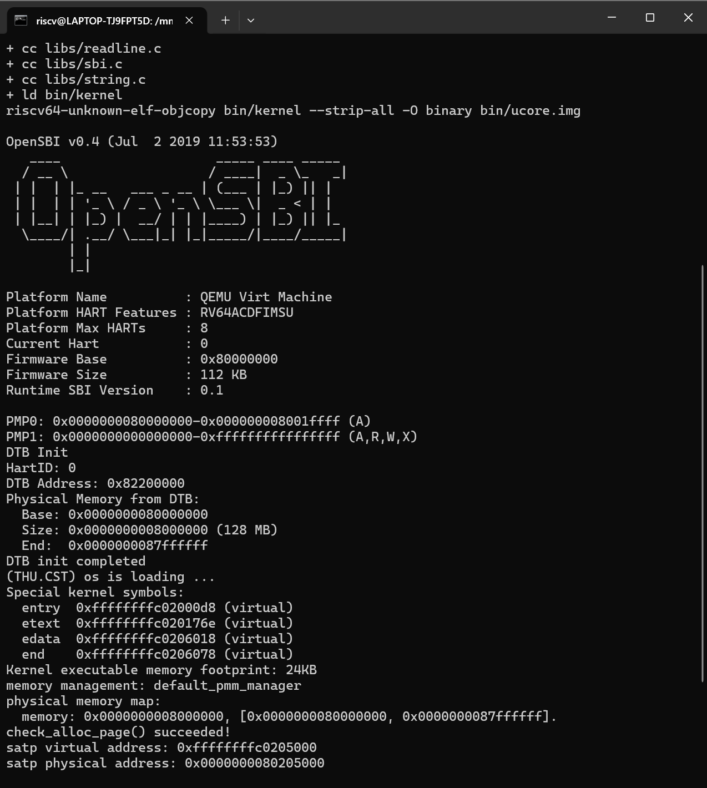
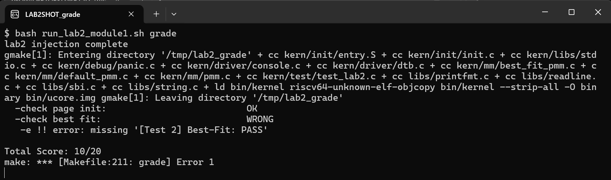

# 操作系统实验报告

## 实验基本信息

| 项目 | 内容 |
|------|------|
| **实验名称** | Lab 2: 物理内存和页表 |
| **小组成员** | 2411292-张旭、2412219-王炳環、2411870-董朝阳 |
| **完成日期** | [待补充] |

### 小组分工

**练习如何分工？**

| 成员 | 负责的练习/模块 |
|------|----------------|
| 2411870-董朝阳 | 功能模块一：物理内存初始化（`page_init()`）；Challenge：硬件可用物理内存范围的获取方法 |
| 2411292-张旭 | [待补充] |
| 2412219-王炳環 | [待补充] |

**实验报告如何分工？**

[待补充]

---

## 一、实验目的

[待补充]

---

## 二、实验环境

### 2.1 使用的 AI 工具

| 成员 | AI 编程工具 | 底层模型 | 备注 |
|------|------------|---------|------|
| 2411870-董朝阳 | Claude Code（桌面应用 Code 标签页） | Claude Opus 5.5 | 用于功能模块一的提示词设计、代码实现、调试与报告撰写 |
| 2411292-张旭 | [待补充] | [待补充] | |
| 2412219-王炳環 | [待补充] | [待补充] | |

**说明：**
- **AI 编程工具**：指具体使用的终端工具、编辑器插件、桌面应用或浏览器界面
- **底层模型**：指该工具使用的大语言模型及版本

### 2.2 关于 QEMU 版本（董朝阳的环境）

本实验的内核在 `entry.S` 中先写 `satp` 开启 Sv39 分页，再跳转到高地址的 `kern_init`。在 lab1 使用的 apt 版 **QEMU 8.2.2** 上，内核**一行输出都没有**（排查过程见功能模块一第一次迭代的问题 2），因此本实验改用与指导书一致的 **QEMU 4.1.1**：

- 从 qemu.org 下载 4.1.1 源码，仅编译 `riscv64-softmmu` 目标，安装到 `/opt/qemu-4.1.1`，与 apt 版 8.2.2 并存。
- 在 Ubuntu 24.04 的 GCC 13 下编译需加 `--disable-werror`；编译过程中只有 Python 3.12 对旧版 `tracetool` 脚本的语法警告，不影响结果。
- 4.1.1 自带 OpenSBI v0.4（`fw_jump` 形态），框架 `Makefile` 原有的 `-device loader` 装载方式可以直接使用，**不需要修改任何框架文件**，运行时只需覆盖 `QEMU` 变量：

```bash
make qemu  QEMU=/opt/qemu-4.1.1/bin/qemu-system-riscv64
make grade QEMU=/opt/qemu-4.1.1/bin/qemu-system-riscv64
```

---

## 三、实验整体逻辑分析

[待补充]

---

## 四、实验内容与实现

### 功能模块一：物理内存初始化功能

**负责人：** 2411870-董朝阳

#### 模块功能描述

**需要实现/修改的函数：**

```c
static void page_init(void);   // kern/mm/pmm.c，由 pmm_init() 在 init_pmm_manager() 之后调用
```

**功能说明：**

`page_init()` 是"设备树探测结果"与"物理页分配器"之间的桥梁。`dtb_init()` 只把 DRAM 的起点和大小存进了两个静态变量，分配器则只认 `struct Page` 描述符；`page_init()` 负责把前者转换成后者：

1. **读取并校验探测结果。** 通过 `get_memory_base()` / `get_memory_size()` 取得设备树报告的内存范围，起点或大小为 0、或起点加大小发生溢出时直接 `panic`。
2. **确定可管理上界。** 取设备树报告的内存末端与内核可管理上界（`KERNTOP` 对应的物理地址 `0x88000000`）中较小者作为 `maxpa`，`npage = maxpa / PGSIZE`。注意 `npage` 是物理页号的**上界**而不是页数，合法页号是 `[nbase, npage)`，其中 `nbase = 0x80000`。
3. **放置描述符数组。** `pages` 放在内核镜像结尾 `end` 之后、向上按页对齐的位置，共 `npage - nbase` 项，第 `i` 项描述物理页号 `nbase + i`。
4. **全部先标为保留。** 描述符数组位于 BSS 之外，`kern_init()` 中的 `memset` 不会清零它，所以逐项把 `ref`、`flags`、`property` 置为确定值后再设 `PG_reserved`。
5. **登记空闲区。** 描述符数组末端（换算为物理地址）向上按页对齐得到空闲区起点，`maxpa` 向下按页对齐得到终点，二者之间若有完整页，就用 `pa2page()` 换成描述符，调用一次 `init_memmap()` 交给当前的 `pmm_manager`。

初始化后的物理内存布局（默认 128 MiB，实测值）：

```text
物理地址                     内容                              状态
0x80000000 ─ 0x80200000     OpenSBI                           Reserved
0x80200000 ─ 0x80206078     内核镜像（end = 0xffffffffc0206078）  Reserved
0x80206078 ─ 0x80207000     对齐空隙                            Reserved
0x80207000 ─ 0x80347000     Page 描述符数组（32768 项 × 40 B）     Reserved
0x80347000 ─ 0x88000000     空闲页（31929 页）                   交给 pmm_manager
```

本函数实现中需要特别注意**四种量不能混用**：虚拟地址（`end`、`pages`）、物理地址（`maxpa`、`freemem`）、物理页号（`npage`、`nbase`）、Page 描述符地址（`pa2page()` 的返回值）。例如 `memlayout.h` 中的 `KERNTOP` 是虚拟地址，必须先减去 `va_pa_offset` 才能与设备树给出的物理地址比较；`pages` 数组末端是虚拟地址，必须经 `PADDR` 换成物理地址才能算出空闲区起点。

**与其他模块的关系：** 上游是 `dtb_init()`（提供内存范围）和 `init_pmm_manager()`（选定分配器）；下游是 `pmm_manager->init_memmap()`。`default_init_memmap()` 会对传入的每一页 `assert(PageReserved(p))`，这正是第 4 步必须先全部标为保留的原因。功能模块二实现的 Best-Fit 分配器同样从这里接收初始空闲区。

#### 最终提示词

以下是最终用于实现本模块的提示词，按指导书 lab0.5 的四段式框架编写：

````markdown
[PROMPT]
**任务**：修改文件 `kern/mm/pmm.c`，在 `//lab2 function1 YOUR CODE` 标记处实现 `page_init()`，完成物理内存探测与 Page 描述符初始化：根据设备树探测到的物理内存范围建立 Page 描述符数组，把除 OpenSBI、内核镜像和描述符数组之外的完整空闲页交给当前的 pmm_manager 管理。

**操作要求**：你必须在项目中修改实际文件，而不是仅展示代码。保留文件中的现有代码和 `lab2` 注释，把标记中的 `YOUR CODE` 替换为学号 `2411870`。只修改 `kern/mm/pmm.c`；不要修改 `dtb.c`、`pmm.h`、`memlayout.h`、`default_pmm.c`、`tools/` 下的测试文件，也不要切换 `init_pmm_manager()` 中的物理内存管理器。

**输出要求**：直接进行文件操作，使用下面 [RELY]、[GUARANTEE]、[SPECIFICATION] 中的信息，以工程真实代码为准，不要引入无关功能。完成后说明改动了哪些代码。

[RELY]
// 内存布局（kern/mm/memlayout.h、kern/mm/mmu.h、libs/riscv.h）
#define KERNBASE               0xFFFFFFFFC0200000
#define KMEMSIZE               0x7E00000               // 内核可管理的最大物理内存
#define KERNTOP                (KERNBASE + KMEMSIZE)   // 可管理上界对应的虚拟地址
#define PHYSICAL_MEMORY_OFFSET 0xFFFFFFFF40000000      // 虚拟地址 = 物理地址 + 该偏移
#define DRAM_BASE              0x80000000
#define PGSIZE                 4096
#define PGSHIFT                12
#define PPN(la)                (((uintptr_t)(la)) >> PGSHIFT)
// entry.S 的启动页表把 [0xFFFFFFFFC0000000, +1GiB) 映射到物理 [0x80000000, +1GiB)

// libs/defs.h
#define ROUNDDOWN(a, n)  // 向下对齐到 n 的倍数，结果类型与 a 相同
#define ROUNDUP(a, n)    // 向上对齐到 n 的倍数，结果类型与 a 相同

// 数据结构（memlayout.h）
struct Page {
    int ref;                 // 引用计数
    uint64_t flags;          // 状态位
    unsigned int property;   // 空闲块大小（仅块首页有效）
    list_entry_t page_link;  // 空闲链表节点
};
SetPageReserved(page) / ClearPageReserved(page) / PageReserved(page)   // PG_reserved 位
SetPageProperty(page) / ClearPageProperty(page) / PageProperty(page)   // PG_property 位

// 全局变量（kern/mm/pmm.c）
struct Page *pages;           // Page 描述符数组的【虚拟地址】，pages[i] 描述物理页号 nbase+i
size_t npage;                 // 可管理物理页号的【上界】（不是页数），合法页号范围 [nbase, npage)
const size_t nbase = DRAM_BASE / PGSIZE;
uint64_t va_pa_offset;        // 虚拟地址与物理地址之差，PADDR 依赖它

// 可用函数
uint64_t get_memory_base(void);  // 设备树报告的 DRAM 起始物理地址，未探测到时为 0
uint64_t get_memory_size(void);  // 设备树报告的 DRAM 大小（字节），未探测到时为 0
static void init_memmap(struct Page *base, size_t n);  // 转调 pmm_manager->init_memmap；
                                                       // default 实现会 assert 这 n 个页都处于 Reserved 状态
static inline struct Page *pa2page(uintptr_t pa);      // 物理地址 → 描述符，PPN(pa) >= npage 时 panic
static inline uintptr_t page2pa(struct Page *page);
#define PADDR(kva)                                     // 内核虚拟地址 → 物理地址（kva 必须 >= KERNBASE）
void panic(const char *fmt, ...);
int cprintf(const char *fmt, ...);
extern char end[];                                     // 链接脚本定义：内核镜像结尾的【虚拟地址】

[GUARANTEE]
必须实现的接口：
```c
static void page_init(void);   // 由 pmm_init() 在 init_pmm_manager() 之后调用
```
你可以根据需要添加：
- 辅助函数（必须为 static）
- 内部使用的宏定义

[SPECIFICATION]
## page_init
**Pre-Condition**:
- 分页已由 entry.S 开启，内核运行在高地址虚拟空间；`dtb_init()` 已执行；`init_pmm_manager()` 已选好并初始化了管理器。
- `pages`、`npage`、`va_pa_offset` 尚未设置。

**Post-Condition**:
- `va_pa_offset` 等于虚实映射偏移；`npage` 等于可管理物理内存末端的页号；`pages` 指向内核 `end` 之后、按页对齐的位置。
- 描述符数组覆盖物理页号 `[nbase, npage)`，每个描述符都已初始化；不进入空闲区的页面（OpenSBI、内核镜像、描述符数组本身、不足一页的尾部）保持 Reserved。
- 描述符数组之后的完整页面全部登记到当前 pmm_manager，空闲页数等于这段区间的页数。
- 输出探测到的物理内存范围，格式为：
  `physical memory map:` 换行，`  memory: 0x<大小16位十六进制>, [0x<起始16位>, 0x<结束-1 的16位>].`

  **Case 1（正常）**：
  - 设备树给出了有效的内存范围，且描述符数组之后至少还有一个完整页：按上述布局建立描述符，并调用一次 `init_memmap()` 注册这段连续的空闲页。

  **Case 2（设备树信息无效）**：
  - 起始地址或大小为 0、范围溢出、或可管理的末端不高于 DRAM 起点：调用 `panic()` 终止初始化，不修改其他全局状态。

  **Case 3（内存不足以放下描述符数组）**：
  - 描述符数组的末端超出可管理的物理内存末端：调用 `panic()`，不得越界写入描述符。

  **Case 4（没有剩余完整页）**：
  - 描述符数组之后按页对齐的起点不小于按页对齐的末端：不调用 `init_memmap()`，但其余初始化照常完成。

**Requirements**:
- 严格区分虚拟地址、物理地址、物理页号、Page 描述符地址四种量，不得混用；比较或运算前先统一到同一种。
- 可管理上界取设备树报告的内存末端与内核可管理上界（`KERNTOP` 对应的物理地址）中较小者。
- 描述符数组所在内存不在 BSS 中，内容未被清零，初始化时必须把每个描述符的所有字段显式置为确定值，再标记为 Reserved。
````

#### 实现迭代过程

本模块的实现经历了 **1** 次迭代：提示词一次生成的代码即满足全部规格，测试中遇到的两个问题都来自**代码之外**（框架依赖与模拟器版本），没有修改提示词或 `page_init()` 的代码。

> 说明：本模块由 Claude Code 在同一会话中完成"阅读指导书与框架代码 → 编写四段式提示词 → 按提示词实现 → 编译测试 → 排查问题"的全过程，组员与 AI 的完整对话见 `prompt.md`。

---

##### 第一次迭代

**目的：** 按上面的提示词在 `kern/mm/pmm.c` 的 `//lab2 function1 YOUR CODE` 处实现 `page_init()`。

**生成结果：** 生成的 `page_init()` 共约 50 行，结构与 [SPECIFICATION] 的 Case 一一对应：开头校验设备树信息（Case 2），中间检查描述符数组是否放得下（Case 3），结尾仅在存在完整页时调用 `init_memmap()`（Case 4）。

**遇到的问题：**

- **问题 1：整个工程编译失败，报错不在 `pmm.c`。**

  ```text
  kern/mm/best_fit_pmm.c:95:34: error: 'nr_free' undeclared (first use in this function)
  ```

  原因：框架的 `best_fit_pmm.c` 只提供了 `basic_check()` 和 `best_fit_check()` 两个测试函数，它们引用的 `free_list`、`nr_free` 以及 `best_fit_pmm_manager` 都要由功能模块二来定义。也就是说，**在模块二完成之前，lab2 无法完整编译**，这不是本模块代码的问题。

- **问题 2：编译通过后，`make qemu` 只打印 OpenSBI 横幅，内核一行输出都没有。**

  连 `pmm_init()` 之前的 `DTB Init` 都没有出现，说明问题发生在 `page_init()` 之前。排查过程：

  1. 用 GDB 在 `0x80200000` 设断点后单步，发现执行约 20 条指令后 PC 又回到了 `0x80200000`，而此时 `satp` 已被写为 `0x8000000000080205`，`stvec` 为 `0x80200000`——内核在入口处反复陷入。
  2. 开启分页后 GDB 无法继续单步（它读内存也要经过页表），于是改用 QEMU 的中断日志 `-d int` 记录每一次陷入：

     ```text
     cause:000000000000000c, epc:0x0000000080200038, tval:0x0000000080200038, desc=exec_page_fault
     cause:000000000000000c, epc:0x0000000080200000, tval:0x0000000080200000, desc=exec_page_fault
     ...（同一行重复约 263 万次）
     ```

  3. 结论：`entry.S` 在物理地址 `0x80200034` 处执行 `csrw satp` 后，下一条指令仍按低地址 `0x80200038` 取指，但启动页表只把高地址 `0xffffffffc0000000` 映射到了 `0x80000000`，低地址没有映射，于是触发**取指缺页**；陷入入口 `stvec` 又恰好是 `0x80200000`，同样没有映射，形成死循环。旧版 QEMU 会把 `csrw satp` 之后已经翻译好的几条指令继续执行完，恰好跳到高地址，所以这段代码在 QEMU 4.1 上能工作；QEMU 8.2 在写 `satp` 后立即按新页表取指，问题就暴露了。

**问题解决策略：**

- 针对问题 1：不修改模块二负责的 `best_fit_pmm.c`，而是把源码复制到 WSL 的临时目录，在副本中补一个仅含 `free_area`、`free_list`、`nr_free` 和空 `best_fit_pmm_manager` 的最小占位，使工程能编译；内核仍使用默认的 First-Fit 管理器验证本模块。占位代码只存在于临时副本中。
- 针对问题 2：两种方案中选择**更换模拟器**而不是修改框架的 `entry.S`。另一种方案是在启动页表中补一条 `0x80000000` 的恒等映射，但那需要改动框架文件。安装 QEMU 4.1.1 后，内核正常启动（见 2.2 节）。
- 两个问题都与提示词无关，因此提示词和生成的代码都未修改。

**最终结果：**

经过 1 次迭代，该模块最终：

- ✅ 编译通过（在补充模块二占位的临时副本中）
- ✅ `make qemu` 正确输出探测到的物理内存范围，First-Fit 的 `check_alloc_page()` 通过
- ✅ `make grade` 中本模块对应的 `check page init` 通过（`[Test 1] Page Init: PASS`）
- ✅ 用 GDB 读出 `npage`、`pages`、空闲页数等全局状态，与手算的内存布局一致
- ✅ 改变内存大小（`-m 64M`、`-m 256M`）后仍能正确初始化；256 MiB 时可管理上界被截断到 `0x88000000`

**关键改进点总结：**

1. **在 [RELY] 中写清每个量是什么"类型"的地址。** `pages` 标注为"虚拟地址"，`npage` 标注为"物理页号的上界（不是页数）"，`end` 标注为"虚拟地址"。这是本模块最容易出错的地方：经典 ucore 代码中就有 `if (maxpa > KERNTOP)` 这种拿物理地址和虚拟地址直接比较的写法（条件永远不成立），把类型写进上下文后，生成的代码先把 `KERNTOP` 减去 `va_pa_offset` 再比较。
2. **把下游函数的隐含约束放进 [RELY]。** 注明了 `default_init_memmap()` 会断言传入的页都处于 Reserved 状态，所以生成的代码先把全部描述符标为保留，再登记空闲区。
3. **在 Requirements 中指出描述符数组不在 BSS 中。** 因此生成的代码逐项把 `ref`、`flags`、`property` 置为确定值，而不是只调用 `SetPageReserved()`（它只做按位或，会保留内存中原有的随机位）。
4. **把测试会检查的布局要求写进 Post-Condition。** 课程测试要求 `pages` 按页对齐并位于 `end` 之后，经典 ucore 写法 `pages = ROUNDUP(end, PGSIZE)` 恰好满足；把它写成规格，避免生成"紧贴 `end` 不对齐"的版本。

---

### Challenge：硬件的可用物理内存范围的获取方法（思考题）

**负责人：** 2411870-董朝阳

> **题目：** 如果 OS 无法提前知道当前硬件的可用物理内存范围，请问你有何办法让 OS 获取可用物理内存范围？

本实验中内核之所以"知道"内存范围，是因为 OpenSBI 把设备树（DTB）的物理地址放在 `a1` 寄存器里交给内核，`dtb_init()` 再从中解析出 `memory` 节点的 `reg` 属性。如果没有这样一份现成的描述，可以按"由外到内、由可靠到兜底"的顺序考虑以下几类办法。

#### 1. 向更底层的软件索要：固件 / 引导程序报告

内存控制器是在加电初期由固件初始化的，固件天然掌握内存布局，最可靠的办法是让它把结果交给 OS。不同平台的接口不同，但思路一致：

| 平台 / 规范 | 获取方式 | 得到的信息 |
|---|---|---|
| RISC-V、ARM（本实验） | 固件把设备树地址放入约定寄存器（RISC-V 为 `a1`） | `memory` 节点的基址与大小，`reserved-memory` 节点给出保留区 |
| x86 传统 BIOS | 实模式下调用 `INT 15h, EAX=E820h` 反复查询 | 一张地址区间表，每项标明可用 / 保留 / ACPI 可回收等类型 |
| UEFI | 调用启动服务 `GetMemoryMap()` | 带类型的内存描述符数组，OS 退出启动服务前必须取得 |
| Multiboot 引导器（如 GRUB） | 引导器把信息结构地址放入寄存器 | `mmap` 字段即整理过的内存表 |
| ACPI | 解析 SRAT 等表 | NUMA 节点与内存区间的对应关系 |

这些接口返回的往往是**一张表**而不是一个区间：可用内存中间可能夹着固件保留区、MMIO 窗口和空洞。因此 OS 拿到后不能简单取最小、最大地址，而要逐项筛选出"可用"类型的区间，再扣掉自身内核镜像所占的部分——这正是本实验 `page_init()` 在单区间情况下做的事情的一般化。

#### 2. 自己动手探测：试探性读写

如果连固件也不提供信息，OS 只能从一个确定存在的起点（例如 RISC-V 的 `DRAM_BASE = 0x80000000`，内核自己就在这里运行）出发，向高地址逐块探测：

1. 先设置好异常处理入口（`stvec`），对候选地址写入一个特征值，再读回比较。
2. 若读回值一致，说明该处有可读写的内存，继续下一块；若访问触发访存异常（RISC-V 的 load/store access fault），或者读回值不一致，就认为到达了内存边界。
3. 探测步长可以先大后小，例如先按 1 MiB 跳跃找到大致边界，再按页细化。

这种做法实现简单，但有不少陷阱，必须一并处理：

- **地址回绕（aliasing）**：内存控制器可能不解码高位地址，写 `base + 256MiB` 实际写到了 `base`。应在每个探测点写入**互不相同**的特征值，并回头检查低地址的值是否被覆盖。
- **误碰外设**：向 MMIO 区域写入可能触发设备动作，读写本身就有副作用。所以探测必须限定在已知的 DRAM 地址窗口内，而不能扫描整个物理地址空间。
- **破坏已有数据**：被探测的位置可能存放着固件、DTB 或内核自身的数据，写入前要先保存原值，比较后再恢复；内核镜像所在区间直接跳过。
- **缓存干扰**：写入后立即读回可能命中缓存而非真正访问内存，需要绕过缓存或在读回前刷新。
- **权限限制**：在 S 态运行时，物理地址访问还受 M 态固件设置的 PMP 约束，被 PMP 拒绝的访问同样表现为访存异常，需要和"没有内存"区分开。

#### 3. 兜底：由使用者显式指定

在嵌入式等硬件固定的场景，可以把内存范围作为编译期常量写入内核（本实验 `memlayout.h` 中的 `PHYSICAL_MEMORY_END` 就是这种思路的痕迹），或者通过启动参数传入（如 Linux 的 `mem=` 参数）。这种办法不需要任何探测，但完全依赖配置的正确性，配置错误时 OS 无从察觉。

#### 小结

实际系统一般优先采用第 1 类方法，把第 2 类作为没有固件信息时的补救，把第 3 类作为调试或特殊硬件的覆盖手段。三者的可靠性依次降低，但对平台的依赖也依次降低。本实验采用的设备树方式属于第 1 类：内核只负责解析和使用，探测工作由 OpenSBI 和 QEMU 完成。

---

## 五、测试与验证

### 5.1 功能模块一

测试在 QEMU 4.1.1 下进行；由于功能模块二尚未完成，测试使用的是补充了模块二最小占位的临时副本（见功能模块一问题 1）。

**`make qemu` 的关键输出：**

```text
OpenSBI v0.4 (Jul  2 2019 11:53:53)
...
DTB Init
HartID: 0
DTB Address: 0x82200000
Physical Memory from DTB:
  Base: 0x0000000080000000
  Size: 0x0000000008000000 (128 MB)
  End:  0x0000000087ffffff
DTB init completed
(THU.CST) os is loading ...
Special kernel symbols:
  entry  0xffffffffc02000d8 (virtual)
  etext  0xffffffffc020176e (virtual)
  edata  0xffffffffc0206018 (virtual)
  end    0xffffffffc0206078 (virtual)
Kernel executable memory footprint: 24KB
memory management: default_pmm_manager
physical memory map:
  memory: 0x0000000008000000, [0x0000000080000000, 0x0000000087ffffff].
check_alloc_page() succeeded!
satp virtual address: 0xffffffffc0205000
satp physical address: 0x0000000080205000
```

**`make grade` 结果：**

```text
  -check page init:                          OK
  -check best fit:                           WRONG
   -e !! error: missing '[Test 2] Best-Fit: PASS'

Total Score: 10/20
```

`check best fit` 检查的是功能模块二是否把管理器切换为 `best_fit_pmm_manager`，在模块二完成前失败属于预期。

**GDB 核对初始化后的全局状态**（断点设在第一次调用 `default_alloc_pages` 处，此时 `page_init()` 已执行完毕）：

| 表达式 | 实测值 | 预期 |
|---|---|---|
| `npage` | `0x88000` | `0x88000000 / 4096` |
| `npage - nbase` | `0x8000` | 128 MiB 共 32768 页 |
| `pages` | `0xffffffffc0207000` | `end = 0xffffffffc0206078` 向上按页对齐 |
| `va_pa_offset` | `0xffffffff40000000` | `PHYSICAL_MEMORY_OFFSET` |
| 描述符数组末端（物理） | `0x80347000` | `0x80207000 + 32768 × 40` |
| `free_area.nr_free` | `31929` | `(0x88000000 − 0x80347000) / 4096` |

**不同内存大小：**

| QEMU 参数 | 探测到的范围 | 结果 |
|---|---|---|
| `-m 64M` | `[0x80000000, 0x83ffffff]` | `check_alloc_page() succeeded!` |
| 默认 128M | `[0x80000000, 0x87ffffff]` | `check_alloc_page() succeeded!` |
| `-m 256M` | `[0x80000000, 0x8fffffff]` | `check_alloc_page() succeeded!`（上界截断到 `0x88000000`） |

**测试截图：**



*图 1　`make qemu` 运行结果：OpenSBI v0.4（QEMU 4.1.1）启动后，内核输出设备树探测到的 128 MiB 物理内存，`page_init()` 打印出 `physical memory map`，First-Fit 的 `check_alloc_page()` 通过。*



*图 2　`make grade` 评分结果：本模块对应的 `check page init` 为 OK；`check best fit` 属于功能模块二，在其完成前失败属于预期。*

> 两张截图均在模块二完成前，用 `run_lab2_module1.sh` 生成的临时副本运行（副本中给 `best_fit_pmm.c` 补了最小占位，见功能模块一问题 1）。

---

## 六、实验总结与收获

[待补充]
