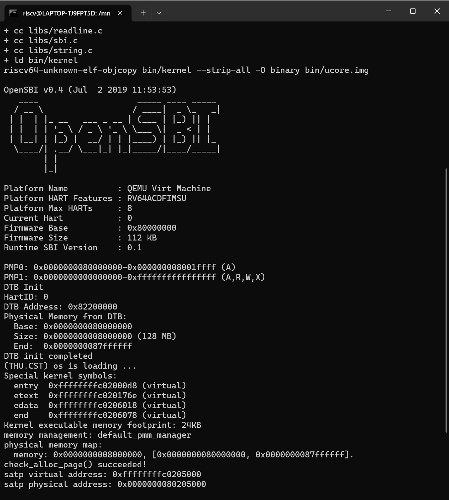
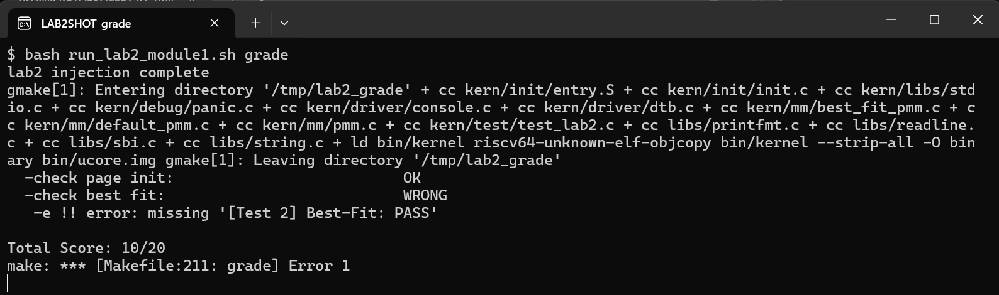
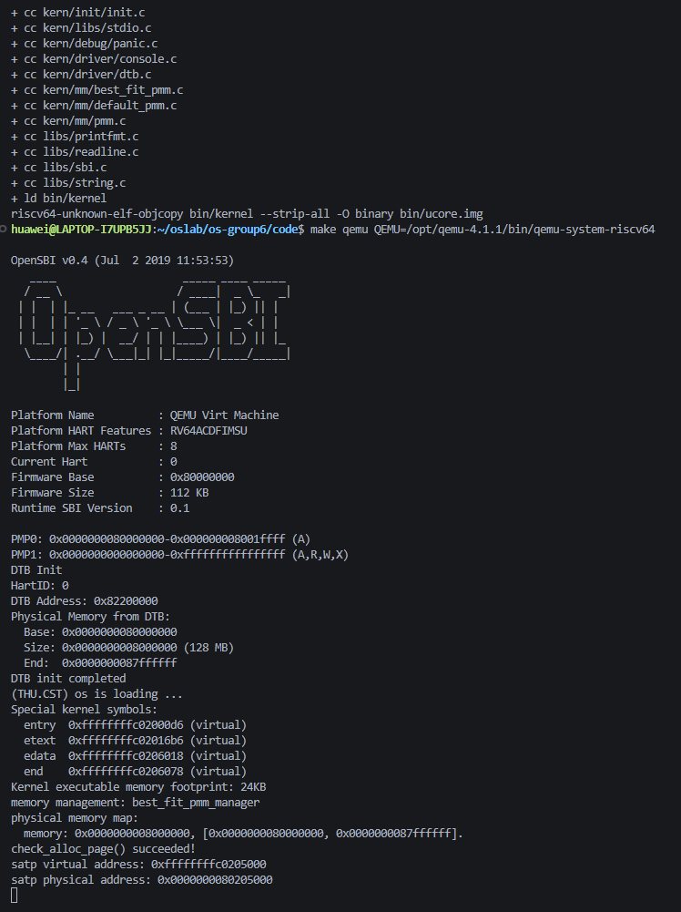
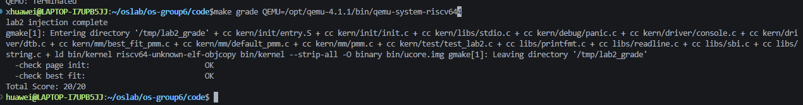
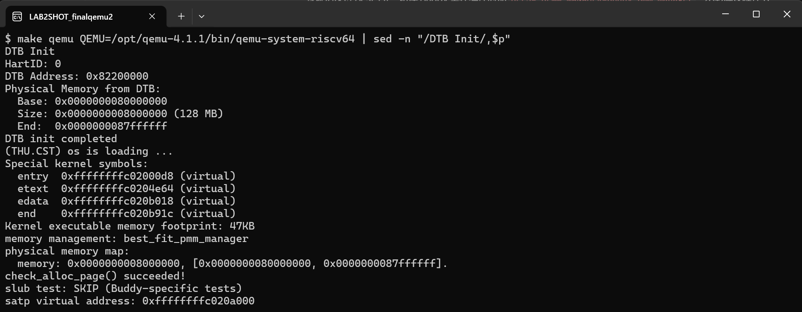
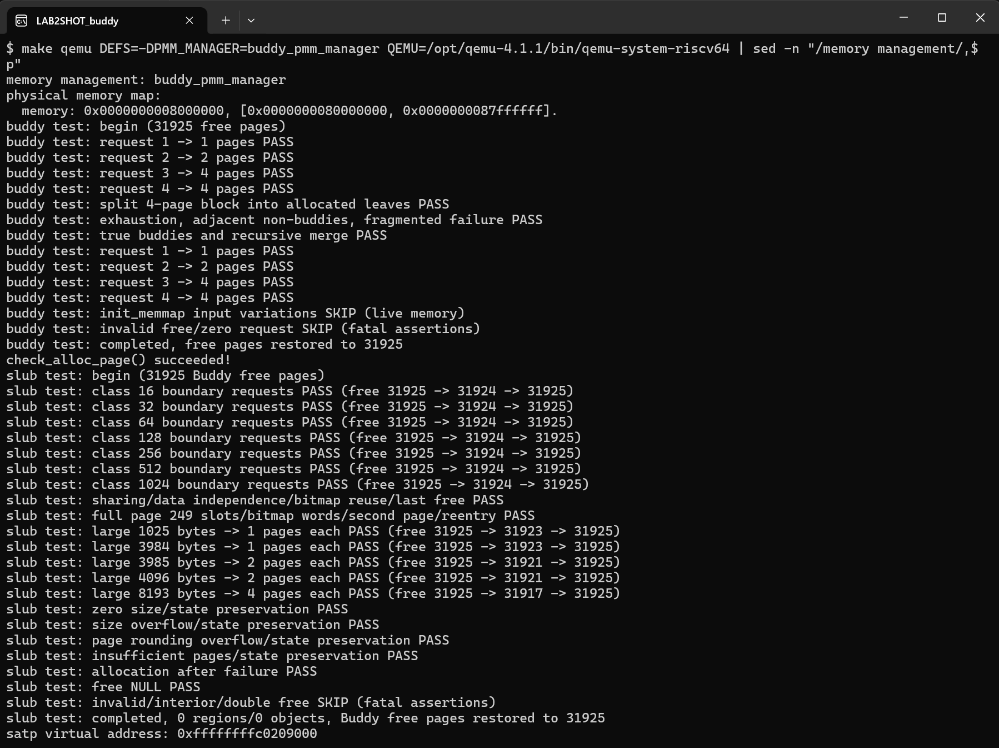
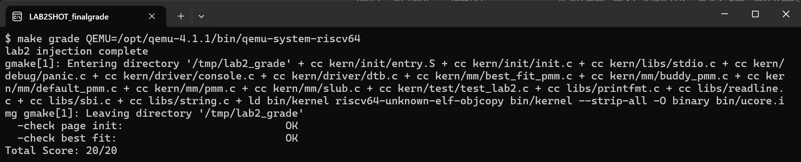

# 操作系统实验报告

<!-- TOC -->
## 目录

- [实验基本信息](#实验基本信息)
  - [小组分工](#小组分工)
- [一、实验目的](#一实验目的)
- [二、实验环境](#二实验环境)
  - [2.1 使用的 AI 工具](#21-使用的-ai-工具)
  - [2.2 软硬件环境](#22-软硬件环境)
  - [2.3 关于 QEMU 版本](#23-关于-qemu-版本)
- [三、实验整体逻辑分析](#三实验整体逻辑分析)
  - [3.1 本章节的逻辑主线](#31-本章节的逻辑主线)
  - [3.2 功能的逐步实现](#32-功能的逐步实现)
- [四、实验内容与实现](#四实验内容与实现)
  - [功能模块一 · 任务一：物理内存探测与页描述符初始化](#功能模块一--任务一物理内存探测与页描述符初始化)
    - [模块功能描述](#模块功能描述)
    - [最终提示词](#最终提示词)
    - [实现迭代过程](#实现迭代过程)
    - [验证记录（模块一完成时）](#验证记录模块一完成时)
  - [功能模块一 · 扩展 Challenge：硬件的可用物理内存范围的获取方法（思考题）](#功能模块一--扩展-challenge硬件的可用物理内存范围的获取方法思考题)
    - [1. 向更底层的软件索要：固件 / 引导程序报告](#1-向更底层的软件索要固件--引导程序报告)
    - [2. 自己动手探测：试探性读写](#2-自己动手探测试探性读写)
    - [3. 兜底：由使用者显式指定](#3-兜底由使用者显式指定)
    - [小结](#小结)
  - [功能模块二 · 任务一：理解 First-Fit 连续物理内存分配算法（思考题）](#功能模块二--任务一理解-first-fit-连续物理内存分配算法思考题)
    - [模块功能描述](#模块功能描述-1)
    - [数据结构与状态约定](#数据结构与状态约定)
    - [核心函数分析](#核心函数分析)
    - [算法示例与改进空间](#算法示例与改进空间)
    - [使用的提示词](#使用的提示词)
  - [功能模块二 · 任务二：实现 Best-Fit 连续物理内存分配算法](#功能模块二--任务二实现-best-fit-连续物理内存分配算法)
    - [模块功能描述](#模块功能描述-2)
    - [接口规格（spec）](#接口规格spec)
    - [实现原理](#实现原理)
    - [最终提示词](#最终提示词-1)
    - [实现迭代过程](#实现迭代过程-1)
    - [Best-Fit 的进一步改进空间](#best-fit-的进一步改进空间)
    - [验证记录（任务二完成时）](#验证记录任务二完成时)
  - [功能模块二 · 任务三：Buddy System](#功能模块二--任务三buddy-system)
    - [模块功能描述](#模块功能描述-3)
    - [最终提示词（一）：Buddy System 实现与内核接入](#最终提示词一buddy-system-实现与内核接入)
    - [最终提示词（二）：Buddy System 专项测试](#最终提示词二buddy-system-专项测试)
    - [实现迭代过程](#实现迭代过程-2)
    - [测试覆盖范围及其有效性](#测试覆盖范围及其有效性)
  - [功能模块二 · 扩展 Challenge：简化 SLUB 分配算法](#功能模块二--扩展-challenge简化-slub-分配算法)
    - [模块功能描述](#模块功能描述-4)
    - [最终提示词（一）：SLUB 实现与接入](#最终提示词一slub-实现与接入)
    - [最终提示词（二）：SLUB 专项测试](#最终提示词二slub-专项测试)
    - [实现迭代过程](#实现迭代过程-3)
  - [分支任务：GDB 调试 QEMU 页表查询过程](#分支任务gdb-调试-qemu-页表查询过程)
    - [1. 实验目的与要求](#1-实验目的与要求)
    - [2. 实验环境与调试方法](#2-实验环境与调试方法)
    - [3. TLB 查询与地址翻译的实际调用路径](#3-tlb-查询与地址翻译的实际调用路径)
    - [4. `get_physical_address()` 页表遍历原理及关键分支](#4-get_physical_address-页表遍历原理及关键分支)
    - [5. 实测 Sv39 高虚拟地址到物理地址的完整推导](#5-实测-sv39-高虚拟地址到物理地址的完整推导)
    - [6. 分页开启前后与软件、硬件 TLB 对比](#6-分页开启前后与软件硬件-tlb-对比)
    - [7. 调试问题及大模型辅助分析过程](#7-调试问题及大模型辅助分析过程)
    - [8. 实验结果](#8-实验结果)
- [五、测试与验证](#五测试与验证)
  - [5.1 编译](#51-编译)
  - [5.2 默认模式（Best-Fit）运行](#52-默认模式best-fit运行)
  - [5.3 Buddy 模式运行（Buddy 与 SLUB 专项测试）](#53-buddy-模式运行buddy-与-slub-专项测试)
  - [5.4 课程评分](#54-课程评分)
  - [5.5 验证汇总](#55-验证汇总)
- [六、实验总结与收获](#六实验总结与收获)
  - [6.1 对操作系统的理解](#61-对操作系统的理解)
    - [一、本实验的重要知识点及其与 OS 原理的对应](#一本实验的重要知识点及其与-os-原理的对应)
    - [二、OS 原理中重要、但本实验未覆盖的知识点](#二os-原理中重要但本实验未覆盖的知识点)
  - [6.2 AI 协作开发的经验](#62-ai-协作开发的经验)

<!-- /TOC -->

## 实验基本信息

| 项目 | 内容 |
|------|------|
| **实验名称** | Lab 2: 物理内存和页表 |
| **小组成员** | 2411292-张旭、2412219-王炳環、2411870-董朝阳 |
| **完成日期** | 2026-10-21 |

### 小组分工

**练习如何分工？**

| 成员 | 负责的练习/模块 |
|------|----------------|
| 2411870-董朝阳 | 功能模块一 · 任务一：物理内存探测与页描述符初始化（`page_init()`）；功能模块一 · 扩展 Challenge：硬件可用物理内存范围的获取方法（思考题）；QEMU 4.1.1 环境问题定位 |
| 2412219-王炳環 | 功能模块二 · 任务一：理解 First-Fit（思考题）；功能模块二 · 任务二：实现 Best-Fit 并切换内核管理器 |
| 2411292-张旭 | 功能模块二 · 任务三：Buddy System（实现与专项测试）；功能模块二 · 扩展 Challenge：简化 SLUB 分配算法（实现与专项测试）；分支任务：GDB 调试 QEMU 页表查询过程 |

**实验报告如何分工？**

各模块的「模块功能描述、提示词、实现迭代过程、测试分析」由对应负责人撰写：董朝阳撰写功能模块一及其 Challenge，王炳環撰写功能模块二任务一、二，张旭撰写任务三、SLUB Challenge 与 GDB 分支任务。董朝阳负责统稿：撰写第一、二、三章及第五章，合并第六章，并在统一后的最终代码上重新完成全部编译、运行与评分验证。

代码按模块分支开发后合并到 `lab2`：模块一直接提交；Best-Fit 来自 `lab2-module2`（PR #1）；Buddy 与 SLUB 来自 `lab2-buddy-slub`（PR #2）。

---

## 一、实验目的

本实验的主要目的是：

1. 理解操作系统如何**发现**物理内存：固件（OpenSBI）通过设备树把内存范围交给内核，内核再据此划定自己能够管理的物理页。
2. 理解如何**组织**物理内存：用 `struct Page` 描述符数组记录每个物理页的状态，区分虚拟地址、物理地址、物理页号和描述符地址这四种量。
3. 理解并比较连续物理页的**分配**算法：First-Fit、Best-Fit 与 Buddy System 在选块、拆分、回收合并上的差异，以及它们共享的 `pmm_manager` 接口。
4. 在页级分配器之上实现任意大小对象的分配（SLUB），理解两层内存分配的分工。
5. 借助 GDB 调试 QEMU，观察 Sv39 页表查询和软件 TLB 的真实执行路径，理解页表的建立与使用。
6. 学习按四段式提示词框架设计提示词、借助 AI 生成代码，并通过编译、运行和评分对 AI 产出进行实测验证。

---

## 二、实验环境

### 2.1 使用的 AI 工具

| 成员 | AI 编程工具 | 底层模型 | 备注 |
|------|------------|---------|------|
| 2411870-董朝阳 | Claude Code（桌面应用 Code 标签页） | Claude Opus 5.5 | 用于模块一的提示词设计、代码实现、QEMU 版本问题排查、截图与报告统稿 |
| 2412219-王炳環 | Codex（桌面应用） | GPT-6.1 Sol | 用于 First-Fit 代码理解、Best-Fit 实现与环境配置、测试步骤指导 |
| 2411292-张旭 | Codex CLI（终端 Agent） | GPT-6.1 Sol（Medium） | 用于 Buddy System 与 SLUB 的实现和专项测试，以及 GDB 分支任务的调试分析 |

**说明：**
- **AI 编程工具**：指具体使用的终端工具、编辑器插件、桌面应用或浏览器界面
- **底层模型**：指该工具使用的大语言模型及版本

### 2.2 软硬件环境

三位成员各自搭建环境，**模拟器统一为 QEMU 4.1.1**（原因见 2.3 节），其余工具版本如下：

| 成员 | 宿主环境 | 交叉编译器 | 模拟器 | 调试器 |
|------|---------|-----------|--------|--------|
| 2411870-董朝阳 | Windows 11 + Ubuntu 24.04 WSL2 | riscv64-unknown-elf-gcc 10.2.0（SiFive freedom-tools v2020.12） | QEMU 4.1.1（`/opt/qemu-4.1.1`，内置 OpenSBI v0.4） | riscv64-unknown-elf-gdb 10.1 |
| 2412219-王炳環 | Windows + Ubuntu 26.04.1 LTS WSL2 | riscv64-unknown-elf-gcc 14.2.0 | QEMU 4.1.1（`/opt/qemu-4.1.1`） | gdb-multiarch 17.1（本部分未使用） |
| 2411292-张旭 | Windows + Ubuntu 24.04 WSL2（x86-64） | 未单独记录 | QEMU 4.1.1；GDB 分支任务另行编译带调试信息的 4.1.1 | 宿主 GDB 15.1、riscv64-unknown-elf-gdb 10.1 |

目标平台统一为 RISC-V 64 位、QEMU `virt` 机器、默认 128 MiB 内存。

### 2.3 关于 QEMU 版本

lab1 中两位成员使用的是 apt 安装的 QEMU 8.2.2。本实验的内核在 `entry.S` 中先写 `satp` 开启 Sv39 分页，再跳转到高地址的 `kern_init`；在 QEMU 8.2.2 上内核**一行输出都没有**（排查过程见功能模块一第一次迭代的问题 2），因此全组改用与指导书一致的 **QEMU 4.1.1**：

- 从 qemu.org 下载 4.1.1 源码，仅编译 `riscv64-softmmu` 目标；在较新的 GCC 下编译需加 `--disable-werror`。可以与 apt 版本并存。
- 4.1.1 自带 OpenSBI v0.4（`fw_jump` 形态），框架 `Makefile` 原有的 `-device loader` 装载方式可以直接使用，**不需要修改任何框架文件**，运行时只需覆盖 `QEMU` 变量：

```bash
make qemu  QEMU=/opt/qemu-4.1.1/bin/qemu-system-riscv64
make grade QEMU=/opt/qemu-4.1.1/bin/qemu-system-riscv64
```

---

## 三、实验整体逻辑分析

### 3.1 本章节的逻辑主线

lab1 的内核只能"活着"——能启动、能打印，但对自己脚下有多少内存一无所知。本章围绕**物理内存管理**展开，解决的问题是：**内核如何发现、组织并分配物理内存**，使后续的页表、进程、文件系统等一切功能都能"按页申请内存"。

整条实现链可以概括为：

```text
entry.S：建立启动页表（1 GiB 大页）并开启 Sv39 分页，跳到高地址 kern_init()
    ↓
kern_init()：dtb_init() 解析设备树，得到 DRAM 起点与大小
    ↓
pmm_init()
    ├─ init_pmm_manager()   选定分配策略（First-Fit / Best-Fit / Buddy），初始化其内部结构
    ├─ page_init()          建立 Page 描述符数组，把空闲页交给分配器          ← 功能模块一
    │     └─ init_memmap()  → 当前管理器的 init_memmap()
    ├─ check_alloc_page()   → 当前管理器的 check()（课程测试 / Buddy 专项测试）  ← 功能模块二
    └─ slub_init()          在页级分配器之上建立对象分配层（及 SLUB 专项测试）   ← SLUB Challenge
```

其中有两个关键的"接口"把各部分解耦：

- **`init_memmap(base, n)`** 把"哪些页可用"（模块一的职责）与"怎样分配"（模块二的职责）分开：`page_init()` 只负责交出一段连续空闲页，不关心分配算法；分配器也不关心这些页是怎么探测出来的。
- **`struct pmm_manager`** 是一组函数指针，First-Fit、Best-Fit、Buddy 都实现同一组六个回调，`pmm.c` 只需改一个指针（本组通过编译宏 `PMM_MANAGER` 选择，默认 Best-Fit）就能切换策略——这是"机制与策略分离"的直接体现。

### 3.2 功能的逐步实现

1. **首先实现物理内存初始化（`page_init()`）** → 没有它，分配器手里没有任何一页可分配，所有分配算法都无从验证。它要解决的是"布局"问题：OpenSBI、内核镜像、描述符数组本身都占内存，只有剩下的完整页才能交出去。
2. **接着理解 First-Fit** → 框架已经给出完整的 First-Fit，读懂它的空闲链表组织（按地址排序、只挂块头）、拆分与合并，就掌握了 `pmm_manager` 的状态约定，这是实现其他算法的模板。
3. **然后实现 Best-Fit** → 在完全相同的数据结构上只改变"选哪一块"的策略，体会策略差异对碎片的影响，并把内核切换到 Best-Fit 以通过课程评分。
4. **再实现 Buddy System** → 换一种根本不同的组织方式：块大小限定为 2 的幂、按物理页号对齐，用"伙伴关系"代替"地址相邻"判断能否合并，以更规整的结构换取更快的合并。
5. **最后在页级分配器之上实现 SLUB** → 前面的分配器都以"页"为单位，而内核大量需要的是几十、几百字节的小对象。SLUB 向下通过 `alloc_pages()` 拿整页，向上切成对象槽，形成两层分配结构，因此必须在页级分配器可用之后才能实现。
6. **分支任务用 GDB 观察页表查询** → 前面所有代码都运行在 `entry.S` 建立的分页环境中，这一步从模拟器内部验证"虚拟地址如何经页表变成物理地址"，把本章的"页表"部分落到实处。

---

## 四、实验内容与实现

### 功能模块一 · 任务一：物理内存探测与页描述符初始化

**负责人：** 2411870-董朝阳

#### 模块功能描述

**需要实现/修改的函数：**

```c
static void page_init(void);   // kern/mm/pmm.c，由 pmm_init() 在 init_pmm_manager() 之后调用
```

**功能说明：**

`page_init()` 是"设备树探测结果"与"物理页分配器"之间的桥梁。`dtb_init()` 只把 DRAM 的起点和大小存进了两个静态变量，分配器则只认 `struct Page` 描述符；`page_init()` 负责把前者转换成后者：

1. **读取并校验探测结果。** 通过 `get_memory_base()` / `get_memory_size()` 取得设备树报告的内存范围，起点或大小为 0、或起点加大小发生溢出时直接 `panic`。
2. **确定可管理上界。** 取设备树报告的内存末端与内核可管理上界（`KERNTOP` 对应的物理地址 `0x88000000`）中较小者作为 `maxpa`，`npage = maxpa / PGSIZE`。注意 `npage` 是物理页号的**上界**而不是页数，合法页号是 `[nbase, npage)`，其中 `nbase = 0x80000`。
3. **放置描述符数组。** `pages` 放在内核镜像结尾 `end` 之后、向上按页对齐的位置，共 `npage - nbase` 项，第 `i` 项描述物理页号 `nbase + i`。
4. **全部先标为保留。** 描述符数组位于 BSS 之外，`kern_init()` 中的 `memset` 不会清零它，所以逐项把 `ref`、`flags`、`property` 置为确定值后再设 `PG_reserved`。
5. **登记空闲区。** 描述符数组末端（换算为物理地址）向上按页对齐得到空闲区起点，`maxpa` 向下按页对齐得到终点，二者之间若有完整页，就用 `pa2page()` 换成描述符，调用一次 `init_memmap()` 交给当前的 `pmm_manager`。

初始化后的物理内存布局（默认 128 MiB，实测值）：

```text
物理地址                     内容                              状态
0x80000000 ─ 0x80200000     OpenSBI                           Reserved
0x80200000 ─ 0x80206078     内核镜像（end = 0xffffffffc0206078）  Reserved
0x80206078 ─ 0x80207000     对齐空隙                            Reserved
0x80207000 ─ 0x80347000     Page 描述符数组（32768 项 × 40 B）     Reserved
0x80347000 ─ 0x88000000     空闲页（31929 页）                   交给 pmm_manager
```

本函数实现中需要特别注意**四种量不能混用**：虚拟地址（`end`、`pages`）、物理地址（`maxpa`、`freemem`）、物理页号（`npage`、`nbase`）、Page 描述符地址（`pa2page()` 的返回值）。例如 `memlayout.h` 中的 `KERNTOP` 是虚拟地址，必须先减去 `va_pa_offset` 才能与设备树给出的物理地址比较；`pages` 数组末端是虚拟地址，必须经 `PADDR` 换成物理地址才能算出空闲区起点。

**与其他模块的关系：** 上游是 `dtb_init()`（提供内存范围）和 `init_pmm_manager()`（选定分配器）；下游是 `pmm_manager->init_memmap()`。`default_init_memmap()` 会对传入的每一页 `assert(PageReserved(p))`，这正是第 4 步必须先全部标为保留的原因。功能模块二实现的 Best-Fit 分配器同样从这里接收初始空闲区。

#### 最终提示词

以下是最终用于实现本模块的提示词，按指导书 lab0.5 的四段式框架编写：

````markdown
[PROMPT]
**任务**：修改文件 `kern/mm/pmm.c`，在 `//lab2 function1 YOUR CODE` 标记处实现 `page_init()`，完成物理内存探测与 Page 描述符初始化：根据设备树探测到的物理内存范围建立 Page 描述符数组，把除 OpenSBI、内核镜像和描述符数组之外的完整空闲页交给当前的 pmm_manager 管理。

**操作要求**：你必须在项目中修改实际文件，而不是仅展示代码。保留文件中的现有代码和 `lab2` 注释，把标记中的 `YOUR CODE` 替换为学号 `2411870`。只修改 `kern/mm/pmm.c`；不要修改 `dtb.c`、`pmm.h`、`memlayout.h`、`default_pmm.c`、`tools/` 下的测试文件，也不要切换 `init_pmm_manager()` 中的物理内存管理器。

**输出要求**：直接进行文件操作，使用下面 [RELY]、[GUARANTEE]、[SPECIFICATION] 中的信息，以工程真实代码为准，不要引入无关功能。完成后说明改动了哪些代码。

[RELY]
// 内存布局（kern/mm/memlayout.h、kern/mm/mmu.h、libs/riscv.h）
#define KERNBASE               0xFFFFFFFFC0200000
#define KMEMSIZE               0x7E00000               // 内核可管理的最大物理内存
#define KERNTOP                (KERNBASE + KMEMSIZE)   // 可管理上界对应的虚拟地址
#define PHYSICAL_MEMORY_OFFSET 0xFFFFFFFF40000000      // 虚拟地址 = 物理地址 + 该偏移
#define DRAM_BASE              0x80000000
#define PGSIZE                 4096
#define PGSHIFT                12
#define PPN(la)                (((uintptr_t)(la)) >> PGSHIFT)
// entry.S 的启动页表把 [0xFFFFFFFFC0000000, +1GiB) 映射到物理 [0x80000000, +1GiB)

// libs/defs.h
#define ROUNDDOWN(a, n)  // 向下对齐到 n 的倍数，结果类型与 a 相同
#define ROUNDUP(a, n)    // 向上对齐到 n 的倍数，结果类型与 a 相同

// 数据结构（memlayout.h）
struct Page {
    int ref;                 // 引用计数
    uint64_t flags;          // 状态位
    unsigned int property;   // 空闲块大小（仅块首页有效）
    list_entry_t page_link;  // 空闲链表节点
};
SetPageReserved(page) / ClearPageReserved(page) / PageReserved(page)   // PG_reserved 位
SetPageProperty(page) / ClearPageProperty(page) / PageProperty(page)   // PG_property 位

// 全局变量（kern/mm/pmm.c）
struct Page *pages;           // Page 描述符数组的【虚拟地址】，pages[i] 描述物理页号 nbase+i
size_t npage;                 // 可管理物理页号的【上界】（不是页数），合法页号范围 [nbase, npage)
const size_t nbase = DRAM_BASE / PGSIZE;
uint64_t va_pa_offset;        // 虚拟地址与物理地址之差，PADDR 依赖它

// 可用函数
uint64_t get_memory_base(void);  // 设备树报告的 DRAM 起始物理地址，未探测到时为 0
uint64_t get_memory_size(void);  // 设备树报告的 DRAM 大小（字节），未探测到时为 0
static void init_memmap(struct Page *base, size_t n);  // 转调 pmm_manager->init_memmap；
                                                       // default 实现会 assert 这 n 个页都处于 Reserved 状态
static inline struct Page *pa2page(uintptr_t pa);      // 物理地址 → 描述符，PPN(pa) >= npage 时 panic
static inline uintptr_t page2pa(struct Page *page);
#define PADDR(kva)                                     // 内核虚拟地址 → 物理地址（kva 必须 >= KERNBASE）
void panic(const char *fmt, ...);
int cprintf(const char *fmt, ...);
extern char end[];                                     // 链接脚本定义：内核镜像结尾的【虚拟地址】

[GUARANTEE]
必须实现的接口：
```c
static void page_init(void);   // 由 pmm_init() 在 init_pmm_manager() 之后调用
```
你可以根据需要添加：
- 辅助函数（必须为 static）
- 内部使用的宏定义

[SPECIFICATION]
## page_init
**Pre-Condition**:
- 分页已由 entry.S 开启，内核运行在高地址虚拟空间；`dtb_init()` 已执行；`init_pmm_manager()` 已选好并初始化了管理器。
- `pages`、`npage`、`va_pa_offset` 尚未设置。

**Post-Condition**:
- `va_pa_offset` 等于虚实映射偏移；`npage` 等于可管理物理内存末端的页号；`pages` 指向内核 `end` 之后、按页对齐的位置。
- 描述符数组覆盖物理页号 `[nbase, npage)`，每个描述符都已初始化；不进入空闲区的页面（OpenSBI、内核镜像、描述符数组本身、不足一页的尾部）保持 Reserved。
- 描述符数组之后的完整页面全部登记到当前 pmm_manager，空闲页数等于这段区间的页数。
- 输出探测到的物理内存范围，格式为：
  `physical memory map:` 换行，`  memory: 0x<大小16位十六进制>, [0x<起始16位>, 0x<结束-1 的16位>].`

  **Case 1（正常）**：
  - 设备树给出了有效的内存范围，且描述符数组之后至少还有一个完整页：按上述布局建立描述符，并调用一次 `init_memmap()` 注册这段连续的空闲页。

  **Case 2（设备树信息无效）**：
  - 起始地址或大小为 0、范围溢出、或可管理的末端不高于 DRAM 起点：调用 `panic()` 终止初始化，不修改其他全局状态。

  **Case 3（内存不足以放下描述符数组）**：
  - 描述符数组的末端超出可管理的物理内存末端：调用 `panic()`，不得越界写入描述符。

  **Case 4（没有剩余完整页）**：
  - 描述符数组之后按页对齐的起点不小于按页对齐的末端：不调用 `init_memmap()`，但其余初始化照常完成。

**Requirements**:
- 严格区分虚拟地址、物理地址、物理页号、Page 描述符地址四种量，不得混用；比较或运算前先统一到同一种。
- 可管理上界取设备树报告的内存末端与内核可管理上界（`KERNTOP` 对应的物理地址）中较小者。
- 描述符数组所在内存不在 BSS 中，内容未被清零，初始化时必须把每个描述符的所有字段显式置为确定值，再标记为 Reserved。
````

#### 实现迭代过程

本模块的实现经历了 **1** 次迭代：提示词一次生成的代码即满足全部规格，测试中遇到的两个问题都来自**代码之外**（框架依赖与模拟器版本），没有修改提示词或 `page_init()` 的代码。

> 说明：本模块由 Claude Code 在同一会话中完成"阅读指导书与框架代码 → 编写四段式提示词 → 按提示词实现 → 编译测试 → 排查问题"的全过程，组员与 AI 的完整对话见 `prompt.md`。

---

##### 第一次迭代

**目的：** 按上面的提示词在 `kern/mm/pmm.c` 的 `//lab2 function1 YOUR CODE` 处实现 `page_init()`。

**生成结果：** 生成的 `page_init()` 共约 50 行，结构与 [SPECIFICATION] 的 Case 一一对应：开头校验设备树信息（Case 2），中间检查描述符数组是否放得下（Case 3），结尾仅在存在完整页时调用 `init_memmap()`（Case 4）。

**遇到的问题：**

- **问题 1：整个工程编译失败，报错不在 `pmm.c`。**

  ```text
  kern/mm/best_fit_pmm.c:95:34: error: 'nr_free' undeclared (first use in this function)
  ```

  原因：框架的 `best_fit_pmm.c` 只提供了 `basic_check()` 和 `best_fit_check()` 两个测试函数，它们引用的 `free_list`、`nr_free` 以及 `best_fit_pmm_manager` 都要由功能模块二来定义。也就是说，**在模块二完成之前，lab2 无法完整编译**，这不是本模块代码的问题。

- **问题 2：编译通过后，`make qemu` 只打印 OpenSBI 横幅，内核一行输出都没有。**

  连 `pmm_init()` 之前的 `DTB Init` 都没有出现，说明问题发生在 `page_init()` 之前。排查过程：

  1. 用 GDB 在 `0x80200000` 设断点后单步，发现执行约 20 条指令后 PC 又回到了 `0x80200000`，而此时 `satp` 已被写为 `0x8000000000080205`，`stvec` 为 `0x80200000`——内核在入口处反复陷入。
  2. 开启分页后 GDB 无法继续单步（它读内存也要经过页表），于是改用 QEMU 的中断日志 `-d int` 记录每一次陷入：

     ```text
     cause:000000000000000c, epc:0x0000000080200038, tval:0x0000000080200038, desc=exec_page_fault
     cause:000000000000000c, epc:0x0000000080200000, tval:0x0000000080200000, desc=exec_page_fault
     ...（同一行重复约 263 万次）
     ```

  3. 结论：`entry.S` 在物理地址 `0x80200034` 处执行 `csrw satp` 后，下一条指令仍按低地址 `0x80200038` 取指，但启动页表只把高地址 `0xffffffffc0000000` 映射到了 `0x80000000`，低地址没有映射，于是触发**取指缺页**；陷入入口 `stvec` 又恰好是 `0x80200000`，同样没有映射，形成死循环。旧版 QEMU 会把 `csrw satp` 之后已经翻译好的几条指令继续执行完，恰好跳到高地址，所以这段代码在 QEMU 4.1 上能工作；QEMU 8.2 在写 `satp` 后立即按新页表取指，问题就暴露了。

**问题解决策略：**

- 针对问题 1：不修改模块二负责的 `best_fit_pmm.c`，而是把源码复制到 WSL 的临时目录，在副本中补一个仅含 `free_area`、`free_list`、`nr_free` 和空 `best_fit_pmm_manager` 的最小占位，使工程能编译；内核仍使用默认的 First-Fit 管理器验证本模块。占位代码只存在于临时副本中。
- 针对问题 2：两种方案中选择**更换模拟器**而不是修改框架的 `entry.S`。另一种方案是在启动页表中补一条 `0x80000000` 的恒等映射，但那需要改动框架文件。安装 QEMU 4.1.1 后，内核正常启动（见 2.3 节）。
- 两个问题都与提示词无关，因此提示词和生成的代码都未修改。

**最终结果：**

经过 1 次迭代，该模块最终：

- ✅ 编译通过（在补充模块二占位的临时副本中）
- ✅ `make qemu` 正确输出探测到的物理内存范围，First-Fit 的 `check_alloc_page()` 通过
- ✅ `make grade` 中本模块对应的 `check page init` 通过（`[Test 1] Page Init: PASS`）
- ✅ 用 GDB 读出 `npage`、`pages`、空闲页数等全局状态，与手算的内存布局一致
- ✅ 改变内存大小（`-m 64M`、`-m 256M`）后仍能正确初始化；256 MiB 时可管理上界被截断到 `0x88000000`

**关键改进点总结：**

1. **在 [RELY] 中写清每个量是什么"类型"的地址。** `pages` 标注为"虚拟地址"，`npage` 标注为"物理页号的上界（不是页数）"，`end` 标注为"虚拟地址"。这是本模块最容易出错的地方：经典 ucore 代码中就有 `if (maxpa > KERNTOP)` 这种拿物理地址和虚拟地址直接比较的写法（条件永远不成立），把类型写进上下文后，生成的代码先把 `KERNTOP` 减去 `va_pa_offset` 再比较。
2. **把下游函数的隐含约束放进 [RELY]。** 注明了 `default_init_memmap()` 会断言传入的页都处于 Reserved 状态，所以生成的代码先把全部描述符标为保留，再登记空闲区。
3. **在 Requirements 中指出描述符数组不在 BSS 中。** 因此生成的代码逐项把 `ref`、`flags`、`property` 置为确定值，而不是只调用 `SetPageReserved()`（它只做按位或，会保留内存中原有的随机位）。
4. **把测试会检查的布局要求写进 Post-Condition。** 课程测试要求 `pages` 按页对齐并位于 `end` 之后，经典 ucore 写法 `pages = ROUNDUP(end, PGSIZE)` 恰好满足；把它写成规格，避免生成"紧贴 `end` 不对齐"的版本。

#### 验证记录（模块一完成时）

以下验证完成于 2026-10-14，此时功能模块二尚未完成，测试使用补充了模块二最小占位的临时副本（见问题 1），QEMU 4.1.1。模块二合并后的最终代码已在第五章重新验证（20/20）。

> 注意：下面 GDB 读出的 `pages`、空闲页数等数值对应**当时**的内核镜像（`end = 0xffffffffc0206078`）。Buddy 与 SLUB 合并后内核变大（`end = 0xffffffffc020b91c`），描述符数组随之后移，空闲页数变为 31925，但计算方法完全相同。

**`make qemu` 的关键输出：**

```text
OpenSBI v0.4 (Jul  2 2019 11:53:53)
...
DTB Init
HartID: 0
DTB Address: 0x82200000
Physical Memory from DTB:
  Base: 0x0000000080000000
  Size: 0x0000000008000000 (128 MB)
  End:  0x0000000087ffffff
DTB init completed
(THU.CST) os is loading ...
Special kernel symbols:
  entry  0xffffffffc02000d8 (virtual)
  etext  0xffffffffc020176e (virtual)
  edata  0xffffffffc0206018 (virtual)
  end    0xffffffffc0206078 (virtual)
Kernel executable memory footprint: 24KB
memory management: default_pmm_manager
physical memory map:
  memory: 0x0000000008000000, [0x0000000080000000, 0x0000000087ffffff].
check_alloc_page() succeeded!
satp virtual address: 0xffffffffc0205000
satp physical address: 0x0000000080205000
```

**`make grade` 结果：**

```text
  -check page init:                          OK
  -check best fit:                           WRONG
   -e !! error: missing '[Test 2] Best-Fit: PASS'

Total Score: 10/20
```

`check best fit` 检查的是功能模块二是否把管理器切换为 `best_fit_pmm_manager`，在模块二完成前失败属于预期。

**GDB 核对初始化后的全局状态**（断点设在第一次调用 `default_alloc_pages` 处，此时 `page_init()` 已执行完毕）：

| 表达式 | 实测值 | 预期 |
|---|---|---|
| `npage` | `0x88000` | `0x88000000 / 4096` |
| `npage - nbase` | `0x8000` | 128 MiB 共 32768 页 |
| `pages` | `0xffffffffc0207000` | `end = 0xffffffffc0206078` 向上按页对齐 |
| `va_pa_offset` | `0xffffffff40000000` | `PHYSICAL_MEMORY_OFFSET` |
| 描述符数组末端（物理） | `0x80347000` | `0x80207000 + 32768 × 40` |
| `free_area.nr_free` | `31929` | `(0x88000000 − 0x80347000) / 4096` |

**不同内存大小：**

| QEMU 参数 | 探测到的范围 | 结果 |
|---|---|---|
| `-m 64M` | `[0x80000000, 0x83ffffff]` | `check_alloc_page() succeeded!` |
| 默认 128M | `[0x80000000, 0x87ffffff]` | `check_alloc_page() succeeded!` |
| `-m 256M` | `[0x80000000, 0x8fffffff]` | `check_alloc_page() succeeded!`（上界截断到 `0x88000000`） |



*图 1-1　模块一完成时 `make qemu` 运行结果：OpenSBI v0.4（QEMU 4.1.1）启动后，内核输出设备树探测到的 128 MiB 物理内存，`page_init()` 打印出 `physical memory map`，First-Fit 的 `check_alloc_page()` 通过。*



*图 1-2　模块一完成时 `make grade` 评分结果：本模块对应的 `check page init` 为 OK；`check best fit` 属于功能模块二，在其完成前失败属于预期。*

> 两张截图均在模块二完成前，用临时副本运行（副本中给 `best_fit_pmm.c` 补了最小占位，见上文问题 1）。

---

### 功能模块一 · 扩展 Challenge：硬件的可用物理内存范围的获取方法（思考题）

**负责人：** 2411870-董朝阳

> **题目：** 如果 OS 无法提前知道当前硬件的可用物理内存范围，请问你有何办法让 OS 获取可用物理内存范围？

本实验中内核之所以"知道"内存范围，是因为 OpenSBI 把设备树（DTB）的物理地址放在 `a1` 寄存器里交给内核，`dtb_init()` 再从中解析出 `memory` 节点的 `reg` 属性。如果没有这样一份现成的描述，可以按"由外到内、由可靠到兜底"的顺序考虑以下几类办法。

#### 1. 向更底层的软件索要：固件 / 引导程序报告

内存控制器是在加电初期由固件初始化的，固件天然掌握内存布局，最可靠的办法是让它把结果交给 OS。不同平台的接口不同，但思路一致：

| 平台 / 规范 | 获取方式 | 得到的信息 |
|---|---|---|
| RISC-V、ARM（本实验） | 固件把设备树地址放入约定寄存器（RISC-V 为 `a1`） | `memory` 节点的基址与大小，`reserved-memory` 节点给出保留区 |
| x86 传统 BIOS | 实模式下调用 `INT 15h, EAX=E820h` 反复查询 | 一张地址区间表，每项标明可用 / 保留 / ACPI 可回收等类型 |
| UEFI | 调用启动服务 `GetMemoryMap()` | 带类型的内存描述符数组，OS 退出启动服务前必须取得 |
| Multiboot 引导器（如 GRUB） | 引导器把信息结构地址放入寄存器 | `mmap` 字段即整理过的内存表 |
| ACPI | 解析 SRAT 等表 | NUMA 节点与内存区间的对应关系 |

这些接口返回的往往是**一张表**而不是一个区间：可用内存中间可能夹着固件保留区、MMIO 窗口和空洞。因此 OS 拿到后不能简单取最小、最大地址，而要逐项筛选出"可用"类型的区间，再扣掉自身内核镜像所占的部分——这正是本实验 `page_init()` 在单区间情况下做的事情的一般化。

#### 2. 自己动手探测：试探性读写

如果连固件也不提供信息，OS 只能从一个确定存在的起点（例如 RISC-V 的 `DRAM_BASE = 0x80000000`，内核自己就在这里运行）出发，向高地址逐块探测：

1. 先设置好异常处理入口（`stvec`），对候选地址写入一个特征值，再读回比较。
2. 若读回值一致，说明该处有可读写的内存，继续下一块；若访问触发访存异常（RISC-V 的 load/store access fault），或者读回值不一致，就认为到达了内存边界。
3. 探测步长可以先大后小，例如先按 1 MiB 跳跃找到大致边界，再按页细化。

这种做法实现简单，但有不少陷阱，必须一并处理：

- **地址回绕（aliasing）**：内存控制器可能不解码高位地址，写 `base + 256MiB` 实际写到了 `base`。应在每个探测点写入**互不相同**的特征值，并回头检查低地址的值是否被覆盖。
- **误碰外设**：向 MMIO 区域写入可能触发设备动作，读写本身就有副作用。所以探测必须限定在已知的 DRAM 地址窗口内，而不能扫描整个物理地址空间。
- **破坏已有数据**：被探测的位置可能存放着固件、DTB 或内核自身的数据，写入前要先保存原值，比较后再恢复；内核镜像所在区间直接跳过。
- **缓存干扰**：写入后立即读回可能命中缓存而非真正访问内存，需要绕过缓存或在读回前刷新。
- **权限限制**：在 S 态运行时，物理地址访问还受 M 态固件设置的 PMP 约束，被 PMP 拒绝的访问同样表现为访存异常，需要和"没有内存"区分开。

#### 3. 兜底：由使用者显式指定

在嵌入式等硬件固定的场景，可以把内存范围作为编译期常量写入内核（本实验 `memlayout.h` 中的 `PHYSICAL_MEMORY_END` 就是这种思路的痕迹），或者通过启动参数传入（如 Linux 的 `mem=` 参数）。这种办法不需要任何探测，但完全依赖配置的正确性，配置错误时 OS 无从察觉。

#### 小结

实际系统一般优先采用第 1 类方法，把第 2 类作为没有固件信息时的补救，把第 3 类作为调试或特殊硬件的覆盖手段。三者的可靠性依次降低，但对平台的依赖也依次降低。本实验采用的设备树方式属于第 1 类：内核只负责解析和使用，探测工作由 OpenSBI 和 QEMU 完成。

---

### 功能模块二 · 任务一：理解 First-Fit 连续物理内存分配算法（思考题）

**负责人：** 2412219-王炳環

#### 模块功能描述

本任务为分析题，阅读已有 `code/kern/mm/default_pmm.c`，不重新编写 First-Fit。涉及的核心函数为：

```c
static void default_init(void);
static void default_init_memmap(struct Page *base, size_t n);
static struct Page *default_alloc_pages(size_t n);
static void default_free_pages(struct Page *base, size_t n);
static size_t default_nr_free_pages(void);
```

#### 数据结构与状态约定

| 数据或标志 | 含义 |
|------------|------|
| `struct Page` | 一个物理页对应的描述符，本实验普通物理页大小为 4096 字节 |
| `free_area.free_list` | 空闲块头页构成的双向循环链表，按地址递增排列 |
| `free_area.nr_free` | 空闲物理页总数，不是链表节点数 |
| `property` | 当描述符是有效空闲块头页时，记录该块的连续页数 |
| `PG_property` | 标记该描述符是空闲块的头页 |
| `PG_reserved` | 标记页面保留，不交给普通分配流程 |
| `ref` | 页面引用计数；本分配器相关初始化和释放操作将其置零 |

一个 8 页空闲块只需要将头页节点挂入链表，并在头页记录 `property = 8`。不能把没有 `PG_property` 的页面一概认作已分配页，因为空闲块的内部页面也不是块头。

#### 核心函数分析

**1. `default_init()`**

将链表头的前后指针指向自身，表示空链表；将 `nr_free` 置零。此时只是建立管理结构，还没有登记可用页面。

**2. `default_init_memmap(base, n)`**

断言传入的页面为保留状态，逐页清理标志、块长度和引用计数；将头页的 `property` 设置为 n 并设置 `PG_property`；增加空闲页数，再按地址顺序将头页插入链表。它接收的可用范围由模块一决定，本身不负责设备树解析或识别内核占用区。

**3. `default_alloc_pages(n)`**

首先检查申请页数是否超过空闲页总数，随后从链表头开始寻找第一个满足 `property >= n` 的空闲块，并立即停止查找。选中后移除原块节点；若有剩余，在 `page + n` 处建立新的空闲块头并放回原位置。最后减少 `nr_free`，清除已分配头页的 `PG_property` 并返回其描述符。

即使总空闲页数不少于 n，也可能因为页面分散而找不到连续 n 页，此时返回 `NULL`。

**4. `default_free_pages(base, n)`**

检查并重置被释放页面的状态，建立长度为 n 的新空闲块，增加 `nr_free`，按地址顺序插入链表。随后检查是否可以与前驱、后继合并：

```c
prev + prev->property == base  /* 前驱在物理页上紧邻 */
base + base->property == next  /* 后继在物理页上紧邻 */
```

如果与前驱合并，需要把后续操作的 `base` 更新为前驱，再检查后继，以支持一次释放连接左右两块的情形。链表相邻不一定代表物理地址相邻，必须进行上述判断。

**5. `default_nr_free_pages()`**

直接返回空闲页数，时间复杂度为 O(1)。

#### 算法示例与改进空间

假设按地址排列的三个空闲块分别为 8、3、5 页，中间均有已占用页面。申请 3 页时，First-Fit 选择 8 页块，留下 5 页；Best-Fit 选择 3 页块，恰好用完。

First-Fit 最坏需要扫描 k 个空闲块，查找复杂度为 O(k)。它实现简单，可能很快命中，但会优先切割低地址的大块，影响后续连续大块申请。可以讨论使用更有效的索引，或改用 Next-Fit、Best-Fit 等策略；不同策略的效果取决于申请序列，不能简单认定某一种始终最好。原实现已经具有相邻块合并，不能把“增加释放合并”视为尚未具备的功能。

#### 使用的提示词

本任务为分析题，不生成代码，使用以下提示词辅助阅读 `default_pmm.c`：

> 说明：以下提示词为负责人根据实际任务与对话整理的复现版本，并非原始对话的逐字记录。

````markdown
请结合 default_pmm.c、memlayout.h、pmm.h 和 list.h，分析 First-Fit
连续物理页分配算法。说明 Page 描述符、property、free_list 和
nr_free 的含义，以及初始化、分配拆分、释放合并等核心函数的作用。
区分空闲页总数与连续空闲块大小，分析算法的改进空间。
本任务仅分析现有代码，不修改 First-Fit 实现和测试函数。
````

---

### 功能模块二 · 任务二：实现 Best-Fit 连续物理内存分配算法

**负责人：** 2412219-王炳環

#### 模块功能描述

本任务在 `code/kern/mm/best_fit_pmm.c` 的实验标记后补全实现，保持原有 `basic_check()` 和 `best_fit_check()` 不变，并在 `pmm.c` 中切换管理器。

新增函数与注册对象：

```c
static void best_fit_insert_block(struct Page *base);
static void best_fit_merge_block(struct Page *base);
static void best_fit_init(void);
static void best_fit_init_memmap(struct Page *base, size_t n);
static struct Page *best_fit_alloc_pages(size_t n);
static void best_fit_free_pages(struct Page *base, size_t n);
static size_t best_fit_nr_free_pages(void);
const struct pmm_manager best_fit_pmm_manager;
```

另为已有 `best_fit_check()` 增加前置声明，使注册结构可以在测试函数定义之前引用它。

#### 接口规格（spec）

以下规格依据指导书、框架测试和最终实现整理，是对需求与实现约束的明确描述。

| 项目 | 规格 |
|------|------|
| 输入约束 | 初始化、分配和释放的页数 n 必须大于零 |
| 初始化约束 | `init_memmap` 接收由模块一交来的有效保留页范围 |
| 分配规则 | 从所有长度不小于 n 的块中选择最小块；同长时保留先遇到的低地址块 |
| 成功结果 | 返回所分配连续 n 页的首个描述符，空闲总页数减少 n |
| 失败结果 | 总空闲页不足或没有足够连续空间时返回 `NULL`，不修改空闲状态 |
| 拆分规则 | 有剩余时，在 `best + n` 处建立尾部空闲块，保留地址顺序 |
| 释放约束 | 调用者传入合法、尚未释放的分配范围；清理页面状态并增加 n 个空闲页 |
| 合并规则 | 按地址插入后检查左右物理相邻块；合并不重复增加空闲页计数 |
| 集成规则 | 定义 `best_fit_pmm_manager`，将 `pmm.c` 的当前管理器切换到它 |
| 测试约束 | 保留框架原有两个检查函数，不通过改断言规避错误 |

框架的页面标志和断言不是完整的通用非法释放检测机制；本实现遵循调用者传入合法范围的接口约定。


#### 实现原理

**1. 地址有序链表与辅助函数**

内部使用 `static free_area_t free_area`，并定义测试需要的 `free_list` 和 `nr_free` 宏。`best_fit_insert_block()` 找到第一个地址更大的节点，在其前插入；若没有更大的节点，则在链表头之前插入，相当于追加到末尾。

`best_fit_merge_block()` 先合并前驱，再合并后继。被吸收的旧块头清除 `PG_property`、将 `property` 置零并从链表移除。合并只改变空闲块数量，不改变空闲页总数。

**2. 初始化**

`best_fit_init()` 初始化空链表并清零计数。`best_fit_init_memmap()` 逐页重置状态，再为头页设置块长和标志，增加空闲页数，插入并尝试合并相邻块。

**3. Best-Fit 查找与拆分**

核心选择条件如下：

```c
if (p->property >= n &&
    (best == NULL || p->property < best->property)) {
    best = p;
    if (p->property == n) {
        break;
    }
}
```

只有当前块比候选更小时才替换，因此在地址有序链表中，同长候选保留低地址块。恰好匹配时已经不可能找到更小的合格块，可以提前退出。

找到候选后，保存原块长度和前驱，删除原节点。若块长大于 n，将尾部 `best + n` 设置为新空闲块并插回原位置；随后清除已分配头页标志和块长，减少空闲页计数并返回。

**4. 释放与合并**

`best_fit_free_pages()` 检查页面不是保留页或空闲块头，逐页重置标志、块长和引用计数，然后为释放范围建立块头、增加 `nr_free`，调用插入和合并辅助函数。

**5. 管理器注册与切换**

注册结构将 `.init`、`.init_memmap`、`.alloc_pages`、`.free_pages`、`.nr_free_pages` 和 `.check` 分别绑定到实现及原有检查函数。`pmm.c` 中仅将选择语句改为：

```c
pmm_manager = &best_fit_pmm_manager;
```

因此模块一登记空闲页时会自动调用 Best-Fit 的初始化接口，无需重写 `page_init()`。

#### 最终提示词

以下是最终用于实现本任务的提示词，按四段式框架编写：

> 说明：以下提示词为负责人根据实际任务与对话整理的复现版本，并非原始对话的逐字记录。

````markdown
[PROMPT]
参考 default_pmm.c，在 best_fit_pmm.c 的实验标记处补全 Best-Fit
物理页分配器，说明关键逻辑及接入步骤。保留实验注释，将本人填写
位置的 YOUR CODE 替换为学号 2412219。

[RELY]
1. 模块一的 page_init() 已完成，通过当前管理器的 init_memmap
   登记可用页面，不需要修改。
2. 参考 pmm.h 中的 pmm_manager 接口、memlayout.h 中的 Page 和
   free_area_t，以及 list.h 提供的双向链表操作。
3. n 的单位是页；base 是 Page 描述符指针；nr_free 是空闲页总数。
   空闲块头页设置 PG_property，其 property 记录连续空闲页数。
4. 文件已有 basic_check() 和 best_fit_check()，它们直接引用
   free_list 和 nr_free，新增实现必须兼容这些名称。

[GUARANTEE]
补全内部状态及以下功能：初始化管理器、登记空闲页、分配连续页、
释放并合并、查询空闲页数；允许添加 static 辅助函数。
定义 best_fit_pmm_manager，注册所有接口及已有 best_fit_check。
在 pmm.c 的 init_pmm_manager() 中将当前管理器切换为
best_fit_pmm_manager。不得修改两个原有测试函数或无关代码。

[SPECIFICATION]
1. 空闲链表按地址递增排列，仅将空闲块头页挂入链表。
2. 初始化时清理页面状态和引用计数，建立块头并更新空闲页数。
3. 分配要求 n > 0。在所有块长不小于 n 的空闲块中选择最小者；
   同长时选择低地址块，恰好匹配时可以提前结束查找。
4. 总空闲页不足或没有足够大的连续块时返回 NULL，保持状态不变。
5. 成功分配后，若有剩余，在 best + n 处建立尾部空闲块；清除
   已分配头页的空闲块标志和块长，将 nr_free 减少 n。
6. 释放要求传入有效、尚未释放的分配范围且 n > 0。重置页面状态，
   按地址插入，检查并合并左右物理相邻块，将 nr_free 增加 n。
   合并不能重复增加页数，被吸收的旧块头应清除标志并移出链表。
7. 完成后执行编译、QEMU 运行和评分。模拟器只使用 QEMU 4.1.1，
   根据实际输出确认结果。
````


#### 实现迭代过程

本模块完成了 **1 次代码实现迭代**。按照“确定状态约定—完成管理接口—接入内核—运行验证”的顺序进行，首次编译和规定测试均通过，因此不设置未实际发生的第二次、第三次迭代。

##### 第一次迭代

**目标：** 在保持现有初始化流程和测试接口不变的前提下，将分配策略由 First-Fit 扩展为 Best-Fit，完成可运行的物理页分配模块。

**具体实现步骤：**

1. **确定管理状态。** 使用独立的 `free_area` 保存空闲链表与页数，并定义 `free_list`、`nr_free`，使管理函数和原有测试访问同一份状态。明确 `n` 表示页数，`base + n` 表示描述符偏移，避免把页数当作字节数处理。
2. **复用地址排序的组织方式。** 将插入和合并分别封装为 `best_fit_insert_block()` 与 `best_fit_merge_block()`。初始化和释放共用这两个辅助函数，避免重复编写链表操作。合并前驱后更新块起点，再检查后继，保证左右同时相邻的情况也能正确处理。
3. **调整候选块选择。** 以 `best` 保存当前最小合格块，只有遇到更小的合格块才更新；精确匹配时提前退出。这样保留了 Best-Fit 的选择规则，也使同长候选按地址顺序稳定选择。
4. **处理拆分及状态变化。** 删除选中块前保存其长度与前驱；存在剩余时在原位置插入尾部块。清除已分配块头的空闲标志与块长，并扣减请求页数。释放时先登记新增页数，再执行合并，避免重复计数。
5. **完成内核接入。** 注册各接口和原有 `best_fit_check()`，添加必要的前置声明；在 `init_pmm_manager()` 中选择 `best_fit_pmm_manager`。模块一的 `page_init()` 随后通过统一接口调用新的空闲区登记函数。

**验证与结果分析：**

| 验证环节 | 实际结果 | 说明 |
|----------|----------|------|
| `make clean`、`make` | 编译、链接及镜像生成成功 | 新增函数、声明及注册结构能够正常构建 |
| QEMU 4.1.1 启动 | 输出 `memory management: best_fit_pmm_manager` | 内核运行时已选择新的管理器 |
| 内置分配器检查 | 输出 `check_alloc_page() succeeded!` | 原有 `best_fit_check()` 及其调用的基础检查通过 |
| `make grade` | 两项检查均为 OK，总分 20/20 | 当前实现通过课程评分脚本的检查 |

测试中的一个关键场景是：同时存在 2 页和 1 页的空闲块，申请 1 页时必须返回后面的 1 页块。该断言通过，说明实现能够选择更小的合格块，而不是沿用 First-Fit 的“第一个满足条件即返回”。测试结束时的块数量及总页数检查则用于核对资源是否恢复一致。运行命令和截图见本节末尾的验证记录。

**遇到的问题及处理：**

本轮没有出现算法相关的编译错误或断言失败，因此没有修改提示词后再次生成、修复算法的过程。运行环境采用已单独安装的 QEMU 4.1.1，并通过命令参数指定路径，保证验证使用的是小组约定版本。

**最终结果：**

- 编译通过，内核正常启动。
- Best-Fit 已通过统一管理器接口接入模块一初始化流程。
- 框架原有两个测试函数保持不变，相关检查通过。
- 课程评分为 `Total Score: 20/20`。

**关键设计点总结：**

1. 地址排序负责支持相邻合并，最小适配搜索负责选择候选块，两者职责分开。
2. 将块拆分、标志维护和页数更新作为一次完整操作处理，避免只改变搜索条件而遗漏状态更新。
3. 通过管理器注册完成策略切换，减少对现有启动流程和其他组员代码的影响。


#### Best-Fit 的进一步改进空间

设空闲块数量为 k，当前最坏分配时间为 O(k)，插入需要 O(k)，定位相邻节点后的合并为 O(1)，另有按页重置状态的 O(n) 开销。可以通过按块长建立平衡树或分桶索引加快候选查找，但还需要维护地址信息以便合并，增加实现复杂度和元数据成本。

Best-Fit 可以减少单次选中块的剩余空间，却可能留下较多很小的空闲块，不能保证长期碎片率最低。本实验以正确实现和通过规定测试为目标，没有额外实现复杂索引或进行工作负载性能对比。

#### 验证记录（任务二完成时）

以下验证由负责人在本人环境中完成于 2026-10-19，此时 Buddy 与 SLUB 尚未合并。

**编译与运行**

在 `~/oslab/os-group6/code` 执行：

```bash
make clean
make
make qemu QEMU=/opt/qemu-4.1.1/bin/qemu-system-riscv64
```

截图显示源文件编译、内核链接及镜像生成完成，随后 OpenSBI v0.4 启动，设备树报告 128 MiB 物理内存。关键输出：

```text
memory management: best_fit_pmm_manager
physical memory map:
  memory: 0x0000000008000000, [0x0000000080000000, 0x0000000087ffffff].
check_alloc_page() succeeded!
satp virtual address: 0xffffffffc0205000
satp physical address: 0x0000000080205000
```

输出完成后内核进入框架末尾的无限循环，不是分配器卡死。通过 `Ctrl+A` 后按 `X` 退出 QEMU。



*图 2-1　任务二完成时 `make qemu` 运行结果：内核使用 `best_fit_pmm_manager`，`check_alloc_page()` 通过。*

**评分结果**

执行：

```bash
make grade QEMU=/opt/qemu-4.1.1/bin/qemu-system-riscv64
```

实际输出：

```text
-check page init: OK
-check best fit:  OK
Total Score: 20/20
```

评分流程先在临时副本注入测试，再编译运行。`check page init` 检查初始化状态；`test_best_fit()` 主要检查是否已切换到 Best-Fit 管理器。具体分配行为还由此前 `pmm_manager->check()` 调用的原有 `best_fit_check()` 验证，不能仅凭管理器名称证明算法正确。



*图 2-2　任务二完成时 `make grade` 评分结果：20/20。*

**原有测试覆盖的行为及局限**

| 测试行为 | 检查意义 |
|----------|----------|
| 申请三个单页，检查地址不重复、引用计数和地址范围 | 基本分配正确性 |
| 隔离空闲链表后尝试分配 | 空闲链表为空时返回失败 |
| 释放后重新申请，核对空闲页计数 | 页面回收与计数维护 |
| 有 2 页和 1 页空闲块时申请 1 页，检查返回后者 | 区分 Best-Fit 与 First-Fit |
| 申请超过连续可用空间的块 | 不满足请求时返回失败 |
| 部分释放、再次分配、恢复完整块 | 拆分、回收及合并相关行为 |
| 测试结束核对空闲块数量和总页数 | 检查状态恢复是否一致 |

---

### 功能模块二 · 任务三：Buddy System

**负责人：** 2411292-张旭

#### 模块功能描述

**实现的主要接口：**

```c
static void buddy_init(void);
static void buddy_init_memmap(struct Page *base, size_t n);
static struct Page *buddy_alloc_pages(size_t n);
static void buddy_free_pages(struct Page *base, size_t n);
static size_t buddy_nr_free_pages(void);
static void buddy_check(void);
extern const struct pmm_manager buddy_pmm_manager;
```

Buddy 将可用内存划分为物理页号对齐、大小为 `2^k` 页的空闲块。分配正整数 `n` 页时，寻找不小于请求的最小二次幂块；若只有更大块，则逐级二分，将剩余伙伴重新加入空闲链表。释放时根据 `PPN ^ B` 定位同阶伙伴，只有伙伴确实空闲、大小相同且符合对齐规则时才合并。

`buddy_pmm.c` 使用一个私有 `free_area_t` 和按地址排序的空闲链表，`PageProperty` 标记空闲块头，`property` 记录块大小；不改变公共 `struct Page`。块大小按实际分配页数计入空闲计数。初始化可处理起始页号未按大块对齐、长度不是二次幂的可用区间。接口限定整块释放；`free_pages(base, n)` 支持原请求页数或实际块大小。

**修改文件：** 新增 `kern/mm/buddy_pmm.c`、`kern/mm/buddy_pmm.h`，修改 `kern/mm/pmm.c` 的管理器选择逻辑。未修改 First-Fit、Best-Fit、公共数据结构及课程测试。

#### 最终提示词（一）：Buddy System 实现与内核接入

````markdown
[PROMPT]

任务要求：

在当前操作系统 Lab2 工程中，从零设计并实现 Buddy System（伙伴系统）物理内存分配模块，使其能够通过现有物理内存管理框架管理连续物理页，并能够被内核选择和使用。

本任务属于 Lab2 模块二任务三。指导书要求管理块的大小为 2 的整数次幂，由学生自行设计实现方案，不提供 Buddy 专用代码框架和测试函数。

当前工作目录为 `~/os-course/os-group6-lab2/code`，Git 分支为 `lab2-buddy-slub`。本轮使用 Codex CLI，模型为 GPT-6.1 Sol，Medium。

请先核对当前分支、工作区状态、实验指导书及实际源码，然后直接修改工程文件完成实现，不要只展示示例代码。

本任务的目标是完成一个能够正确管理物理页的 Buddy 分配器，而不是单纯补齐若干函数。实现应当与当前内核的内存初始化流程、页面描述符、物理页地址转换和物理内存管理接口保持一致。

当前已有 First-Fit 实现，Best-Fit 由其他组员负责。不得为了完成 Buddy 而重写、替代或修改 Best-Fit。SLUB 分配算法和 GDB 页表查询任务不属于本轮范围。

如果实际源码与先前分析不一致，以当前分支的源码和课程指导书为准，并明确指出差异。

[RELY]

请以以下材料为实现依据：

1. 当前课程的 Lab2 实验指导书，重点是模块二任务三 Buddy System 的要求，以及实验报告要求。
2. `kern/mm/pmm.h`：物理内存管理器接口及公共分配、释放函数。
3. `kern/mm/pmm.c`：管理器选择、初始化顺序、`page_init()` 和公共接口的调用关系。
4. `kern/mm/memlayout.h`：`struct Page`、`free_area_t`、页面状态标记及相关操作。
5. `kern/mm/mmu.h` 和 `libs/riscv.h`：页大小、页移位、物理内存地址及相关宏。
6. `kern/mm/default_pmm.c` 和 `kern/mm/default_pmm.h`：现有 First-Fit 的实现方式、链表维护规则及管理器注册方式。
7. `kern/mm/best_fit_pmm.c` 和 `kern/mm/best_fit_pmm.h`：只用于了解现有框架及任务边界，不得修改其他组员负责的实现。
8. `libs/list.h`、`libs/defs.h` 及相关头文件：已有链表、地址转换、断言和辅助操作。
9. `Makefile`、`tools/` 中的构建、测试和评分文件：了解实际构建方式及测试边界。

必须以当前工程文件为准，不得直接套用旧版 `lab2.zip` 中可能过时的代码状态。

现有 `struct pmm_manager` 定义了六项接口：初始化、初始空闲区间登记、页面分配、页面释放、空闲页计数查询和正确性检查。Buddy 必须遵守这些已有接口，不得修改公共结构的成员签名。

现有页面描述符通过 `struct Page` 管理。请区分页面描述符与其代表的物理页，正确使用现有的页面状态、块大小字段、链表节点和页号转换接口。

如果构建过程中发现 Best-Fit 等其他模块存在未完成实现导致的编译错误，应先确认错误来源。不得修改其他组员的代码来绕过问题，也不得将受阻的整体构建报告为成功。

[GUARANTEE]

必须交付以下结果：

1. 新增独立的 Buddy 物理内存管理模块，并提供对应头文件。
2. 实现符合现有 `pmm_manager` 接口的 Buddy 管理器，覆盖初始化、可用内存登记、分配、释放、空闲页计数和正确性检查。
3. 将 Buddy 接入现有内核，使其能够通过现有管理器选择机制启用。若需要修改 `pmm.c`，只做必要的局部调整，保持原有公共接口和初始化流程。
4. 能够正确处理不规则的初始空闲内存区间，不能遗漏合法可用页、重复登记页面或把保留页面纳入空闲空间。
5. 能够完成 Buddy 块的分配、拆分、释放和递归合并，且维护一致的空闲页计数。
6. 正确处理分配失败，不得因失败破坏原有空闲状态。
7. 复用当前工程已有的数据结构和工具。不得为了简化实现而随意修改 `struct Page`、`struct pmm_manager` 或公共地址转换接口。
8. 保留现有 First-Fit、Best-Fit 实现及课程提供的测试和评分逻辑。不得修改 `basic_check()`、`default_check()`、`best_fit_check()` 或 `tools/` 下的课程测试、注入和评分文件。
9. 本轮只实现 Buddy 的主体算法及其必要的基础正确性检查。完整的 Buddy 专项测试将在第二份 Prompt 中单独设计，不要把两轮任务混在一起。
10. 完成后说明实际修改的文件、核心设计选择、构建结果、已验证的行为和仍然存在的阻塞问题。

可以自行选择合适的内部数据结构和辅助函数，不要求固定使用单链表、多级链表、树或位图。应优先采用与当前工程兼容、实现简洁、容易验证的方案，并解释选择理由。

不得修改 `report.md`、`prompt.md`，不得提交或推送 Git。本轮完成后停止，等待后续测试设计。

[SPECIFICATION]

## 1. 整体分配模型

Buddy 以物理页为基本单位管理连续内存。一个 Buddy 块包含 \(2^k\) 个连续物理页，其中 \(k\) 为非负整数。

对于一个正整数分配请求 `n`，将其映射为最小的、能够容纳该请求的二次幂页数 `B`：

- `B >= n`；
- 若 `B > 1`，则 `B / 2 < n`；
- `B` 为 2 的整数次幂。

分配器实际管理和分配的是 `B` 页，而不是任意大小的非二次幂块。取整计算必须防止整数溢出。

## 2. 初始化与可用内存登记

### Pre-Condition

- 管理器初始化先于可用内存登记。
- `init_memmap` 接收由现有内存初始化流程确认可用的连续页面区间。
- 传入区间中的页面描述符与实际物理页号具有当前框架规定的对应关系。

### Post-Condition

- Buddy 的内部空闲管理结构已初始化。
- 每个登记的可用页恰好属于一个空闲块。
- 空闲块之间不得重叠，不得越过登记的可用区间。
- 每个空闲块的页数均为 2 的整数次幂，并满足伙伴系统的对齐要求。
- 所有保留页和区间外的页面都不进入 Buddy 空闲管理结构。

### Requirements

初始空闲区间不一定从较大块的对齐边界开始，其总页数也不一定是 2 的整数次幂。

实现必须把整个合法可用区间分解为多个合适的 Buddy 块，而不能简单丢弃无法组成最大二次幂块的剩余页面。

如果内核将多个独立的可用区间传入管理器，必须依据实际调用方式正确处理，不能假定所有可用内存天然构成一个对齐的大块。

## 3. 页面分配

### Pre-Condition

- Buddy 已完成初始化和可用内存登记。
- 请求页数 `n` 为正整数。
- 空闲管理结构及空闲页计数保持一致。

### Post-Condition

当存在足够的可用内存时：

- 返回一个能够容纳请求的连续物理页块的起始 `struct Page *`。
- 实际分配块的页数为 `B`。
- 返回块不再属于空闲管理结构。
- 分配后空闲页总数减少 `B`。
- 如果候选块大于目标块，则应将其逐级拆分，并将未分配的伙伴块重新登记为空闲块。
- 拆分后的块均满足 Buddy 的大小、对齐和状态约束。

当无法满足请求时：

- 返回 `NULL`。
- 空闲链表、页面状态和空闲页总数均不得发生错误变化。

当 `n == 0` 时，按照当前工程既有的非法参数处理约定拒绝请求，不得产生错误的分配状态。

### Requirements

不能仅仅因为找到一个足够大的空闲块就直接把整个块交给调用方；应在不破坏管理结构的前提下，拆分到合适的块大小。

分配成功后，必须正确维护块头状态、链表关系和计数，避免同一物理页被重复分配。

## 4. 页面释放与伙伴合并

### Pre-Condition

- `base` 是此前成功分配的块的起始页面描述符。
- `n` 对应此次分配的请求大小，或者对应实际分配块的页数。
- 调用方释放的是整个已分配块，而不是任意子区间。

### Post-Condition

- 已释放块重新进入空闲管理结构。
- 空闲页总数增加实际归还的块大小。
- 若其同阶伙伴也处于空闲状态，则可以合并为更高阶的块。
- 合并成功后，应继续尝试更高阶合并，直至不能继续合并。
- 合并后的块仍满足 Buddy 的大小、对齐、边界和状态约束。

### Requirements

伙伴判断必须基于正确的物理页号坐标、块大小及对齐规则。

两个物理块地址相邻，并不意味着它们一定是可以合并的伙伴。只有大小相同且满足真正伙伴关系的两个空闲块才允许合并。

释放时应正确移除被合并伙伴的空闲链表节点，并清理不再有效的块头标记，防止重复登记或重复合并。

对于不合法的释放请求，应依据当前工程的错误处理约定进行检查或拒绝，不得静默破坏空闲管理结构。

## 5. 空闲页计数与内部状态

### Post-Condition

空闲页计数必须满足以下不变量：

- 空闲页总数等于所有空闲块所包含的页面数量之和。
- 分配成功时，计数减少实际分配的块大小。
- 释放成功时，计数增加实际归还的块大小。
- 拆分和合并只改变空闲块的组织方式，不改变空闲页总数。
- 分配失败不改变空闲页总数。

### Requirements

空闲块的状态、块大小、链表登记和计数必须始终保持一致。

只能将有效的空闲块头登记为空闲块。块内部页面不能被错误地重复登记为独立空闲块。

请依据当前源码明确 `PageProperty`、`property` 和 `page_link` 的含义及维护规则，不要把空闲块数量与空闲页数量混淆，也不要未经论证就为现有页面字段赋予新的全局语义。

## 6. 地址、页号与内存边界

### Requirements

- 区分物理地址、物理页号、页面描述符数组下标和 `struct Page *`。
- 使用当前工程已有的 `page2ppn()`、`page2pa()`、`pa2page()` 等接口时，先确认其参数和边界约定。
- 伙伴地址的计算必须在正确的页号坐标下进行，不能直接对 `struct Page *` 指针执行异或来推导物理伙伴。
- 访问页面描述符前必须确认目标页号在有效管理范围内。
- 不得越过已登记的可用内存区间，不得释放或覆盖保留页。
- 不得因为块大小取整、地址对齐或递归合并而产生越界访问。
- 不得假定 `page_init()` 已经为 Buddy 初始化好所有内部链表节点。

## 7. 管理器接入和正确性检查

### Requirements

- Buddy 必须通过现有 `pmm_manager` 接口工作。
- 管理器选择和接入应尽量集中在必要的代码位置，避免影响其他分配器。
- 如果需要临时切换内核当前使用的管理器以验证 Buddy，应确保修改局部、清晰、容易恢复。
- 基础检查回调应检查必要的内部状态不变量，不得在没有说明的情况下破坏可用内存状态。
- 完整的 Buddy 分配、拆分、释放、合并和边界测试由下一份 Prompt 完成。

## 8. 实现完成后的输出要求

请在完成实际修改后，输出：

1. 新增和修改的文件清单。
2. Buddy 的内部数据结构选择及理由。
3. 初始化、分配、拆分、释放、合并和计数的实际实现逻辑。
4. 每个关键不变量如何在代码中得到保证。
5. 实际执行过的构建或检查命令及完整结果。
6. 尚未验证的行为，以及由于 Best-Fit 或其他模块未完成而产生的构建阻塞。

如果整体构建失败，请区分 Buddy 自身错误和其他模块错误；可以尝试使用项目的实际编译参数单独检查 Buddy 源文件，但必须明确区分单文件编译与整个工程构建。

不得修改 Best-Fit 或课程测试来绕过错误，不得声称未执行的测试已经通过。

完成以上任务后停止，不要提前实现 SLUB 或第二份 Buddy 专项测试 Prompt。
````

#### 最终提示词（二）：Buddy System 专项测试

````markdown
[PROMPT]

任务：为当前 Lab2 工程中已经实现并接入内核的 Buddy System 物理页分配器设计、编写并接入一套独立的专项测试。当前代码位于 `code/kern/mm/buddy_pmm.c` 和 `code/kern/mm/buddy_pmm.h`，管理器通过 `pmm.c` 中的选择机制启用。

本轮重点是验证算法，而不是重新实现 Buddy。请先检查当前分支、工作区、实际 Buddy 源码和实验指导书，再在真实工程文件中完成测试代码；不要只给示例代码或测试方案。

当前工作区分支为 `lab2-buddy-slub`，AI 工具为 Codex CLI，模型为 GPT-6.1 Sol（Medium）。Best-Fit 由其他组员负责。当前整体构建曾因 `best_fit_pmm.c` 中 `free_list`、`nr_free` 未声明而失败；不得修改该文件来绕过问题。

[RELY]

请以当前工程源码和 Lab0.5、Lab2 指导书为依据，至少阅读：

- `kern/mm/buddy_pmm.c`、`kern/mm/buddy_pmm.h`：真实算法、管理器注册和当前测试入口。
- `kern/mm/pmm.c`、`kern/mm/pmm.h`：管理器选择、`alloc_pages()`、`free_pages()`、`nr_free_pages()` 公共接口及初始化顺序。
- `kern/mm/memlayout.h`、`kern/mm/mmu.h`、`libs/riscv.h`：`struct Page`、页面状态、页大小和地址转换。
- `libs/list.h`：链表操作及节点初始化规则。
- `kern/mm/default_pmm.c`、`kern/mm/best_fit_pmm.c`：只了解公共框架和测试保护边界，不得修改其测试。
- `Makefile`、`tools/` 中的构建、测试和评分逻辑。

必须按实际 Buddy 实现确认以下约定，不得只依赖本段描述：

1. Buddy 通过现有 `pmm_manager` 六项回调工作。
2. 每个空闲块的页数是 2 的整数次幂，并满足以物理页号为坐标的块对齐要求。
3. 对正整数请求 `n`，分配器将其向上取整为最小二次幂块 `B`；例如请求 3 页实际占用 4 页。
4. 当前实现的空闲块首页使用 `PageProperty` 和 `property` 表示空闲块状态及大小；只有空闲块头挂入空闲链表。已分配块头清除 `PageProperty`，并按实现约定保留实际块大小；块内部页不能被误认为独立块头。
5. 伙伴应通过物理页号和块大小计算，并且必须验证候选块确实在空闲链表中、大小相同；仅地址相邻不能证明是伙伴。
6. 测试应通过真实公共分配、释放接口构造场景，不得伪造 `nr_free`、手工改链表或重新登记整段内存来制造结果。

[GUARANTEE]

1. 在 `buddy_pmm.c` 中新增 Buddy 私有的测试辅助函数，并通过现有 `buddy_check()` 调用测试；若当前源码已有相关测试，应审查后补全，不要无故重复实现。
2. 不得修改 Buddy 算法主体来迎合测试。若发现明确的算法错误，先说明错误及最小修复理由，再只修改必要代码。
3. 不得修改 `struct pmm_manager`、`struct Page`、公共函数签名或 `page_init()`。
4. 不得修改 `default_pmm.c` 中的 `basic_check()`、`default_check()`，也不得修改 `best_fit_pmm.c` 中的 `basic_check()`、`best_fit_check()`。
5. 不得修改 `tools/test_lab2.c`、`tools/test_lab2.h`、`tools/inject.py`、`tools/grade.sh` 或其他课程评分逻辑；不得把 Buddy 冒充 Best-Fit 以获取评分通过。
6. 所有测试必须在结束时归还其分配的页面，恢复测试前的空闲页总数和合法状态。测试不得覆盖页描述符、空闲链表或分配器元数据。
7. 对运行会触发 `panic`/断言的非法参数或重复释放测试，不能直接让默认启动检查必然崩溃；若无法安全隔离，应明确记录为未覆盖，不得假装已测试。
8. 不得修改 `report/prompt.md`、`report/report.md`；本轮只处理代码，文档由独立报告流程同步。
9. 实际执行的命令、退出码和完整构建失败原因必须如实记录。单文件编译通过不等于整体内核构建或 QEMU 运行测试通过。

[SPECIFICATION]

## 1. 测试回调与基本状态检查

**Pre-Condition**：Buddy 已初始化，初始可用页已通过 `init_memmap()` 登记，当前 `pmm_manager` 指向 Buddy。

**Post-Condition**：测试能够在不重置分配器内部状态的情况下检查空闲块大小、对齐、链表双向关系、块重叠、保留页、空闲页总数及可合并伙伴等不变量。

**Requirements**：测试断言应使用明确的预期值，不能只复用待测的取整函数来推导自身期望；如果某种场景在当前物理内存状态下无法安全构造，输出 `SKIP` 并说明原因。

## 2. 基本分配与释放

**Pre-Condition**：存在满足对应请求的空闲块。

**Cases**：分别请求 1、2、3、4 页，期望实际块大小分别为 1、2、4、4 页；分别使用原始请求大小和实际块大小作为释放参数，验证两种当前接口允许的释放方式。

**Post-Condition**：分配成功返回有效且正确对齐的块头；分配后空闲页数减少实际块大小；释放后空闲页数恢复阶段初始值，块头和链表状态正确。

## 3. 强制拆分

构造一个确实需要拆分的较大空闲块：通过公共分配接口暂存比目标块更小的空闲块，使下一次分配必须从选定的大块开始；申请单页并检查返回地址、块状态和每一级拆分留下的伙伴块。继续分配同一目标块中的单页，验证这些页面连续且不会重复分配。

测试应确认拆分产生的每个空闲块头在链表中恰好出现一次，块大小、对齐及空闲页计数均正确。

## 4. 资源耗尽、相邻非伙伴与碎片失败

暂存其他空闲块，利用真实分配把可用内存耗尽；验证单页申请返回 `NULL`，且空闲页计数、空闲描述符状态和链表摘要保持不变。

随后只释放目标四页区间中的两个相邻单页，并确认它们不满足伙伴关系。此时虽然总空闲页数达到 2，但不存在可用的二页块，因此申请两页必须失败。失败前后状态应保持一致；之后执行合法分配与释放，验证分配器仍可使用。

## 5. 真正伙伴与递归合并

按可验证的释放顺序释放同一四页区域中的页面，检查先由两个真正伙伴形成二页块，再由两个二页伙伴形成四页块。每一步都核对空闲页计数、块头大小、链表成员和已分配页面状态。

## 6. 失败原子性与恢复

测试请求当前空闲页数加一以及极大请求（例如 `(size_t)-1`）。应返回 `NULL`，且计数、空闲链表及相关页面描述符摘要不变。失败后再完成合法分配和释放，确认状态恢复。

## 7. 资源恢复与输出

测试结束前归还全部暂存块；检查最终空闲页数等于测试开始时的数值，并再次执行完整状态检查。每个测试阶段输出简明的 PASS/SKIP 日志，日志必须区分“已执行并通过”与“因前置条件不足而跳过”。

## 8. 完成后的报告

完成后说明：修改文件、测试辅助函数及其作用、每个测试用例覆盖的不变量、资源恢复方式、实际执行的命令及退出码、尚未验证的内容和构建阻塞原因。若整体构建仍被 Best-Fit 阻塞，应单独编译 Buddy 与 `pmm.c`，并明确这不代表运行时测试已经通过。完成后停止，不实现 SLUB。
````

#### 实现迭代过程

##### 第一次迭代：实现 Buddy 主体

通过第一份正式提示词生成 Buddy 分配模块和管理器接入。`buddy_pmm.o` 与 `pmm.o` 按项目参数单独编译成功；但完整构建被未完成的 `best_fit_pmm.c` 中 `free_list`、`nr_free` 未声明错误阻塞，未能直接启动内核。

##### 第二次迭代：设计并生成专项测试

通过第二份正式提示词扩展 `buddy_check()`：分别验证单页、多页请求、非二次幂向上取整、逐级拆分、真正伙伴合并、相邻非伙伴不合并、资源耗尽、碎片化失败与最终计数恢复。使用真实 `alloc_pages()` / `free_pages()` 构造场景；相关目标再次单独编译通过。由于上述 Best-Fit 构建阻塞，此时还未运行测试。

##### 第三次迭代：隔离构建与运行验证

在 `/tmp/lab2-buddy-runtime-e_h6pp_q` 建立内核副本，仅在副本 Makefile 的源文件收集表达式中排除 `kern/mm/best_fit_pmm.c`，不修改 Best-Fit 文件。`make clean`、`make -n V=`、`make -j2 V=` 均返回 0，生成 `bin/kernel` 和 `bin/ucore.img`。采用 QEMU 4.1.1 启动内核并运行测试，串口输出关键片段如下：

```text
memory management: buddy_pmm_manager
buddy test: begin (31928 free pages)
buddy test: request 1 -> 1 pages PASS
buddy test: request 2 -> 2 pages PASS
buddy test: request 3 -> 4 pages PASS
buddy test: request 4 -> 4 pages PASS
buddy test: split 8-page block into allocated leaves PASS
buddy test: exhaustion, adjacent non-buddies, fragmented failure PASS
buddy test: true buddies and recursive merge PASS
buddy test: completed, free pages restored to 31928
check_alloc_page() succeeded!
```

运行命令使用 15 秒 `timeout`，退出码为 124；该码对应超时终止，不能作为测试成功的依据。Buddy 测试已在终止前输出完成标记，未出现 panic 或断言失败，故主要专项测试判为通过。测试前后空闲页均为 **31928 页**。编译和串口日志保存在 `/tmp/lab2-buddy-runtime-e_h6pp_q/`，原仓库内容未改变。

#### 测试覆盖范围及其有效性

| 测试类别 | 核心行为、边界情况 | 检验方式及其有效性 | 结果 |
|---|---|---|---|
| 基本分配与取整 | 1、2、3、4 页申请 | 使用明确的预期值 1、2、4、4，检查返回块、对齐和空闲页减少量，能够发现未正确向上取整或计数错误 | PASS |
| 释放接口 | 原始请求页数与实际块大小两种参数 | 对同一分配分别采用两种合法释放参数并恢复阶段计数，验证分配/释放契约的一致性 | PASS |
| 逐级拆分 | 从真实 8 页空闲块分配小块 | 暂存较小空闲块以强制从大块拆分，检查每一级剩余伙伴恰好登记一次，能够排除未真实拆分而仅返回地址的实现 | PASS |
| 非伙伴不合并 | 两个相邻但不满足伙伴关系的单页 | 检查它们仍是两个单页空闲块，且即使空闲总数为 2，也不能分配二页块，验证合并判定不只是地址相邻 | PASS |
| 伙伴递归合并 | 由两次同阶合并恢复四页块 | 按指定顺序释放四个页面，检查两页块和四页块的中间状态，验证合并顺序、块头大小及对齐要求 | PASS |
| 资源耗尽与失败原子性 | 可用内存耗尽、碎片化、超量请求和极大请求 | 检查分配返回 `NULL`，并比较失败前后空闲页数及空闲块描述符摘要，能够发现失败过程误修改管理状态的问题 | PASS |
| 内存状态不变量 | 链表、标记、块边界、空闲计数和最终恢复 | 在关键操作后检查结构不变量，最终比对空闲页数 `31928 → 31928`，验证测试自身未遗留占用或破坏空闲结构 | PASS |
| 不规则初始区间 | 非对齐起点、非二次幂长度 | 不能直接重新登记已使用的全局内存；未建立独立隔离初始化试验，故不能据此判断该边界均已正确处理 | SKIP |
| 非法参数与非法释放 | 零请求、重复释放、非法或内部页地址 | 对应路径可能触发致命断言；未建立独立负向执行模式，未将其当作通过用例 | SKIP |

上述测试通过真实分配/释放路径，使用固定预期值、强制构造分配场景、检查中间块状态与失败前后的状态摘要，因此不仅验证运行结束时的空闲页数，还能定位拆分、伙伴判定、合并及失败处理的具体错误。`SKIP` 项不是测试通过，其覆盖范围应与已执行项目区分。后续统一工程中的 Buddy 模式再次正常启动，Buddy 和 SLUB 专项测试仍通过；相关结果在第五节汇总。

---

### 功能模块二 · 扩展 Challenge：简化 SLUB 分配算法

**负责人：** 2411292-张旭

#### 模块功能描述

**实现的公共接口：**

```c
void slub_init(void);
void *slub_alloc(size_t size);
void slub_free(void *ptr);
```

本模块通过 `alloc_pages()` / `free_pages()` 使用底层 Buddy 物理页分配器，而不替换 `pmm_manager`。小对象设置 16、32、64、128、256、512、1024 字节七个类别，每页使用区域头、占用位图和计数管理多个对象槽；分配优先复用空槽，所有对象释放后立即归还整页。大于 1024 字节的对象通过独立连续页路径分配，计算对象数据与管理元数据所需空间，按 Buddy 的二次幂约定处理，并记录完整释放所需页数。

SLUB 返回按内核高地址映射计算的对象虚拟地址，并保证 16 字节对齐。`slub_alloc(0)` 返回 `NULL`，`slub_free(NULL)` 不做操作。实现包含可检测非法指针和重复释放的检查，但旧对象地址被重新分配后，不能仅凭裸指针识别其历史身份。当前接口假定串行调用，未实现并发锁。

**修改文件：** 新增 `kern/mm/slub.c`、`kern/mm/slub.h`；修改 `kern/mm/pmm.c`，在物理页管理器检查之后调用 `slub_init()`。没有修改 Buddy 核心、First-Fit、Best-Fit、`struct Page` 或课程测试。

#### 最终提示词（一）：SLUB 实现与接入

````markdown
[PROMPT]

当前操作系统 Lab2 工程已经完成 Buddy System 的主体实现和专项测试，并通过临时隔离构建在 QEMU 中完成主要运行验证。

现在开始 SLUB（Slab/SLUB 风格内核对象分配器）任务的第一阶段：**从零设计、实现一个简化的两层内存分配模块，并接入现有内核。**

根据 Lab2 指导书，本任务需要在已有页级内存分配的基础上，实现不同大小内存对象的分配与回收。实验允许适当简化，只需体现 SLUB 的主体思想，不要求完整复现 Linux SLUB。

本轮是指导书要求的第一份正式实现 Prompt。第二份用于生成专项测试的 Prompt 将在本轮实现完成后单独执行。

请以当前工程的真实源码为依据，直接修改实际文件，不要只提供示例代码。

工作位置：

- 仓库：`~/os-course/os-group6-lab2`
- 代码目录：`code/`
- 开发分支：`lab2-buddy-slub`
- AI 工具：Codex CLI
- 模型：GPT-6.1 Sol（Medium）

本轮不得修改已有 Buddy 核心算法、First-Fit、Best-Fit、模块一的物理内存初始化代码，或者课程评分文件。

[RELY]

请首先阅读当前工程及指导书中的相关内容：

1. Lab0.5 的提示词结构和设计规范。
2. Lab2 中“任意大小的内存单元 SLUB 分配算法”的任务要求。
3. `code/kern/mm/pmm.h`
4. `code/kern/mm/pmm.c`
5. `code/kern/mm/buddy_pmm.c`
6. `code/kern/mm/buddy_pmm.h`
7. `code/kern/mm/memlayout.h`
8. `code/kern/mm/mmu.h`
9. `code/libs/list.h`
10. `code/libs/defs.h`
11. `code/Makefile`

已知工程约定：

- `struct Page` 描述物理页，本身不是物理页的实际内存。
- `alloc_pages(n)` 通过当前 `pmm_manager` 分配连续物理页。
- `free_pages(base, n)` 通过当前管理器归还页面。
- `nr_free_pages()` 返回空闲物理页总数。
- 当前开发分支使用 Buddy 作为底层物理页分配器。
- Buddy 对分配请求采用二次幂取整，只支持完整块释放。
- `page2pa()` 将页面描述符转换为物理地址。
- 工程采用内核高地址映射，但实际可用的物理地址至内核虚拟地址转换方式必须从当前源码确认，不得使用不存在或被注释的宏。
- 当前 Makefile 会编译尚未完成的 Best-Fit 文件，因此原工程的整体构建可能被其他组员代码阻塞。

SLUB 应当建立在现有页级分配器之上，通过公共分配接口获取和归还页面，而不是绕过 Buddy 直接管理物理内存。

[SPECIFICATION]

## 1. 整体架构

实现一个简化的两层内存分配器。

第一层：物理页分配。

- 使用已有的 `alloc_pages()` 和 `free_pages()`。
- 通过当前的 Buddy 管理器获取连续物理页面。
- SLUB 不接管物理页分配器的内部链表，也不改变 `struct pmm_manager` 的接口。

第二层：对象分配。

- 将从第一层获得的页面组织成可以分配多个小对象的内存区域。
- 对相同或相近大小的对象使用大小类别进行管理。
- 分配时返回实际可访问、满足对齐要求的内核虚拟地址。
- 释放时能够识别对象所属的管理区域，回收该对象，并使其可以被再次分配。

实现应具有缓存和复用空闲对象的能力，而不应简单地每次分配小对象都申请完整的物理页。

## 2. 接口

优先提供以下接口，具体名称如与工程冲突，可在说明后合理调整：

```c
void slub_init(void);
void *slub_alloc(size_t size);
void slub_free(void *ptr);
```

其中：

- `slub_init()`：初始化 SLUB 的全局管理状态。
- `slub_alloc(size)`：申请至少 `size` 字节的对象空间，成功返回内核虚拟地址，失败返回 `NULL`。
- `slub_free(ptr)`：释放此前由 SLUB 成功分配的对象。

除公开接口外，其他辅助函数和管理状态尽量保持模块私有。

不要求将 SLUB 注册为新的 `pmm_manager`。

## 3. 小对象分配

### Pre-Condition

- 现有物理页分配器已经完成初始化。
- SLUB 已完成自身管理状态初始化。
- 请求大小属于小对象管理范围。

### Post-Condition

- 返回的对象区域具有至少 `size` 字节的可用容量。
- 多个不同对象的有效内存区域不重叠。
- 对象所在页面由 SLUB 合法持有，不属于 Buddy 空闲页链表。
- SLUB 对对象的占用状态和空闲对象数量具有可靠记录。

### Requirements

可以使用固定的对象大小类别，例如按 2 的幂划分，也可以使用其他合理的简化策略。

必须说明：

1. 对象大小类别如何确定；
2. 如何从一页中划分多个对象；
3. 每个对象的分配状态如何记录；
4. 如何查找空闲对象；
5. 同一页面如何容纳多个对象；
6. 已释放对象如何重新投入分配；
7. 对象头、页面管理信息等元数据存储在什么位置。

管理元数据可以存放在 SLUB 自己持有的页面内部，或者采用其他不依赖尚未初始化的动态分配器的安全方案。

不能为了简化而将所有小对象都变成整页分配。

## 4. 较大对象的处理

指导书要求体现任意大小内存单元的分配能力，因此不能只支持几个固定的小对象类别。

对于不适合装入小对象页池的请求，应设计合理的大对象分配路径。

允许直接使用底层 `alloc_pages(n)` 获取足够数量的连续页面，但必须：

- 正确计算对象数据及元数据所需的页面数量；
- 防止大小计算中的整数溢出；
- 为调用者提供至少请求大小的有效连续地址空间；
- 正确记录释放时需要的页面数量；
- 兼容 Buddy 的二次幂页面分配及整块释放约定；
- 在 `slub_free(ptr)` 时能够找到正确的底层分配块并归还。

如果因可用物理内存不足而无法满足请求，返回 `NULL`，不得破坏已有 SLUB 或 Buddy 状态。

## 5. 对象释放与页面回收

### Pre-Condition

- `ptr` 为此前通过 SLUB 成功分配且尚未释放的对象地址，或为 `NULL`。

### Post-Condition

- 对于合法的小对象，释放后对应对象槽重新变为可用。
- 已释放对象可以被后续相同大小类别的请求复用。
- 对于大对象，底层对应页面得到正确归还。
- SLUB 的内部统计信息和链表状态保持一致。
- 不得把仍包含活跃对象的页面归还给 Buddy。

### Requirements

建议支持完全空闲的对象页回收到底层页分配器，避免所有曾经申请过的页面永久停留在 SLUB 中。

如果为了降低复杂度保留少量空缓存页面，应明确说明缓存保留策略，并保证能够观察和验证其行为。

`slub_free(NULL)` 可以定义为空操作。

对于重复释放、非法地址或对象内部地址，不得静默破坏内存管理结构；根据当前内核错误处理能力设计合理的检查机制，并在实现说明中说明其检测边界。

## 6. 内存对齐与地址安全

- 返回地址至少满足当前 RISC-V 内核指针大小所需的基本对齐要求。
- 不得把 `struct Page *` 当作实际内存对象地址返回。
- 物理地址和内核虚拟地址之间的转换必须遵守当前内核映射关系。
- SLUB 的页内管理信息、对象头和实际用户数据不能相互覆盖。
- 页内对象分割不得超过页面边界。
- 对跨页的大对象分配，必须确认获得的是足够大的连续物理页块，且相应虚拟地址范围可访问。
- 不得使用标准 C 库的 `malloc()`、`free()` 代替本实验的内核内存分配实现。

## 7. 初始化与内核接入

SLUB 必须在页级物理内存初始化完成后才能开始使用。

请根据实际工程确认合理的初始化位置，并完成最小必要的内核接入。

要求：

- 保留 `page_init()` 原有逻辑。
- 保留 `pmm_manager` 的现有管理器选择能力。
- 不改变 Buddy 的分配和释放算法。
- 不破坏现有 Buddy 专项测试的调用流程。
- 不修改启动页表或设备树初始化流程。
- 不修改课程提供的测试函数、评分脚本及注入逻辑。

应尽量通过新增独立的 `slub.c` 和 `slub.h` 完成实现；如需修改 `pmm.c` 或其他内核初始化文件，仅做必要的局部接入。

## 8. 本轮测试边界

本轮重点是 SLUB 主体实现，不提前编写完整的第二阶段专项测试。

但必须保证实现满足基本可编译性，可以使用最小必要的内部检查来验证初始化和基本状态。

以下内容留待第二份测试 Prompt：

- 不同对象大小类别；
- 多对象分配和数据独立性；
- 对象复用；
- 空闲页面回收；
- 大对象跨页分配；
- 资源耗尽和错误请求；
- SLUB 与 Buddy 的空闲页计数关系；
- 分配与释放后的资源恢复；
- 各种边界大小和对齐问题。

[GUARANTEE]

必须完成以下交付：

1. 新增实际 SLUB 分配器源文件和头文件。
2. 实现 SLUB 初始化、不同大小对象的分配和释放。
3. 实现页级分配与对象级分配的两层关系。
4. 实现小对象的复用，避免每个小对象都独占一页。
5. 支持较大对象的独立分配和正确释放。
6. 提供明确的元数据管理方案。
7. 完成最小必要的内核初始化接入。
8. 尽量保留当前 Buddy 测试结果不受影响。
9. 不得修改 First-Fit、Best-Fit、Buddy 核心算法、公共页面数据结构或课程评分文件。
10. 不得修改 `report.md`、`prompt.md`，不提交、不推送 Git。

请在完成代码修改后：

- 列出所有实际新增和修改的文件；
- 解释 SLUB 的数据结构、对象分配流程及释放流程；
- 说明小对象、较大对象分别如何处理；
- 说明空闲页面何时归还 Buddy；
- 使用当前工程的真实编译参数检查新增代码；
- 如果原始工程仍受 Best-Fit 阻塞，说明错误来源，不得修改 Best-Fit 绕过；
- 明确列出尚未完成的第二阶段测试内容。

如果发现当前工程无法安全实现某项约定，请说明实际限制并提出最小修改方案，不得悄悄缩小指导书要求。

本轮只完成 SLUB 实现与接入，不提前执行第二份 SLUB 测试 Prompt。完成后停止，等待进一步指令.
````

#### 最终提示词（二）：SLUB 专项测试

以下为本模块实际使用的第二份四段式提示词，用于生成、接入并运行 SLUB 专项测试。

````markdown
[PROMPT]

当前操作系统 Lab2 工程已经完成简化 SLUB 对象分配器的主体实现及内核初始化接入，但目前只完成编译检查，尚未验证对象分配、释放和页面回收的实际运行行为。

本轮任务是：**针对现有 SLUB 实现设计并编写独立的专项测试，并通过 QEMU 验证其正确性。**

本任务属于 Lab2 中任意大小内存单元 SLUB 分配算法的第二份正式 Prompt。指导书要求自行设计测试，检验不同大小对象的分配与释放，并在实验报告中解释测试覆盖的核心行为、边界情况以及测试的有效性。

本轮重点是验证已实现的 SLUB，不是重新设计分配器，也不能通过修改算法或降低断言要求制造测试通过。

工程信息：

- 仓库目录：`~/os-course/os-group6-lab2`
- 代码目录：`code/`
- 分支：`lab2-buddy-slub`
- AI 工具：Codex CLI
- 模型：GPT-6.1 Sol（Medium）

开始前请确认实际工作区状态，阅读现有 SLUB 完整实现、Buddy 接口及相关实验指导书。

请实际修改工程中的测试相关代码，不要只提供示例函数。

[RELY]

### 1. 当前 SLUB 实现

以下文件是本轮测试的主要依据：

- `code/kern/mm/slub.c`
- `code/kern/mm/slub.h`
- `code/kern/mm/pmm.c`
- `code/kern/mm/pmm.h`
- `code/kern/mm/memlayout.h`
- `code/kern/mm/buddy_pmm.c`
- `code/kern/mm/buddy_pmm.h`
- `code/libs/list.h`
- `code/Makefile`

现有 SLUB 公开接口：

```c
void slub_init(void);
void *slub_alloc(size_t size);
void slub_free(void *ptr);
```

### 2. 对象大小类别

当前 SLUB 使用七个小对象大小类别：

```c
16, 32, 64, 128, 256, 512, 1024
```

请求不超过 1024 字节时，选择能够容纳该请求的最小类别。

请求超过 1024 字节时，使用独立的大对象分配路径。

请求大小为 0 时，`slub_alloc(0)` 返回 `NULL`。

`slub_free(NULL)` 不执行释放操作。

### 3. 小对象管理方式

当前 `slub.c` 使用 `struct slub_region` 管理对象所在页面。

- `all_link`：连接 SLUB 当前持有的全部区域。
- `available_link`：连接尚有空闲槽位的小对象页面。
- `page`：底层物理页描述符。
- `npages`：底层实际申请的页数。
- `class_index`：对象大小类别。
- `slot_size`：当前页的对象槽大小。
- `capacity`：当前页的对象槽容量。
- `inuse`：当前页已分配的对象数量。
- `used[]`：对象槽占用位图。

页面起始位置用于存放 SLUB 元数据，对象数据从 `SLUB_DATA_OFFSET` 之后开始。

每个小对象页面通过 `alloc_pages(1)` 获得。

对象页满后，从对应的 `slub_available` 链表移除；释放满页中的一个对象后，页面可以重新进入可分配状态。

最后一个对象释放时，整页立即归还底层页分配器。

### 4. 大对象管理方式

大于 1024 字节的请求使用独立分配路径。

根据请求数据大小和 `SLUB_DATA_OFFSET` 计算所需页面数量，再向上取整为二次幂页数。

元数据记录底层实际申请的页数，释放时通过 `free_pages()` 完整归还。

### 5. 初始化与底层分配器

当前 `pmm.c` 在物理页分配器初始化和 `check_alloc_page()` 完成后调用 `slub_init()`。

SLUB 通过公共 `alloc_pages()`、`free_pages()` 获取和归还页面，不直接操作 Buddy 私有链表。

当前默认页分配器为 Buddy，其主要专项测试已经在 QEMU 4.1.1 的隔离副本中通过。

测试必须保留这一层级关系，不得将 SLUB 改造成另一个 `pmm_manager`。

[GUARANTEE]

### 一、实现范围

本轮主要在 `code/kern/mm/slub.c` 中增加测试辅助函数和 SLUB 检查函数。

优先采用模块内部的：

```c
static void slub_check(void);
```

可以在 `slub_init()` 完成自身状态初始化后调用检查函数，使测试在内核启动过程中执行。

如果需要增加函数前置声明，可以进行最小修改。

原则上不修改现有 `slub_alloc_small()`、`slub_alloc_large()`、`slub_free()` 和底层页面分配算法。

如果测试暴露主体算法错误，应保留能够复现错误的断言，说明具体错误和触发条件，不得擅自降低测试要求或重写算法。

### 二、文件保护

禁止修改：

- Buddy 的主体分配、释放和伙伴合并算法；
- First-Fit、Best-Fit 的实现与测试；
- 模块一的 `page_init()`；
- `struct Page` 和 `struct pmm_manager` 的公共定义；
- 课程提供的评分、注入和测试脚本；
- 启动页表和设备树解析逻辑。

保留当前已有的学号标记、代码接口和初始化顺序。

### 三、真实验证

测试应直接使用现有 SLUB 公开接口分配和释放对象，而不是用模拟结构替代真实内存操作。

应通过实际读写对象数据验证不同对象的存储空间没有重叠。

各测试应具备明确的前置条件、预期状态、断言和失败判据。

必须检查 SLUB 及底层 Buddy 的资源状态，确保测试不会造成物理页泄漏。

正常测试结束时，所有测试对象必须释放，空闲物理页数量应恢复到进入测试前的值。

不得在正常启动检查中故意触发非法指针、重复释放等会使内核停机的断言。

### 四、构建与运行隔离

已知原始工程中的 `best_fit_pmm.c` 尚未完成，会导致整体编译失败。

本轮允许沿用 Buddy 验证阶段已经成功使用的隔离方法：

1. 保留原仓库不变。
2. 将当前工作区的实际 `code/` 文件完整复制到临时目录，包含尚未跟踪的 SLUB 和 Buddy 源文件。
3. 只修改临时副本中的 Makefile，精确排除 `kern/mm/best_fit_pmm.c`。
4. 在临时副本中完整构建内核并使用 QEMU 运行 SLUB 测试。
5. 保存构建和串口输出。
6. 核对原仓库没有受到临时测试影响。

禁止通过修改 Best-Fit 代码、删除课程测试或修改评分脚本绕过编译问题。

不得把单文件编译、完整构建和 QEMU 测试混为一谈。

### 五、交付要求

完成后必须提供：

- 实际修改的文件及具体测试函数；
- 各测试的前置条件、验证行为及预期结果；
- 各个测试实际执行状态；
- 真实编译命令及结果；
- QEMU 运行结果及关键日志；
- SLUB 对象与底层页面的计数变化；
- 未覆盖的边界以及未覆盖原因；
- 原仓库工作区状态核对结果。

不得修改实验报告或提示词记录，不执行 Git 提交或推送。

[SPECIFICATION]

## 1. 对象大小类别与边界

**Pre-Condition**

SLUB 已完成初始化，底层分配器存在足够的可用页面。

**Post-Condition**

各种合法对象请求都能获得符合实际大小类别、对齐和可用容量要求的对象空间。

**Case 1：小对象大小类别**

分别验证下列请求：

```text
1, 15, 16
17, 31, 32
33, 63, 64
65, 127, 128
129, 255, 256
257, 511, 512
513, 1023, 1024
```

预期对象槽大小分别映射到七个已有类别。

每次成功申请后检查：

- 返回值不为 `NULL`；
- 返回地址满足 16 字节对齐；
- 元数据中实际对象类别符合预期；
- 至少具有请求大小的可用空间；
- 分配状态及占用计数正确。

每次释放后检查相关对象页的状态与底层页面计数。

**Case 2：零大小请求**

`slub_alloc(0)` 必须返回 `NULL`，并且不得增加 SLUB 持有区域或改变底层空闲页数量。

**Case 3：类别分界**

特别验证：

- 16 和 17 字节；
- 32 和 33 字节；
- 512 和 513 字节；
- 1024 和 1025 字节。

1024 字节应走小对象类别，1025 字节应走大对象路径。

## 2. 多对象共享与数据独立性

**Pre-Condition**

SLUB 已完成初始化，相关大小类别有足够可用空间。

**Post-Condition**

多个有效对象可以共享同一物理页，但数据区域不得相互覆盖。

**Requirements**

在同一大小类别中连续申请多个对象，检查：

1. 至少两个对象位于同一个对象页。
2. 每个对象地址不同。
3. 相邻对象槽之间符合 `slot_size` 布局。
4. 这些对象的实际可写数据区域没有重叠。
5. 给不同对象写入不同的测试模式后，逐一读回验证内容。
6. 释放部分对象不会破坏其他仍然存活的对象。

测试写入必须严格限制在对象请求大小之内，不得覆盖元数据或超出对象有效范围。

## 3. 槽位复用

**Pre-Condition**

某个对象页中有多个正在使用的对象。

**Post-Condition**

释放其中一个对象后，对应槽位能够再次用于分配，不需要立即额外申请新的物理页。

**Case 1：部分释放**

连续申请多个同类对象，释放其中一个非最后存活对象，然后再次申请相同类别。

检查：

- 被释放槽位被标记为空闲；
- 再次分配能够复用已有可用槽位；
- 对象所在页仍由 SLUB 持有；
- Buddy 空闲页数不应因为槽位复用而额外减少。

**Case 2：位图状态**

检查 `used[]` 中对应槽位的分配位是否按分配、释放和再次分配正确改变。

应尽量通过独立断言验证实际状态，不要单纯重复调用被测试函数的内部判断逻辑。

## 4. 满页与跨页扩展

**Pre-Condition**

存在可用于小对象分配的物理页面。

**Post-Condition**

当前对象页满后，后续分配能够使用新的对象页；满页释放一个槽位后，该页面能够重新进入可分配状态。

**Requirements**

选择一个小对象类别，根据当前源码计算该类每页能够容纳的实际对象数。

连续申请直到第一张对象页填满，再额外申请一个对象。

检查：

1. 第一张对象页确实达到满页状态。
2. 满页不再位于 `slub_available` 中。
3. 额外申请的对象位于另一个合法的对象页。
4. 底层物理空闲页数随新增对象页而减少。
5. 释放满页中的一个对象后，该页面重新具有可用槽位。
6. 再次分配同类对象能够复用该页面。
7. 所有对象释放后，相应对象页全部归还。

用于保存对象地址的测试记录必须有明确容量限制，避免过度消耗内核启动栈。

## 5. 最后一个对象释放与整页回收

**Pre-Condition**

一个对象页中仍有一个或多个有效对象。

**Post-Condition**

只要页面还有存活对象，该页面就不能归还底层分配器；最后一个对象释放后，整页应该立即归还。

**Case 1：非最后对象释放**

释放部分对象，检查：

- `inuse` 正确减少；
- 该区域仍属于 `slub_regions`；
- 底层 Buddy 空闲页数保持不变。

**Case 2：最后对象释放**

释放最后一个对象，检查：

- 对应对象页从 SLUB 管理链表中移除；
- 底层 Buddy 空闲页数增加一页；
- 同一对象类别未来仍能重新获得可用页面。

注意：页面归还后不能继续解引用该页面内部的 `slub_region` 元数据。需要在释放前保存必要的状态和地址信息。

## 6. 大对象与跨页分配

**Pre-Condition**

底层页面分配器有足够连续内存可用。

**Post-Condition**

大对象可以访问至少请求大小的连续内存空间，并在释放时正确归还全部实际占用的物理页。

**Case 1：小对象上界**

验证 1025 字节请求使用大对象路径。

**Case 2：跨单页边界**

验证请求大小及元数据合计超过一个物理页的情况，例如申请 `PGSIZE` 字节。

要求对象数据跨越页面边界时仍可正常读写。

**Case 3：跨多页边界**

选择能够使请求跨越两个以上页面、并触发底层二次幂页块取整的大小。

检查：

- 实际页面数量符合计算规则；
- 页面块具有正确的大小和对齐；
- 对象数据区长度至少满足请求；
- 跨页面位置的数据写入和读取正确；
- 释放时归还全部实际占用页面。

**Requirements**

不同大对象的有效数据区域不得相互重叠。

测试可根据当前 `SLUB_DATA_OFFSET` 计算页数临界值，不应把头部开销误算为可用对象数据空间。

## 7. 失败路径和非法请求

**Case 1：零大小**

申请零字节返回 `NULL`，空闲页数及区域列表不变。

**Case 2：大小溢出**

对 `slub_alloc((size_t)-1)` 等无法合法满足的极端大小请求进行验证。

预期安全返回 `NULL`，不会产生整数溢出、页面泄漏或错误的分配状态。

**Case 3：内存不足**

在不破坏现有内存状态的前提下，构造无法满足的分配请求。

预期返回 `NULL`，并且分配器状态保持一致。

不得为了制造失败而任意修改 `nr_free` 或底层 Buddy 链表。

**Case 4：空指针释放**

`slub_free(NULL)` 不应发生错误，也不应改变任何管理状态。

**Case 5：非法释放、内部地址和重复释放**

现有实现对此采用断言或 `panic`，不能直接加入正常启动测试。

只有能够建立安全隔离的负向测试环境时，才可单独运行这些场景。

否则明确记录未执行，不得将它们标记为 PASS。

## 8. 测试结构与数据完整性

在关键测试步骤之后检查：

- SLUB 全部区域链表合法；
- 可用对象页链表合法；
- 对象页的 `capacity`、`inuse` 与占用位图一致；
- 小对象页满时不在可用页链表；
- 未满的非空对象页在对应可用页链表；
- 同一个对象页不能重复挂入链表；
- 大对象区域不应被挂入小对象可用页链表；
- 任意两块 SLUB 持有的区域不能重叠；
- SLUB 持有的页面不得同时出现在底层 Buddy 的空闲管理结构中。

测试可以增加内部只读检查函数，但不能为测试修改生产状态。

测试之间必须有明确的资源清理步骤。

全部测试结束后，SLUB 应不再持有本轮测试申请的对象和页面。

最终检查底层 Buddy 空闲页数等于测试开始时的数值。

## 9. QEMU 执行与结果判定

**Pre-Condition**

SLUB 测试已接入内核初始化后的检查流程，测试源文件能够使用项目实际编译参数编译。

**Post-Condition**

能够获得真实的构建日志、QEMU 串口输出和测试结果。

**Requirements**

1. 先执行与本次改动相关的编译检查。
2. 尝试原工程整体构建；如果仍被 Best-Fit 阻塞，记录具体错误。
3. 使用临时副本隔离 Best-Fit，完整编译并链接内核。
4. 优先使用此前已验证可工作的 QEMU 4.1.1。
5. 实际执行 SLUB 专项检查。
6. 为关键测试输出清晰的 PASS/FAIL/SKIP 信息。
7. 记录测试开始和结束的 Buddy 空闲页数。
8. 保存编译日志、串口日志和相关命令。
9. 若使用超时结束 QEMU，不得单凭退出码判定测试成败。
10. 核对原仓库在隔离运行前后的状态。

**最终完成条件**

只有当测试代码实际在 QEMU 中运行、断言未失败、对应功能输出完成标记，且测试占用的物理页全部恢复时，才能将已经运行的测试标记为 PASS。

未运行的项目必须标记 SKIP，不得用编译通过替代运行验证。

## 10. 最终输出

完成后请整理：

1. 实际新增或修改的测试函数；
2. 每个测试的目的、前置条件和预期结果；
3. 实际覆盖的 SLUB 核心行为及边界情况；
4. 证明这些测试有效的具体断言或状态检查；
5. 编译结果及退出码；
6. QEMU 版本、执行命令和实际运行结果；
7. 测试日志中的 PASS/FAIL/SKIP；
8. 测试前后 Buddy 空闲页数；
9. 尚未验证的边界及原因；
10. 修改文件清单和原仓库状态。

本轮不重新实现 Buddy、不修改 First-Fit/Best-Fit、不修改课程评分逻辑、不编写实验报告、不提交或推送 Git。

完成测试实现与验证后停止，等待进一步指令。
````

#### 实现迭代过程

##### 第一次迭代：SLUB 主体实现

根据第一份 SLUB 提示词生成简化对象分配器。小对象按七类复用对象页；大对象经连续页分配；完全空闲的对象页立即归还底层 Buddy。初始化在 `pmm_init()` 物理页检查完成后执行。

编译检查结果：

| 命令 | 退出码 | 结果 |
|---|---:|---|
| `git diff --check`、新增文件空白检查 | 0 | 通过 |
| `make -B obj/kern/mm/slub.o obj/kern/mm/pmm.o V=` | 0 | 按项目参数单独编译成功，含 `-Wall -Werror` |
| `make -j2` | 2 | 被尚未完成的 Best-Fit 源文件中的 `free_list`、`nr_free` 未声明错误阻塞 |

**本轮结束时的阶段结果：** SLUB 主体代码与初始化接入已生成且可单独编译；当时尚未生成专项测试或执行 QEMU。后续专项测试和运行验证已完成，见第二次迭代。

##### 第二次迭代：SLUB 专项测试与 QEMU 运行验证

本轮仅在 `kern/mm/slub.c` 中新增测试辅助函数，并在 `slub_init()` 初始化完成后执行 `slub_check()`。保持原有对象分配和释放算法、Buddy 核心实现及公共接口不变。

专项测试的主要实现与结果如下：

| 测试函数 | 核心行为和边界条件 | 实际结果 |
|---|---|---|
| `slub_test_classes()` | 21 个请求、七级类别映射、16 字节对齐、数据读写和计数恢复 | PASS |
| `slub_test_sharing_reuse()` | 四个对象共页、独立数据、部分释放后位图复用、最后对象释放归还整页 | PASS |
| `slub_test_full_page()` | 249 槽填满，覆盖多个位图字；页满扩展，释放槽后重新加入可分配链表 | PASS |
| `slub_test_large()` | 1025、3984、3985、4096、8193 字节；头部开销、页数取整、跨页数据独立性与整块释放 | PASS |
| `slub_test_failures()` | 零大小、极大请求、资源不足、安全失败及失败后的恢复，`slub_free(NULL)` | PASS |

**边界大小与实际页面占用：**

| 大对象请求字节数 | 实际占用物理页 |
|---:|---:|
| 1025 | 1 |
| 3984（与元数据合计为 4096 字节） | 1 |
| 3985 | 2 |
| 4096 | 2 |
| 8193 | 4 |

每个大对象测试同时分配两个对象，通过写入不同模式并读回验证不重叠，再释放并核对 Buddy 空闲页数恢复。例如 8193 字节测试中，两个大对象各占四页，空闲页数为 `31925 → 31917 → 31925`。

**测试有效性：** 测试不只检查 `slub_alloc()` 的返回值。大小类别测试结合实际元数据、16 字节对齐和数据读写；共享与复用测试检查位图和 `inuse` 的变化，验证部分对象释放不误还整页；满页测试检查 249 个槽位、可用链表退出及重新进入，并验证新页扩展；大对象测试跨越页面边界写入数据，检查真实页数及归还；失败测试对比失败前后的区域数、对象数与页数，并在失败后继续合法分配。全部测试结束需满足零区域、零存活对象和底层空闲页数恢复。这些断言从对象层、页层和状态不变量三个方面验证 SLUB 的功能。

**编译与运行记录：**

| 检查项目 | 退出码 | 结果 |
|---|---:|---|
| `git diff --check` | 0 | 通过 |
| `make -B obj/kern/mm/slub.o obj/kern/mm/pmm.o V=` | 0 | 项目实际编译参数，包含 `-Wall -Werror`，编译通过 |
| 原工程 `make -j2` | 2 | Best-Fit 中 `free_list`、`nr_free` 未声明，尚不能直接构建整组工程 |
| 临时隔离副本 `make -j2 V=` | 0 | 仅在副本 Makefile 中排除 `best_fit_pmm.c`，完整编译链接成功 |
| QEMU 4.1.1 运行（30 秒 `timeout`） | 124 | 专项测试完成并进入原有空循环后由超时终止，测试结论依据串口输出 |

QEMU 命令：

```bash
timeout --signal=TERM --kill-after=3s 30s \
  /usr/local/bin/qemu-system-riscv64 \
  -machine virt -nographic -bios default \
  -device loader,file=bin/ucore.img,addr=0x80200000 \
  -monitor none -no-reboot
```

关键运行输出：

```text
memory management: buddy_pmm_manager
slub test: begin (31925 Buddy free pages)
slub test: full page 249 slots/bitmap words/second page/reentry PASS
slub test: large 8193 bytes -> 4 pages each PASS (free 31925 -> 31917 -> 31925)
slub test: insufficient pages/state preservation PASS
slub test: allocation after failure PASS
slub test: free NULL PASS
slub test: invalid/interior/double free SKIP (fatal assertions)
slub test: completed, 0 regions/0 objects, Buddy free pages restored to 31925
```

Codex 报告此次串口日志共包含 **20 条 SLUB PASS**，未见 panic 或断言失败。SLUB 结束时区域数为 0、活动对象数为 0，Buddy 空闲页数 **31925 → 31925**；此前的 Buddy 自检也正常完成。

**未测试的边界：** 非法地址、对象内部地址、重复释放属于预期触发内核停机的负向路径，本轮未为其建立独立启动模式，状态为 SKIP。当前运行采用默认 128 MiB 和串行调用环境，其他内存配置及并发行为未验证。上述情况不列为 PASS。

**结果：** SLUB 两份正式 Prompt 均已执行，分配器主体及专项测试在 Buddy 模式下通过 QEMU 运行验证；后续统一工程的 Buddy 模式再次通过。Best-Fit 模式通过 PMM 检查并正常进入后续内核初始化，但 SLUB 的 Buddy 专用测试被明确跳过，不将其记为 Best-Fit 模式下的 SLUB 测试通过。未覆盖项包括上述 SKIP 负向路径及不同内存/并发场景。

---

### 分支任务：GDB 调试 QEMU 页表查询过程

#### 1. 实验目的与要求

根据 2026 年 Lab2 指导书“分支任务：gdb 调试页表查询过程”，在 QEMU 4.1.1 源码层面分析 RISC-V 客体访存的地址翻译，结合真实 GDB 调试解释 TLB 查询、TLB 未命中后的页表遍历、实际物理地址形成及关键分支。实验还需比较 QEMU 软件模拟 TLB 与真实 CPU 硬件 TLB 的逻辑差异，记录调试问题、解决思路与大模型辅助分析过程。

#### 2. 实验环境与调试方法

| 项目 | 实际环境 |
|---|---|
| 宿主系统 | WSL Ubuntu 24.04，x86-64 |
| QEMU | 4.1.1，源码目录 `~/src/qemu-4.1.1`，带 DWARF 调试信息 |
| 宿主 GDB | GNU GDB 15.1，`/usr/bin/gdb`，用于调试 QEMU 的 C 实现 |
| 交叉 GDB | `riscv64-unknown-elf-gdb` 10.1，用于调试 guest uCore 内核 |
| 目标机器 | `-machine virt`，128 MiB 内存，OpenSBI v0.4 |
| 内核镜像 | `code/bin/kernel`（符号）、`code/bin/ucore.img`（载入到物理地址 `0x80200000`） |
| GDB Stub | `127.0.0.1:1234`，启动时 `-S` 暂停模拟 CPU |

**操作步骤 1：构建带符号的模拟器。** 按指导书进入 QEMU 4.1.1 源码目录，执行 `make distclean`、`./configure --target-list=riscv32-softmmu,riscv64-softmmu --enable-debug` 与 `make -j$(nproc)`。实测 `qemu-system-riscv64 --version` 为 **4.1.1**；`file` 标识程序为 `ELF 64-bit ... x86-64`、`with debug_info, not stripped`；`readelf -SW` 显示 `.debug_info` 与 `.debug_line` 段。QEMU 可执行文件是宿主 x86-64 程序，所模拟的 CPU 才是 RISC-V。

**操作步骤 2：建立双 GDB 会话。** 安装并确认宿主 GDB 15.1 与交叉 GDB 10.1 后，用调试版 QEMU 运行现有 uCore 镜像，参数核心为：

```bash
~/src/qemu-4.1.1/riscv64-softmmu/qemu-system-riscv64 \
  -machine virt -nographic -bios default \
  -device loader,file=bin/ucore.img,addr=0x80200000 \
  -S -gdb tcp:127.0.0.1:1234 -monitor none -no-reboot
```

宿主 GDB 加载 QEMU 可执行文件，设置 `riscv_cpu_tlb_fill`、`get_physical_address` 等函数断点；交叉 GDB 使用 `file bin/kernel`、`target remote 127.0.0.1:1234` 检查模拟内核 PC、`satp`，并在物理入口、高地址 `kern_init` 设置断点。实际自动化会话由 Python 标准库驱动双 GDB，记录逐条指令和返回结果；原始会话见 `gdb_task_logs/execution.log` 与 `gdb_task_logs/tlb-observation-2-execution.log`。两个调试目标应严格区分：宿主 GDB 调试模拟器执行，交叉 GDB 调试被模拟的指令和寄存器。使用 `-S` 时，仅有 QEMU 进程启动不等于 guest 已开始执行。

**操作步骤 3：利用条件断点截取实际访存。** 根据具体函数的参数名区分 `riscv_cpu_tlb_fill(address, ...)` 与 `get_physical_address(addr, ...)`，通过条件断点筛选真实 CPU 取指及高虚拟地址事件，并在 `continue` 前检查断点是否启用。真实内核入口符号包括 `kern_entry=0xffffffffc0200000`、`kern_init=0xffffffffc02000d8`。

#### 3. TLB 查询与地址翻译的实际调用路径

QEMU 4.1.1 的一次实际 CPU 取指未命中时，宿主 GDB 记录了如下调用顺序：

```text
cpu_exec() / tb_find() / tb_htable_lookup()
  └─ get_page_addr_code()       accel/tcg/cputlb.c
       └─ tlb_fill()            accel/tcg/cputlb.c:878
            └─ riscv_cpu_tlb_fill()   target/riscv/cpu_helper.c:435
                 └─ get_physical_address()  同文件:155
            └─ tlb_set_page() / tlb_set_page_with_attrs()
```

`get_page_addr_code()` 从当前 `mmu_idx` 所属的软件 TLB 表项中读取 `addr_code` 标签，将其与目标虚拟页号比较。主表未命中时，先尝试 victim TLB；两者均未命中才调用 `tlb_fill()`。通用 TCG 层的 `tlb_fill()` 根据 CPU 类回调进入 RISC-V 专属 `riscv_cpu_tlb_fill()`，该函数通过 `get_physical_address()` 完成当前访问的翻译和权限检查，成功后填充软件 TLB。填充可能改变内部表布局，因此 `get_page_addr_code()` 随后重新取得表项指针再检查命中。主要依据为 `accel/tcg/cputlb.c:977–1052`、`target/riscv/cpu_helper.c:435–479`、`include/exec/cpu-all.h:348–361`。

**实测未命中和再次命中：** 高地址第一次查询 `0xffffffffc02000d8` 时，TLB `entry->addr_code=0xffffffffffffffff`，单步实际进入主 TLB 未命中、victim 检查与 `tlb_fill()`；填充后的标签为 `0xffffffffc0200000`。后续又一次针对该地址的查询中，标签已匹配，执行从 `cputlb.c:1030` 直接进入 `1039`、`1051`，没有再次触发填充。对应 `tlb_set_page()` 的参数 `vaddr=0xffffffffc0200000`、`paddr=0x80200000`、`prot=7`、`mmu_idx=1`、`size=4096`。这证实了**主 TLB 未命中 → 地址翻译 → 填充 → 后续命中**的完整软件执行路径。victim TLB *自身命中*则未获得运行样本，相关行为仅由源码说明。

软件 TLB 的表项还保存读取、写入、取指标签以及宿主内存定位所需的 `addend`；其中 `addr + entry->addend` 用于形成 QEMU 内部的宿主 RAM 指针，不是页表 PTE 或 guest 物理地址。不能把 `get_page_addr_code()` 返回的 QEMU 内部 `ram_addr_t` 与 guest 物理地址直接混同。

#### 4. `get_physical_address()` 页表遍历原理及关键分支

**模式判断。** 函数先检查有效权限模式。若处于 M 模式（不含需要 MPRV 影响的数据访问），可直接取 `*physical=addr`；对支持分页的 S 模式，则解析 `satp` 中的 MODE 与根页表 PPN。`VM_1_10_MBARE` 表示 Bare 直接映射；`VM_1_10_SV39` 选择 `levels=3`、`ptidxbits=9`、`ptesize=8`，并在遍历前核验规范虚拟地址。相关代码见 `cpu_helper.c:163–228`。

**核心变量与逐级操作。** Sv39 每个页表占 4 KiB，含 512 项，每项 8 字节，虚拟地址的 VPN[2]、VPN[1]、VPN[0] 各为 9 位。具体循环使用：

| 变量 | 含义与计算方式 |
|---|---|
| `base` | 当前页表的 **guest 物理基址**；首轮由 `satp.PPN << 12` 得到 |
| `ptshift` | 当前层以下还剩的 VPN 位数，依次是 18、9、0 |
| `idx` | `(addr >> (12 + ptshift)) & 0x1ff`，取当前一级索引 |
| `pte_addr` | `base + idx * 8`，即当前 PTE 的 guest 物理地址 |
| `pte` | 通过 `ldq_phys(...)` 从 `pte_addr` 读取的 64 位内容 |
| `ppn` | `pte >> 10`，描述下一张页表或叶子映射的物理页号 |

在 `cpu_helper.c:231–352` 的遍历中，每轮先计算索引和 PTE 地址，对 PTE 的物理读取执行必要的 PMP 检查，再解析 `V/R/W/X` 等位：`V=0` 属无效映射；`V=1` 且 `R=W=X=0` 表示非叶子节点，执行 `base=ppn<<12` 后继续下一层；遇到有效叶子则进行访问权限、对齐、A/D 等检查，形成地址后提前返回。因此**Sv39 有三级表结构，但一次成功查询未必需要访问三级**。

| 当前级 | 循环轮次 | `ptshift` | 使用的 VPN | 内部节点的行为 | 叶子的映射大小 |
|---|---:|---:|---|---|---|
| L2 根级 | `i=0` | 18 | VPN[2] | 转入 L1 | 1 GiB |
| L1 | `i=1` | 9 | VPN[1] | 转入 L0 | 2 MiB |
| L0 | `i=2` | 0 | VPN[0] | 无更低页表，不能继续无限遍历 | 4 KiB |

**叶子与异常分支。** 叶子权限检查涉及 S/U 特权关系、SUM、MXR 以及 load/store/fetch 对 R/W/X 的要求；大页叶子还需验证低位 PPN 全为零以满足 1 GiB 或 2 MiB 对齐。访问时 A 位应被置位，写入还需要 D 位；若 PTE 需更新，该版本尝试写回并在并发冲突时重试。读取 PTE 和最终物理访问还可能受到 PMP 限制。PTE 无效、权限不足、PMP 失败等可分别引发页故障或访问故障。

#### 5. 实测 Sv39 高虚拟地址到物理地址的完整推导

**真实访问现场：** QEMU 实际执行一次 S 模式内核取指，`access_type=MMU_INST_FETCH`，`mmu_idx=1`，虚拟地址 `VA=0xffffffffc02000d8`，`env->satp=0x800000000008020a`，`env->mstatus=0x8000000000006000`。这次调用栈属于 CPU/TB 取指路径，而非 GDB Stub 自身读内存。

**步骤 1：解析页表模式与根页表地址。**

```text
satp.MODE = satp[63:60] = 8                 → Sv39
satp.PPN  = satp & ((1 << 44) - 1) = 0x8020a
root      = satp.PPN << 12 = 0x8020a000
levels = 3，ptidxbits = 9，ptesize = 8
```

**步骤 2：计算三级索引。**

```text
VPN[2] = (VA >> 30) & 0x1ff = 0x1ff = 511
VPN[1] = (VA >> 21) & 0x1ff = 0x001 = 1
VPN[0] = (VA >> 12) & 0x1ff = 0x000 = 0
offset = VA & 0xfff = 0xd8
```

**步骤 3：实际读取根级 PTE。** 首轮 `i=0`、`ptshift=18`，即使用 VPN[2]=511：

```text
pte_addr = 0x8020a000 + 511 * 8 = 0x8020aff8
pte      = 0x200000cf
ppn      = pte >> 10 = 0x80000
```

PTE 的低位标志包含 `V=1`、`R=W=X=1`、`A=D=1`、`U=0`。它已是有效叶子，并非下一张页表的地址；页表项低 18 位物理页号满足 1 GiB 对齐要求。因此 QEMU **在根级 L2 就命中 1 GiB 大页，直接结束遍历**。虽然 VPN[1]=1、VPN[0]=0 可由虚拟地址计算，实际并未访问 L1、L0 两级 PTE，不能填写不存在的 PTE 内容。现有 `entry.S` 中根表第 511 项就是 `(0x80000 << 10) | 0xcf`，与实测一致。

**步骤 4：形成最终物理地址。** QEMU 当前函数先得到本次 4 KiB 子页的物理基址，再由后续访问补上页内偏移：

```text
vpn = VA >> 12
vpn & ((1 << 18) - 1) = 0x200
physical_ppn = 0x80000 | 0x200 = 0x80200
*physical    = 0x80200 << 12 = 0x80200000
PA           = *physical | 0xd8 = 0x802000d8
```

独立按 1 GiB 大页计算也得到：`0x80000000 + (VA & 0x3fffffff) = 0x80000000 + 0x2000d8 = 0x802000d8`。本次 `get_physical_address()` 的 `*physical=0x80200000` 代表当前 4 KiB 子页基址，**完整访问地址**为 `0x802000d8`，二者不得混为一谈。页表项自身存放在 `0x8020aff8`，并不是转换后的物理地址。

**步骤 5：为什么 1 GiB 大页只填入 4 KiB 软件 TLB？** QEMU RISC-V 当前路径使用大页 PPN 与低位 VPN 先求出所访问的 4 KiB 子页，然后在 `cpu_helper.c:472–473` 通过 `tlb_set_page(..., TARGET_PAGE_SIZE)` 填充，而 `TARGET_PAGE_SIZE=4096`。实验断点实际记录 `size=4096`。因此，**原页表叶子覆盖 1 GiB，软件 TLB 本次缓存 4 KiB 子页**；二者粒度不同，不表示映射被修改。

| Sv39 层级 | 索引 | PTE 地址及内容 | 本次实际行为 |
|---|---:|---|---|
| L2 | 511 | `0x8020aff8` → `0x200000cf` | 实际读取，1 GiB 叶子，提前返回 |
| L1 | 1 | 未读取 | 索引可计算，但未进入该层 |
| L0 | 0 | 未读取 | 索引可计算，但未进入该层 |

#### 6. 分页开启前后与软件、硬件 TLB 对比

**三种模式的实测结果：**

| 观察项 | M 模式直映 | S 模式 Bare | S 模式 Sv39 |
|---|---|---|---|
| 输入 VA | `0x1000` | `0x80200000` | `0xffffffffc02000d8` |
| `mmu_idx` | 3 | 1 | 1 |
| `satp` | 0 | 0 | `0x800000000008020a` |
| 实际分支 | `mode == PRV_M` | `vm == VM_1_10_MBARE` | `vm == VM_1_10_SV39` |
| 页表遍历 | 不需要 | 不需要 | 根级 1 GiB 叶子 |
| 地址结果 | `0x1000` | `0x80200000` | `0x802000d8`（完整地址） |

M 模式取指的直接映射在权限模式检查中返回，S 模式 Bare 在 `satp` 模式分支中返回；Sv39 才依据根页表查找 PTE。值得注意的是，**即使客体不进行分页翻译，QEMU 仍可能使用软件 TLB 进行客体地址到宿主内存位置的缓存**，所以“Bare 不查页表”不等于“QEMU 不执行软件 TLB 查询”。

**与真实 CPU 的区别：** 真实硬件 TLB 是处理器微架构内部实现的地址转换缓存，具体容量、关联度与替换策略由芯片决定；QEMU TCG 用 `CPUTLBEntry` 等软件结构、C 函数及生成代码模拟地址访问缓存。二者都复用已有映射、在缺失时处理翻译与权限，但 QEMU 的 `get_page_addr_code`、victim TLB 交换及 `addend` 宿主指针计算不是实际 CPU 内部的 C 函数调用。QEMU 对一次 1 GiB 叶子映射只缓存 4 KiB 的现象，不能据此推断硬件也采用相同粒度。本实验没有测量真实硬件 TLB 行为。

#### 7. 调试问题及大模型辅助分析过程

**问题一：为何宿主 GDB 已安装却无法跟踪进程？**

- 现象：最小探测运行 `/usr/bin/gdb -q -nx -batch -ex starti --args /bin/true` 时得到 `ptrace: Operation not permitted`。
- 分析：此时甚至没有进入 QEMU 断点，优先怀疑执行环境的进程跟踪权限，而不是 QEMU 缺少符号或版本错误。
- 处理与验证：后续改在允许跟踪子进程的执行环境中完成双 GDB 调试；成功会话退出码为 0，实际命中 QEMU 源码断点。未擅自更改内核代码或系统安全配置。

**问题二：断点已命中，为什么读取 `physical` 报没有该符号？**

- 现象：补充调试中 `set $physout = physical` 报 `No symbol "physical" in current context`。
- 分析：用 `bt` 确认实际停在 `get_page_addr_code()`，不是声明 `physical` 的 `get_physical_address()`；普通断点的再次命中使自动化脚本错误判断了当前帧。
- 处理与验证：将只需一次的复位断点改为 `tbreak`，之后重新核对执行位置，成功取得 PTE、PPN 和地址结果。调试时还必须等到局部变量赋值后再记录，不能解释未初始化的 `ppn`。

**问题三：交叉 GDB 无法读取 `mstatus`，是否意味着寄存器不存在？**

- 现象：S 模式交叉 GDB 报 `Could not fetch register "mstatus"; remote failure reply 'E14'`。
- 分析：源码中调试 CSR 读取仍受权限判断约束；早期 M 模式可读，而 S 模式读取 M 级 CSR 失败，不代表寄存器不存在。
- 处理与验证：改在宿主 GDB 读取 QEMU 模拟 CPU 状态 `env->mstatus`，取得 `0x8000000000006000`；该 CSR 失败原因是基于源码的解释，没有假称已单步进入 CSR 读取函数。

**问题四：为什么 `addr=0` 也能命中翻译函数，却不是 CPU 访存？**

- 现象：交叉 GDB 执行 `x/1bx 0` 后，宿主 GDB 命中 `get_physical_address(addr=0)`。
- 分析：实际栈为 `handle_read_mem()` → `target_memory_rw_debug()` → `cpu_memory_rw_debug()` → `riscv_cpu_get_phys_page_debug()` → `get_physical_address()`；由 GDB Stub 读内存触发，而非 `cpu_exec()` 下的 TLB 未命中。
- 结论：调试读取失败 `Cannot access memory at address 0x0` 只表示 GDB 请求失败，不表示 guest CPU 执行零地址 load 或收到 page fault。

**问题五：怎样证明真的观察到 TLB 命中，而不是仅调用过页表翻译函数？**

- 证据：实际取指栈先经过 `get_page_addr_code()`；首次查询标签无效且进入 `cputlb.c:1031–1032`，随后填充；后一次相同地址查询从 `1030` 跳至 `1039/1051`，不再进入 `tlb_fill()`。
- 结论：只有结合访问来源、标签及分支变化，才能区分“已实际命中 TLB”和“根据源码推测填充后应当命中”。

#### 8. 实验结果

**已取得的结果：** 成功建立双 GDB 调试、观察 M 模式与 S/Bare 直映、捕获真实 CPU 取指的 TLB 未命中和填充、跟踪 Sv39 根级 1 GiB 叶子映射、计算 `VA=0xffffffffc02000d8 → PA=0x802000d8`，并观察后续软件 TLB 命中；能够将正常 CPU 路径与 GDB Stub 调试读内存路径区分。调试产生的进程已退出、端口已释放。

**实验结论：** 通过对 QEMU 模拟 CPU 取指的双 GDB 追踪，将软件 TLB 查询、未命中、Sv39 页表项访问、权限判断、物理地址形成以及后续缓存命中连接成一条真实运行路径。实际根级 1 GiB 叶子导致页表遍历提前结束，并不影响对 Sv39 三级查询机制的源码分析；必须将实测路径与一般页表原理明确区分。

---

## 五、测试与验证

各模块在开发阶段的验证记录见第四章对应小节。本章是三个分支全部合并到 `lab2` 之后，由统稿人在**最终代码**上重新完成的统一验证（QEMU 4.1.1，默认 128 MiB）。

### 5.1 编译

`make` 编译全部 15 个源文件（含 `best_fit_pmm.c`、`buddy_pmm.c`、`slub.c`），在框架的 `-Wall -Werror` 下**无任何警告**，成功生成 `bin/kernel` 与 `bin/ucore.img`。

### 5.2 默认模式（Best-Fit）运行



*图 A　默认模式 `make qemu`：设备树报告 128 MiB 内存，`page_init()` 打印 `physical memory map`，内核使用 `best_fit_pmm_manager`，框架的 `best_fit_check()` 通过（`check_alloc_page() succeeded!`）。SLUB 专项测试依赖 Buddy 的分配行为，在此模式下按设计跳过。*

### 5.3 Buddy 模式运行（Buddy 与 SLUB 专项测试）

切换管理器只需在编译时覆盖宏，不修改任何源文件：

```bash
make clean
make qemu DEFS=-DPMM_MANAGER=buddy_pmm_manager QEMU=/opt/qemu-4.1.1/bin/qemu-system-riscv64
```



*图 B　Buddy 模式 `make qemu`（截取 `memory management` 之后的输出）：Buddy 专项测试 11 项 PASS，SLUB 专项测试 20 项 PASS；两组测试结束后空闲页数均恢复为 31925，SLUB 剩余 0 个区域、0 个对象。*

| 测试组 | PASS | SKIP | FAIL | 资源恢复 |
|---|---:|---:|---:|---|
| Buddy 专项测试 | 11 | 2（不规则 `init_memmap` 输入、致命断言类非法调用） | 0 | 31925 → 31925 |
| SLUB 专项测试 | 20 | 1（非法 / 内部地址 / 重复释放，会触发致命断言） | 0 | 31925 → 31925，0 regions / 0 objects |

SKIP 项均为会导致内核停机、或需要重新登记整段内存的负向场景，未建立隔离的执行环境，因此**如实记为未覆盖**，不计入通过。

### 5.4 课程评分



*图 C　`make grade` 在最终代码上得到 **20/20**：`check page init`（功能模块一）与 `check best fit`（功能模块二任务二）均为 OK。*

### 5.5 验证汇总

| 验证项目 | 结果 | 依据 |
|---|---|---|
| 编译（`-Wall -Werror`） | 通过，无警告 | 5.1 |
| 物理内存探测与 `page_init()` | 正确输出 128 MiB 内存范围；评分 `check page init` OK | 图 A、图 C |
| Best-Fit 分配器 | 框架 `best_fit_check()` 通过；评分 `check best fit` OK | 图 A、图 C |
| Buddy System | 专项测试 11 PASS / 0 FAIL | 图 B |
| SLUB | 专项测试 20 PASS / 0 FAIL | 图 B |
| 不同内存大小（`-m 64M`、`-m 256M`） | 均正常初始化，256 MiB 时上界截断到 `0x88000000` | 功能模块一验证记录 |
| `make grade` | **20/20** | 图 C |

---

## 六、实验总结与收获

### 6.1 对操作系统的理解

#### 一、本实验的重要知识点及其与 OS 原理的对应

| 实验知识点 | 对应 OS 原理 | 含义、关系与差异 |
|------------|-------------|----------------|
| 设备树（DTB）与 `page_init()` 的内存探测 | 物理内存的发现、引导信息传递 | 原理课通常一句"OS 知道内存大小"带过；实验中这件事由固件探测、通过约定寄存器交给内核，内核只负责解析和使用。若没有固件提供信息，就只能试探性读写或由人工指定（见模块一 Challenge） |
| `struct Page` 描述符数组 | 页框管理、内存元数据 | 用独立的元数据表示物理页状态；描述符本身也占用物理内存，必须从空闲区中扣除——原理中常被忽略的"管理开销"在实验中有具体数字（128 MiB 需约 1.25 MiB 描述符） |
| 虚拟地址、物理地址、物理页号、描述符地址的换算 | 地址空间与地址转换 | 原理中地址转换由 MMU 完成；实验中内核自己的代码也要在这几种量之间手工换算，混用会导致静默错误（如拿物理地址与虚拟地址的 `KERNTOP` 比较） |
| First-Fit、Best-Fit | 动态分区分配的适配策略 | 原理讨论的是任意大小的分区；实验把这些策略应用到"连续物理页块"，分配单位固定为页，因此只有外部碎片、没有分区内的字节级碎片 |
| 拆分与相邻合并 | 外部碎片与空闲区管理 | 合并能减少碎片，但不能跨越正在使用的页面；链表上相邻不等于物理上相邻，必须用地址判断 |
| Buddy System | 伙伴系统 | 与原理一致：块大小为 2 的幂、按块大小对齐，伙伴地址通过页号异或得到。差异在于实验要处理不对齐、非 2 的幂的初始区间，需要把它拆成多个合法块 |
| SLUB 两层分配 | 内核对象分配（slab 思想）、内部碎片 | 页级分配器解决"整页"，对象分配器解决"小对象"；把对象按大小类别放进同一页能大幅减少内部碎片，但向上取整到类别大小仍会产生少量内部碎片 |
| `pmm_manager` 函数指针 | 机制与策略分离 | 上层统一调用接口，下层可替换 First-Fit / Best-Fit / Buddy，本组用编译宏选择，无需改动初始化流程 |
| 启动页表与 Sv39 地址翻译 | 多级页表、大页、TLB | 启动页表只用一项 1 GiB 大页就映射了整个内核；GDB 实测表明页表遍历在根级就命中叶子并提前结束，QEMU 的软件 TLB 仍以 4 KiB 粒度缓存，与硬件 TLB 的实现方式不同 |
| 保留页与空闲页 | 内核内存保护、资源分类 | 用标志位防止分配器交出 OpenSBI、内核等已占用区域；这是软件约定，不同于页表项中由硬件检查的访问权限 |

#### 二、OS 原理中重要、但本实验未覆盖的知识点

| 知识点 | 说明 |
|---|---|
| 进程独立地址空间 | 本实验只有一张内核启动页表，没有为不同进程建立各自的页表，也没有切换 `satp` |
| 按需分页与缺页异常处理 | 尚未设置中断 / 异常处理入口，缺页只会导致死循环（模块一在 QEMU 8.2 上遇到的正是这种现象） |
| 页面置换与交换 | 物理内存不足时分配直接失败，没有把页面换出到磁盘的机制 |
| 写时复制、共享内存 | 页面没有引用共享，`ref` 字段在本实验中基本未被使用 |
| 用户态访问权限 | 所有代码运行在 S 态，页表项的 U 位、SUM 等用户 / 内核隔离机制尚未使用 |
| 多核与并发同步 | 分配器和 SLUB 都假定串行调用，没有加锁；只启动了一个 hart |
| NUMA 与多段物理内存 | 设备树只解析了一个 `memory` 节点，没有处理多段或带空洞的物理内存 |

### 6.2 AI 协作开发的经验

**一、把"上下文是什么类型"写清楚，比写"要做什么"更重要。**（董朝阳）模块一最容易出错的地方是混用虚拟地址、物理地址和页号。在提示词的 [RELY] 中逐一标注 `pages` 是虚拟地址、`npage` 是页号上界而非页数，并写明下游 `default_init_memmap()` 会断言页面处于保留状态，生成的代码一次就满足了全部规格。

**二、AI 的结论必须以实测为准，尤其是环境相关的问题。**（董朝阳）内核在 QEMU 8.2 上无输出时，第一反应容易怀疑新写的 `page_init()`；实际用 GDB 和 `qemu -d int` 定位到的是启动页表与模拟器版本的问题，与代码无关。"先区分是环境问题还是代码问题"能省下大量盲目修改提示词的时间。

**三、借助 AI 理解代码时要带着具体问题提问。**（王炳環）结合具体函数提问（如"`property` 什么时候有效""为什么合并前驱后要更新 `base`"），比笼统地让 AI 讲解整个文件更有助于理解 `Page` 描述符、空闲链表以及拆分与合并的过程。

**四、对 AI 的解释和实现建议要自行核对，并及时记录。**（王炳環）环境配置和运行时，借助报错解释可以区分环境问题与代码问题；但所有结论都需要结合源码检查，并通过编译、运行和测试确认。及时记录关键操作和测试结果，也便于向组员说明思路。

**五、在提示词中明确"不能做什么"，并要求如实报告状态。**（张旭）Buddy 与 SLUB 的提示词都写明了不得修改其他组员的代码和课程测试、不得把单文件编译当作整体构建通过、SKIP 不能计为 PASS。在其他模块尚未完成导致整体构建失败时，AI 选择在临时副本中隔离构建而不是改动他人代码，最终得到的测试结论可信。

**六、把实现与测试拆成两份提示词。**（张旭）先用一份提示词生成算法主体，再用另一份提示词针对已生成的实现设计测试，要求测试使用明确的预期值、真实的分配接口，并检查失败前后状态不变。这样测试不会简单复用被测代码的逻辑，能真正发现拆分、伙伴判定和合并中的错误。

**七、多人协作时，用分支和"可切换的配置"减少互相阻塞。**（统稿）三人分别在 `lab2`、`lab2-module2`、`lab2-buddy-slub` 上开发，通过 PR 合并；管理器用编译宏选择而不是改源码切换，使默认 Best-Fit 能通过课程评分，Buddy 与 SLUB 的专项测试又能随时启用。
